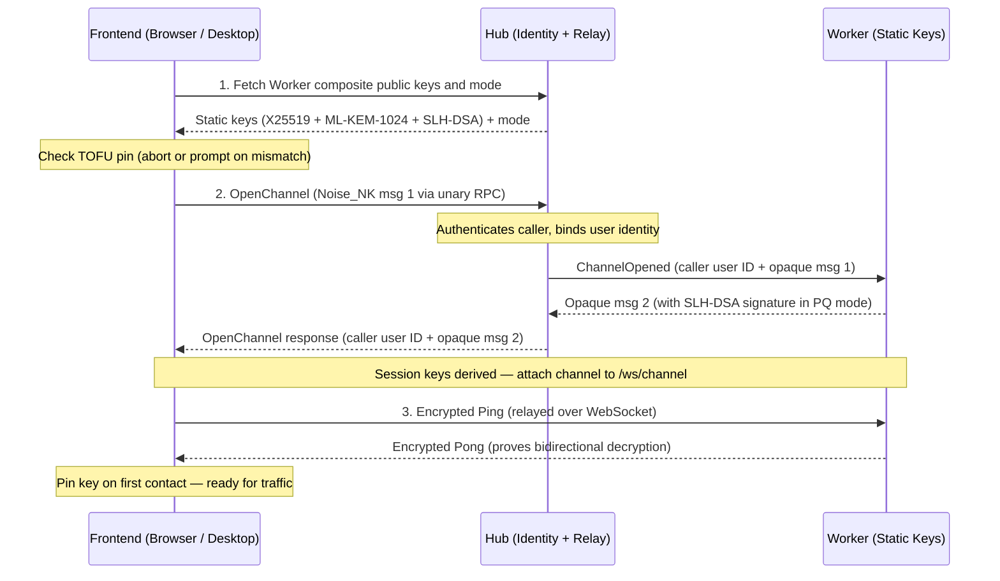

This page specifies the cryptographic protocol, transport hardening, key lifecycle, and trust-on-first-use (TOFU) verification behind LeapMux's end-to-end encrypted (E2EE) Frontend↔Worker channels. For trust boundaries and authentication rules, see [Security & Authentication](/docs/admin/security-and-auth/). For Hub at-rest database encryption, see [Encryption & Data](/docs/admin/encryption-and-data/).

## Hybrid post-quantum `Noise_NK` handshake

Frontend↔Worker traffic uses a **hybrid post-quantum `Noise_NK` handshake**. Combining classical and post-quantum primitives preserves confidentiality and authentication even if either primitive family is broken.

Channel setup runs in two stages:

1. **Handshake over Hub-relayed unary RPCs:** the Frontend fetches the Worker's pinned composite public keys and encryption mode from the Hub, verifies them against its local pin, and runs the `Noise_NK` handshake through Hub-relayed unary RPCs. The Hub forwards opaque handshake messages without decrypting them.
2. **Multiplexed WebSocket transport:** once session keys exist, the Frontend attaches the channel to `/ws/channel` and round-trips an encrypted liveness `Ping` before returning the channel to the pool.

### Primitives and protocol labels

| Role | Classical | Post-quantum |
| --- | --- | --- |
| Key exchange | X25519 ECDH | ML-KEM-1024 (FIPS 203) |
| Forward secrecy | Ephemeral X25519 exchange | Ephemeral ML-KEM-1024 exchange (`post-quantum` mode) |
| Worker static-key authentication | Noise `NK` pre-message + static ML-KEM-1024 encapsulation | Static ML-KEM-1024 encapsulation + `SLH-DSA-SHAKE-256f` (FIPS 205) signature over the handshake hash |
| Transport encryption | ChaCha20-Poly1305 AEAD | — |
| Hashing and key derivation | BLAKE2b | — |

Exact Noise protocol labels:

- **Post-quantum (default):** `Noise_NKhfs+skem+sig_25519+MLKEM1024+SLHDSASHAKE256f_ChaChaPoly_BLAKE2b`
- **Classic:** `Noise_NK+skem_25519+MLKEM1024_ChaChaPoly_BLAKE2b`

In the `NK` pattern, the responder (Worker) proves a known static key verified by the initiator (Frontend), while the initiator stays anonymous at the Noise layer.

### Security properties against an observing Hub

- The handshake hash binds the protocol label, Worker ID, and all three static public keys — another Worker or key set cannot complete the handshake.
- In `post-quantum` mode, the Worker signs the handshake hash with its `SLH-DSA` private key; any verification failure aborts and zeroes handshake state.
- `post-quantum` mode mixes four shared secrets into session keys (two X25519 + two ML-KEM-1024); `classic` mode mixes three (two X25519 + one static ML-KEM-1024).
- In `post-quantum` mode, later compromise of Worker static keys cannot decrypt previously recorded sessions even against an attacker who breaks X25519.
- Every transport frame authenticates its channel ID, correlation ID, and flags; tampering tears down the channel without exposing plaintext.

### Encryption modes

Configure the Worker mode with `--encryption-mode` (`encryption_mode` in YAML, `LEAPMUX_WORKER_ENCRYPTION_MODE` in the environment):

| Mode | Security properties |
| --- | --- |
| `post-quantum` (**default**) | Hybrid X25519 + ML-KEM-1024 + SLH-DSA signature + post-quantum forward secrecy. Aliases `pq`, `post_quantum`, empty, and unrecognized values fail safe here. |
| `classic` | Static ML-KEM-1024 authentication without the SLH-DSA signature or post-quantum forward secrecy. Smaller handshake messages; recorded sessions stay secret only while static keys stay secret. |

Both modes register and advertise all three static public keys. The Hub advertises the Worker's live mode so both peers run the same handshake; falsifying the mode causes handshake failure rather than silent downgrade.

### User identity binding and liveness ping

Because `Noise_NK` leaves the initiator anonymous, the Hub authenticates `OpenChannel` and supplies the caller's user ID to both ends. Every RPC the Worker executes runs under that Hub-verified identity. Before returning a pooled channel, the client round-trips an encrypted no-op `Ping` to verify that the Worker decrypted the session under the matching key.

## Transport hardening and in-band rekey

Encrypted channels enforce fixed limits to prevent desynchronization, nonce exhaustion, and memory abuse:

| Property | Value | Effect |
| --- | --- | --- |
| Max plaintext per frame | `65,519` bytes | Larger payloads are chunked automatically. |
| Nonce exhaustion | Soft: 2³¹ − 1; Hard: 2³² − 1 | Past the soft threshold, the initiator triggers an in-band rekey; past the hard ceiling, encryption/decryption fail closed. |
| Session key max age | 1 hour | Initiator requests an in-band rekey without dropping multiplexed traffic. |
| Session key hard ceiling | 70 minutes | Past this per-epoch age (reset on each rekey), the initiator closes and re-handshakes; the 10-minute margin covers one refused rekey. |
| Minimum rekey interval | 50 minutes | Age-only rekeys inside this window are rejected; soft-nonce exhaustion bypasses this guard. |
| Decrypt failure | Any | Treated as unrecoverable; both ends close the channel immediately. |

Without decrypting payloads, the Hub caps reassembled messages at the negotiated payload ceiling (`max_message_size_bytes`, default 16 MiB, up to 64 MiB) plus 64 KiB of envelope headroom and permits at most one in-flight chunked sequence per channel and direction. Workers fast-reject duplicate channel IDs before running post-quantum handshake operations to prevent CPU-amplification replay attacks.

### In-band rekey

In-band rekey rotates transport keys on a live channel without interrupting chats, terminals, CLI calls, or desktop tunnels:

- Both modes mix a fresh ephemeral X25519 exchange into the next key epoch.
- `post-quantum` mode also encapsulates to the Worker's static ML-KEM-1024 key and exchanges a fresh ephemeral ML-KEM-1024 keypair, mixing both ML-KEM secrets into the next epoch.
- The rekey travels inside the active encrypted channel (authenticated by the current cipher) with a ~10-second key-overlap window so in-flight frames decrypt cleanly.
- Frontends re-check key age on channel use, on a 1-minute idle timer, and on wake from suspend.
- Rekey refreshes transport keys only; Hub credential expiration and revocation still terminate channels from the outside.

## Worker identity keys and storage

`leapmux daemon worker register` generates the Worker's long-term composite keypair (`X25519` + `ML-KEM-1024` + `SLH-DSA-SHAKE-256f`) locally:

- **`<data_dir>/pending-registration.json` (mode `0600`):** holds the Hub URL, registration key, and private keys while registration is unfinished; deleted on completion.
- **`<data_dir>/state.json` (mode `0600`):** holds the Hub URL, Worker ID, Hub auth token, and private keys in unencrypted JSON. Protect and back it up as a secret.

The Hub pins the public keys permanently to the Worker ID and refuses connections presenting different keys. Because public keys are public, a stolen Worker auth token still allows displacing the live Worker stream, reading tab IDs, minting or revoking delegation tokens for the Worker's owner, or clearing the Worker's tab inventory. Registration recovery requires proof of possession of the pinned private keys and rotates the Worker auth token. Replacing a Worker's keys requires registering a new Worker ID.

Separately from channel E2EE, the Hub encrypts sensitive database columns at rest using its `XChaCha20-Poly1305` key ring and token pepper in `encryption.key`; see [Encryption & Data](/docs/admin/encryption-and-data/).

## Pinning verification and audit

### Three independent TOFU pin stores

| Client | Store location | Lifetime and management |
| --- | --- | --- |
| **Browser / Desktop Frontend** | Per-account IndexedDB trust store (`leapmux-trust`; desktop isolates per Hub) | Retained 1 year, refreshed on use. Manage under **Preferences → Advanced → Trusted worker keys**. |
| **Worker → sibling Worker** | `<data_dir>/cross_worker_pins.json` | Aborts on mismatch until cleared with `leapmux daemon worker cross-worker-pins remove <worker-id>`. |
| **`leapmux` CLI** | `<config-dir>/<scheme>_<hub-host>/pins.json` | Aborts on mismatch until cleared with `leapmux worker pins remove <worker>`. |

### Four-word fingerprints and mismatch handling

Fingerprints are **4 dash-joined English words** derived from a hash of the Worker's composite public key (for example `deep-idea-obey-tack`), drawn from a shared 256-word list so you can compare them aloud out of band.

Every Worker logs `key_fingerprint` in its `worker initialized` startup line. To inspect the desktop app's bundled Worker log on macOS or Linux, launch the desktop binary from a terminal (`"/Applications/LeapMux Desktop.app/Contents/MacOS/LeapMux Desktop"` on macOS, or the AppImage/`leapmux-desktop` on Linux) and inspect `desktop-sidecar:` stderr output.

On a mismatch, the Frontend halts and shows **Worker public key changed** with **Expected** and **Actual** fingerprints and **Reject** / **Accept** buttons (dismissing fails closed). Reject by default and accept only after out-of-band confirmation against the Worker's startup log.

### Tunnel key trust

Desktop tunnels share the account's browser pin rather than keeping a separate trust store:

1. **First contact:** without a pin, **Create** opens a browser channel to verify the peer holds the matching private keys and responds before recording the pin and creating the tunnel.
2. **Shared trust:** new tunnels reuse the browser pin; running tunnels keep their initial key expectation.
3. **Mismatch on reconnect:** if the Hub announces a different key, the tunnel stops before dialing and displays both fingerprints.
4. **Exact-key confirmation:** **Verify Worker key** opens a browser channel to review the changed key for that exact Worker and session, returning to a prefilled form that still requires an explicit **Create** click.

### Differential conformance

Both the Go implementation (Hub, Worker, CLI) and the TypeScript Frontend replay shared differential conformance test vectors covering handshake transcripts, key derivation, and both classic and post-quantum in-band rekey sequences.

## See also

- [Security & Authentication](/docs/admin/security-and-auth/) — trust boundaries, session elevation, OAuth, and revocation.
- [Encryption & Data](/docs/admin/encryption-and-data/) — Hub at-rest keystore, rotation, and backups.
- [Managing Workers](/docs/admin/managing-workers/) — Worker registration and pin management commands.
