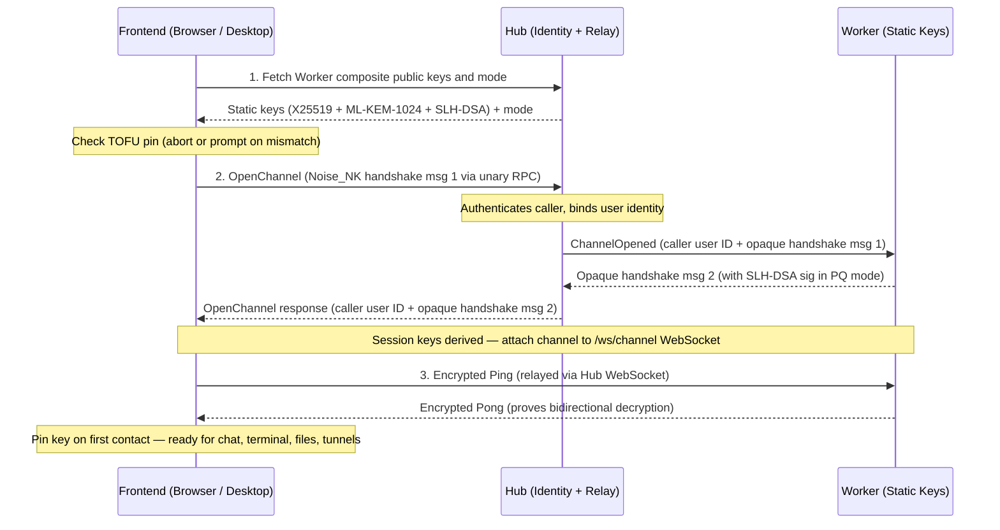

This page describes the cryptographic protocol, transport hardening, key lifecycle, and trust-on-first-use (TOFU) verification behind LeapMux's end-to-end encrypted (E2EE) Frontend↔Worker channels. For the trust model and what the Hub can see, see [Security & Threat Model](/docs/admin/security/). For authentication, elevation, and OAuth security, see [Authentication & Session Security](/docs/admin/authentication-security/).

## Hybrid post-quantum `Noise_NK` handshake

Frontend↔Worker traffic is protected by a **hybrid post-quantum `Noise_NK` handshake**. Combining classical and post-quantum primitives preserves confidentiality and authentication even if either primitive family is broken.

Channel setup runs in two stages across two transports:

1. **Handshake over Hub-relayed unary RPCs:** The Frontend fetches the Worker's pinned composite public keys and encryption mode from the Hub, verifies them against its local pin, and runs the `Noise_NK` handshake through Hub-relayed unary RPCs. The Hub forwards opaque handshake messages without decrypting them.
2. **Multiplexed transport over WebSocket:** Once the session keys exist, the Frontend attaches the channel to the shared `/ws/channel` WebSocket and sends an encrypted `Ping` round trip before returning the channel to the pool.

### Primitives

| Role | Classical | Post-quantum |
| --- | --- | --- |
| Key exchange | X25519 ECDH | ML-KEM-1024 (FIPS 203) |
| Forward secrecy | Ephemeral X25519 exchange | Ephemeral ML-KEM-1024 exchange (post-quantum mode) |
| Worker static-key authentication | Noise NK pre-message and static ML-KEM-1024 encapsulation | Static ML-KEM-1024 encapsulation plus Stateless Hash-Based Digital Signature Algorithm (`SLH-DSA-SHAKE-256f`, FIPS 205) signature over the handshake hash |
| Transport encryption | ChaCha20-Poly1305 AEAD | — |
| Hashing and key derivation | BLAKE2b | — |

Exact Noise protocol labels:

- **Post-quantum (default):** `Noise_NKhfs+skem+sig_25519+MLKEM1024+SLHDSASHAKE256f_ChaChaPoly_BLAKE2b`
- **Classic:** `Noise_NK+skem_25519+MLKEM1024_ChaChaPoly_BLAKE2b`

In the `NK` pattern, the responder (Worker) has a known static key verified by the initiator (Frontend), while the initiator stays permanently anonymous at the Noise layer.

### Why this design defeats a curious Hub

- The handshake hash covers the protocol label, the Worker ID, and all three of the Worker's static public keys. Another Worker or key set cannot complete the handshake.
- Every key-exchange value is authenticated. In post-quantum mode, the Worker signs the handshake hash with its `SLH-DSA` private key; a signature verification failure aborts the handshake and zeroes its state.
- Post-quantum mode mixes four shared secrets into session keys (two X25519 + two ML-KEM-1024); classic mode mixes three (two X25519 + one static ML-KEM-1024).
- In post-quantum mode, later compromise of the Worker's static keys cannot decrypt previously recorded sessions even against an attacker who breaks X25519.
- Every data frame authenticates its channel ID, correlation ID, and flags. A Hub that tampers with frame metadata causes channel teardown without learning plaintext.

### Encryption modes

Configure the Worker mode with `--encryption-mode` (`encryption_mode` in YAML, `LEAPMUX_WORKER_ENCRYPTION_MODE` in the environment):

| Mode | Security properties |
| --- | --- |
| `post-quantum` (**default**) | Hybrid X25519 + ML-KEM-1024 + SLH-DSA signature + post-quantum forward secrecy. Aliases: `pq`, `post_quantum`, empty, or any unrecognized value (fail-safe). |
| `classic` | Static ML-KEM-1024 authentication without the SLH-DSA signature or post-quantum forward secrecy. Recorded sessions stay secret only while the Worker's static keys stay secret. Smaller handshake messages. |

Both modes register and advertise all three static public keys. The Hub reports the Worker's live mode to the Frontend so both ends run the same handshake; a falsified mode report causes handshake failure rather than downgrade.

### User identity binding and liveness ping

Because `Noise_NK` does not authenticate the initiator, the **Hub** authenticates `OpenChannel` and states the caller identity to both ends — to the Frontend in the `OpenChannel` response and to the Worker in `ChannelOpened`. Every RPC the Worker dispatches runs under that Hub-supplied identity. Identity never travels inside the channel because an in-channel claim would be unauthenticated and could drift from the Hub's decision.

Before `OpenChannel` returns a pooled channel to callers, the client round-trips an encrypted no-op `Ping`. The handshake proves only that the client encrypted to the Worker's static key; the `Ping` proves the Worker decrypted the session and replied under the matching key, catching broken channels at open time rather than on a later caller's request.

## Transport hardening and in-band rekey

Encrypted channels enforce fixed limits to cap desynchronization, replay, and resource exhaustion:

| Property | Value | Effect |
| --- | --- | --- |
| Max plaintext per frame | 65,519 bytes | Larger payloads are chunked automatically. |
| Nonce exhaustion | Soft: 2³¹ − 1; Hard: 2³² − 1 | Past the soft threshold, the initiator requests an in-band rekey; past the hard ceiling, encryption and decryption refuse outright (fail-closed). |
| Session key max age | 1 hour | Initiator requests an in-band rekey; the channel ID and multiplexed connections stay open. |
| Session key hard ceiling | 70 minutes | Past this per-epoch age (reset on each rekey), the initiator closes and re-handshakes rather than continuing on an old key; the 10-minute margin covers one refused rekey. |
| Min rekey interval | 50 minutes | Age-only rekeys inside this window are rejected (telling the initiator how long to wait); soft-nonce exhaustion bypasses this guard. |
| Decrypt failure | Any | Treated as unrecoverable: both sides close the channel immediately. |

### Hub unencrypted resource limits

The Hub enforces memory and CPU caps without decrypting:

- Caps reassembled messages at the negotiated payload budget plus 64 KiB of envelope headroom (default ~16.06 MiB; administrators can raise `max_message_size_bytes` up to 64 MiB).
- Allows only one in-flight chunked sequence per channel and direction.
- The Worker fast-rejects duplicate channel IDs *before* running post-quantum handshake operations, preventing CPU-amplification replay attacks.

### In-band rekey

In-band rekey rotates transport keys on the existing channel without dropping multiplexed traffic:

- Both modes mix a fresh ephemeral X25519 exchange into the next key epoch.
- In post-quantum mode, the initiator also encapsulates to the Worker's static ML-KEM-1024 key and sends a fresh ephemeral ML-KEM-1024 public key; the Worker encapsulates to that fresh key, and both sides mix both ML-KEM secrets into the next epoch.
- The exchange travels inside the active encrypted channel, so the current cipher authenticates it with no extra signature.
- A ~10-second key-overlap window lets frames encrypted just before the swap decrypt cleanly, so browser sessions, `leapmux` CLI calls, cross-worker channels, and desktop port-forwards or SOCKS5 tunnels survive hourly rotation without stalling.
- The Frontend re-checks key age on channel use, on a 1-minute idle timer, and on wake from suspend so a frozen clock cannot hide an over-age key.
- Rekey rotates only the transport key epoch; Hub credential expiry (1 hour for CLI access and delegation tokens) and revocation watchers still terminate channels from the outside. Identity drift (expected user no longer matching the Hub-authenticated user) closes the channel and forces a fresh `OpenChannel`.

## Worker identity keys and storage

### Composite static keypair

`leapmux daemon worker register` generates the Worker's long-term composite keypair (`X25519` + `ML-KEM-1024` + `SLH-DSA-SHAKE-256f`) locally:

- **`<data_dir>/pending-registration.json` (mode `0600`):** holds the Hub URL, registration key, and private keys while registration is in progress; deleted on completion.
- **`<data_dir>/state.json` (mode `0600`):** holds the Hub URL, Worker ID, Hub auth token, and private keys in unencrypted JSON. Protect and back it up as a secret.

The Hub receives only the public halves at registration, pins them permanently to the Worker ID, and refuses any Worker connection presenting different keys.

Because public keys are public, a stolen Worker auth token still lets an attacker:

- Present the real public keys and displace the live Worker stream (taking the Worker offline because client handshakes fail)
- Read the Worker's tab IDs
- Mint delegation tokens for the Worker's owner (up to the delegation ceiling)
- Revoke delegation tokens of the Worker's agents
- Send an empty tab inventory, causing the Hub to tombstone every tab the Worker hosts

Registration recovery requires proof of possession of the pinned private keys; a successful recovery replaces the Worker auth token, closes the old stream, and rejects delayed hellos using the replaced token. Deregistering a Worker ends its token when the Worker acknowledges the stop or 7 days later. Generating new keys requires a new registration, which creates a new Worker ID so clients pin it cleanly as a new Worker without triggering a mismatch dialog.

### Hub at-rest keystore (separate layer)

Separately from Worker E2EE keys, the Hub stores a versioned `XChaCha20-Poly1305` key ring (256-bit keys, 24-byte random nonces, 4-byte key-version prefix, per-column AAD binding table, column, and row key) and a stable token pepper in `<data_dir>/encryption.key` (mode `0600`). It encrypts 37 columns across 15 tables (14 persistent, 1 short-lived transient), hashes passwords with `Argon2id` (encrypted at rest), and stores bearer secrets as peppered `HMAC-SHA256` digests. See [Encryption & Data](/docs/admin/encryption-and-data/) for rotation and disaster recovery.

## Pinning verification and audit

### Three independent TOFU pin stores

| Client | Store location | Lifetime / management |
| --- | --- | --- |
| **Browser / Desktop Frontend** | Per-account IndexedDB (`leapmux-trust`, key `leapmux:u:<user-id>:key-pins`); desktop app keeps one isolated store per Hub | Kept 1 year, refreshed on use. Manage under **Preferences → Advanced → Trusted worker keys**. |
| **Worker → sibling Worker** | `<data_dir>/cross_worker_pins.json` | Aborts on mismatch until cleared with `leapmux daemon worker cross-worker-pins remove <worker-id>`. |
| **`leapmux` CLI** | `<config-dir>/<scheme>_<hub-host>/pins.json` | Aborts on mismatch until cleared with `leapmux worker pins remove <worker>`. |

A compromised Hub can serve modified Frontend code to a browser that reads or alters browser pins. The desktop app runs its bundled Frontend and isolates pins per Hub in its own storage, though the Hub remains trusted for caller identity.

### Four-word fingerprints and startup logs

Fingerprints are **4 dash-joined English words** derived from a hash of the Worker's composite public key (for example, `deep-idea-obey-tack`), drawn from a fixed 256-word list of 4-letter words shared identically across the Worker and Frontend so you can compare them aloud over a phone call or out-of-band check.

Every Worker entry point (standalone Worker, solo, dev, and desktop sidecar) logs `key_fingerprint` in its `worker initialized` startup line. To inspect the desktop app's bundled Worker log:

- **macOS:** run `"/Applications/LeapMux Desktop.app/Contents/MacOS/LeapMux Desktop"` from a terminal and look for `desktop-sidecar: ` lines on stderr.
- **Linux:** run the AppImage or `leapmux-desktop` from a terminal.
- **Windows:** release builds attach no console. In desktop solo mode, the local Worker runs in-process with the Hub, so a key mismatch indicates local pin or data directory changes rather than a network substitute.

### The "Worker public key changed" dialog

On a mismatch, the Frontend halts the connection and displays **"Worker public key changed"** with the **Expected** and **Actual** fingerprints and **Reject** / **Accept** (danger-styled) buttons. Dismissing the dialog or lacking confirmation UI fails closed (rejects). Rejecting blocks that Worker for the rest of the session until page reload or app restart.

No ordinary operation changes a Worker's keys on the same Worker ID: reject by default, and accept only after out-of-band verification against the Worker's `key_fingerprint` log.

### Tunnel key trust

Desktop tunnels share the account's browser pin rather than keeping an independent pin store. Each tunnel create request identifies its owning account, and the webview rejects forms whose session ended:

1. **First contact:** Without a stored pin, **Create** opens a browser channel to verify the peer holds the matching private keys and responds, records the pin, and then creates the tunnel.
2. **Shared trust:** Browser channels and new tunnels share the same pin; removing the pin requires a fresh verified browser session before new tunnel creation. Running tunnels keep their original key expectation.
3. **Mismatch on reconnect:** If the Hub announces a key differing from the tunnel's expectation, the tunnel stops before dialing and keeps the stopped row with both fingerprints visible.
4. **Exact-key confirmation before recreation:** **Verify Worker key** opens a fresh browser channel to review the changed key for that exact key, Worker, and account session, then returns to a prefilled form requiring a separate **Create** submission. If the pin was removed concurrently, the form offers first-contact trust; if another tab pinned a key first, it returns to stored-key review.

### Conformance and audit vectors

Both the Go backend (Hub/Worker/CLI) and TypeScript Frontend replay shared differential conformance test vectors (`testdata/noise_handshake_vectors.json`, `testdata/noise_rekey_vectors.json`, and `testdata/noise_rekey_pq_vectors.json`) to verify identical handshake transcripts, key derivation, and in-band rekey behavior across implementations.

## See also

- [Security & Threat Model](/docs/admin/security/) — trust boundaries, solo mode, and administrator recommendations.
- [Authentication & Session Security](/docs/admin/authentication-security/) — session elevation, passkeys, OAuth, app credentials, and revocation.
- [Managing Workers](/docs/admin/managing-workers/) — registration, pin commands, and desktop tunnels.
- [Encryption & Data](/docs/admin/encryption-and-data/) — Hub at-rest column encryption, key rotation, and backups.
