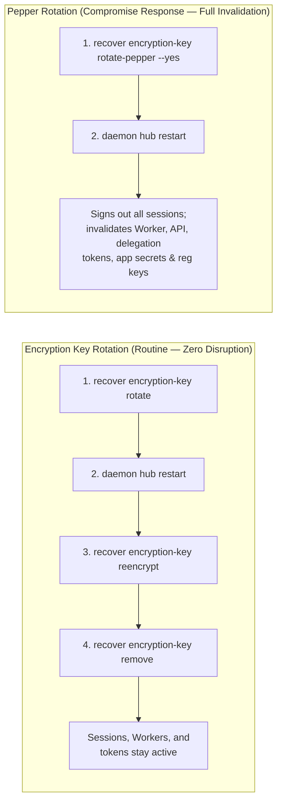
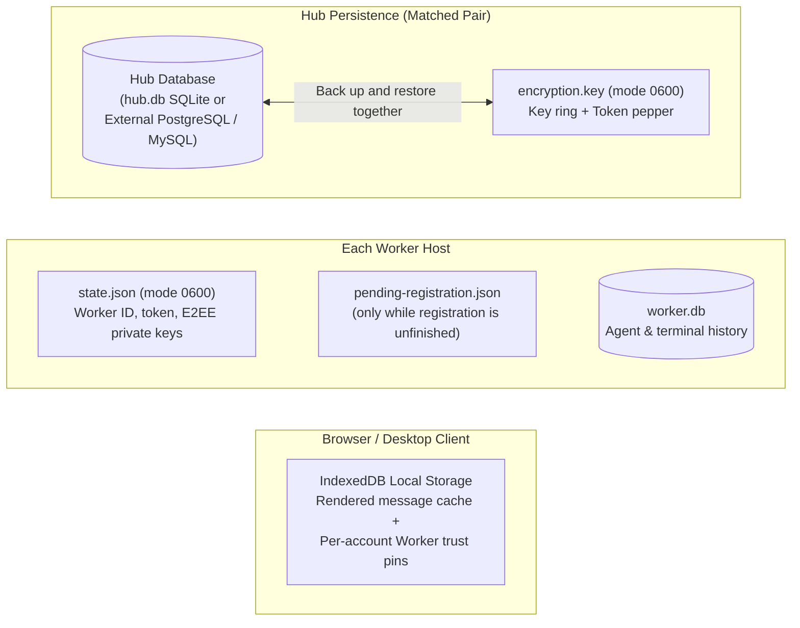

This chapter covers **at-rest encryption**, key and pepper rotation, database migrations, browser storage, and backup/restore for a LeapMux **Hub** (or `solo` instance).

Do not confuse at-rest encryption with end-to-end encryption (E2EE):

- **Encryption at rest** (this page) protects sensitive Hub database columns using the local keystore file (`encryption.key`).
- **End-to-end encryption** protects live Frontend↔Worker traffic in transit across the Hub relay; see [Security & Authentication](/docs/admin/security-and-auth/) and [Cryptography & Key Architecture](/docs/admin/cryptography/).

## What is stored, and what is encrypted

| Data category | Where it lives | Protection at rest |
| --- | --- | --- |
| **Sensitive Hub user data & configuration** (password hashes, user preferences, pending email tokens, session IP/user agent, workspace titles & section names, synced layout state & operation batches, tab publication payloads, OAuth provider configs & client secrets, OAuth app registrations & short-lived auth codes, API/delegation token metadata & scopes, passkey public keys & metadata, Hub settings & setting secrets) | Hub database (`hub.db` or external SQL backend) | **Encrypted** with `XChaCha20-Poly1305` using `encryption.key` and per-row/column additional authenticated data (AAD). Account passwords are also hashed with `Argon2id` before encryption. |
| **Bearer secrets** (session secrets, Worker auth tokens, registration keys, OAuth authorization codes, API/delegation token secrets, confidential app client secrets) | Hub database (device codes live in Hub memory only) | **One-way `HMAC-SHA256` digest** keyed by the dedicated token pepper inside `encryption.key`. No plaintext secret is stored. |
| **Routing, lookup, and indexing metadata** (IDs, foreign keys, usernames, emails, display names, timestamps, status ordinals, counters, passkey credential IDs & sign counts, Worker pinned public keys) | Hub database | **Unencrypted** — required for SQL lookups, joins, sorting, uniqueness checks, or public key verification. |
| **Agent transcripts, terminal output, worktree state** | Worker SQLite (`worker.db`) | Unencrypted local SQLite (mode `0600`) on the Worker host. |
| **Worker private E2EE keys & Hub auth token** | Worker `state.json` (and `pending-registration.json` during registration) | Unencrypted JSON (mode `0600`) — protect as a secret. |

### What stays in the browser

An observing Hub cannot read agent transcripts, tool calls, terminal output, or files. For rendering speed, the browser caches rendered message text and code locally in IndexedDB:

- On startup, the browser runs best-effort cleanup removing cached entries last used at least 7 days earlier (no guaranteed deletion deadline).
- The rendered-message cache is not scoped to one account and is not cleared on sign-out — clear browser site data on shared devices when immediate removal is required.
- Separately, the browser keeps per-account Worker trust pins in its own IndexedDB store (`leapmux-trust`), retained for 1 year and refreshed on use. See [Managing Workers](/docs/admin/managing-workers/#tofu-key-pinning).

## The encryption key file (`encryption.key`)

The Hub keystore is a plain-text file (mode `0600`, parent directory `0750`) holding a **versioned `XChaCha20-Poly1305` key ring** plus a separate **token pepper**:

- **Default path:** `{data_dir}/encryption.key` (`{data_dir}/hub/encryption.key` in `solo` and `dev` modes). Override with `encryption_key_path` in YAML or `LEAPMUX_HUB_ENCRYPTION_KEY_PATH` (no CLI flag).
- **Auto-generated:** created automatically on first Hub start with key version `1` and a random token pepper.
- **Active key:** the highest key version encrypts all new writes; retained lower versions decrypt older rows until re-encrypted. Each ciphertext includes a 4-byte key-version prefix and binds its table, column, and row key as AAD so ciphertext cannot be swapped across rows or columns.

```text
# leapmux encryption key ring
1:aGVsbG8gd29ybGQgdGhpcyBpcyBub3QgYSByZWFsIGtleQ==
2:YW5vdGhlciBmYWtlIGtleSBmb3IgZG9jdW1lbnRhdGlvbg==
pepper:cGVwcGVyIGlzIGEgc2VwYXJhdGUgc3RhYmxlIHNlY3JldA==
```


Treat `encryption.key` as a top-grade secret. It stores raw base64 key material and the token pepper without an external KMS wrapper. Anyone with both `encryption.key` and the database can decrypt all encrypted Hub data; **losing `encryption.key` makes all encrypted Hub data permanently unrecoverable**.


## Key rotation vs. pepper rotation

Encryption key rotation and pepper rotation are independent operations with very different operational impact:



### Encryption key rotation runbook

Every `leapmux recover encryption-key` command requires an existing `encryption.key`. Pass `--config /path/to/hub.yaml` when using an external SQL backend (or `--data-dir <data_dir>/hub` for `solo`/`dev`). See [Recovery](/docs/admin/recover/).

{}

### Generate a new active key version

```bash
leapmux recover encryption-key rotate
```

Adds the next key version and marks it active while keeping older versions to read existing rows.

### Restart the Hub

```bash
leapmux daemon hub restart
```

The Hub reloads `encryption.key` and uses the new active version for all new writes.

### Re-encrypt existing persistent rows

```bash
leapmux recover encryption-key reencrypt
```

Rewrites every persistent encrypted row still under an older version to the active version inside a transaction. (Short-lived OAuth authorization codes expire within minutes and are excluded.)

### Remove the retired key version (optional)

```bash
leapmux recover encryption-key remove 1
leapmux daemon hub restart
```

`remove` inspects ciphertext headers across all persistent encrypted tables and refuses to delete a version that still encrypts any row or is currently active.

{}

### Pepper rotation (emergency credential invalidation)

Routine key rotation never changes the token pepper. To deliberately invalidate all bearer credentials (for example after a suspected `encryption.key` leak), regenerate the pepper and restart the Hub:

```bash
leapmux recover encryption-key rotate-pepper --yes
leapmux daemon hub restart
```

Rotating the pepper (or losing `encryption.key`) has these immediate effects on restart:

- Signs out every browser and desktop session
- Invalidates every Worker auth token
- Invalidates every API token, delegation token, and confidential app client secret
- Invalidates all live Worker registration keys, pending device codes, and pending OAuth authorization codes

Account-recovery links do not use the pepper and remain subject to their normal expiry and attempt limits.

Because bearer digests are one-way, affected credentials cannot be recovered:

1. Users sign in again; confidential app client secrets must be replaced.
2. `solo` mode and the desktop app automatically reissue their bundled Worker's token.
3. For each standalone Worker: remove it in the Hub UI or with `leapmux admin worker deregister`, stop the Worker, delete `<data_dir>/state.json`, and register it again with a fresh registration key (creating a new Worker ID).
4. Re-issue service API tokens online with `leapmux admin api-token issue`.

## Databases and migrations

The Hub supports six SQL backends (`sqlite`, `postgres`, `mysql`, `cockroachdb`, `yugabytedb`, `tidb`; see [Storage Backend Decision Matrix](/docs/admin/configuration/#storage-backend-decision-matrix)). Embedded SQLite runs in WAL mode (`hub.db-wal` and `hub.db-shm` sidecars) and checkpoints cleanly on shutdown. Each Worker maintains its own local SQLite database (`worker.db`) for agent and terminal state.

LeapMux embeds schema migrations for every backend and applies them **automatically on Hub startup** and during `leapmux recover create-admin`. Inspect or run migrations manually offline with `leapmux recover db path|version|migrate` (always pass `--config` for non-SQLite backends); see [Recovery](/docs/admin/recover/#db--database-utilities).

## Backup and restore

The Hub database and `encryption.key` are a **matched pair** — always back them up and restore them together.



### What to back up

1. **Hub database:** for SQLite, stop the Hub first (or use a SQLite online-backup tool; if copying live, copy `hub.db-wal` and `hub.db-shm` too). For PostgreSQL, MySQL, or compatible SQL servers, use standard database dump tooling (`pg_dump`, `mysqldump`).
2. **`encryption.key`:** copy at the same time as the database and encrypt backups at rest.
3. **Each Worker's `state.json`:** preserves the Worker's ID, Hub auth token, and E2EE private keys across host rebuilds (also keep `pending-registration.json` if a registration is in progress).
4. **Each Worker's `worker.db` (optional):** preserves local agent transcripts and terminal scrollback.

### Restore runbook

{}

### Stop the Hub and affected Workers

```bash
leapmux daemon hub stop
```

### Restore the database and matching `encryption.key`

Restore the SQLite file (or load your SQL dump into PostgreSQL/MySQL) and place the matching `encryption.key` at `{data_dir}/encryption.key` (or the path set in `encryption_key_path`). Restore each Worker's `state.json` to its data directory.

### Start the Hub and verify Workers

```bash
leapmux daemon hub start
```

The Hub loads `encryption.key`, opens the database, and applies any pending migrations automatically. Any Worker registered *after* the backup has no matching row in the restored database — stop it, delete its `state.json`, and register it again.

{}

### Disaster-recovery notes

- **Lost `encryption.key`, database intact:** all encrypted Hub columns are permanently unreadable, and generating a new key file also replaces the token pepper (invalidating all sessions, Worker tokens, and API/delegation tokens). If a `captcha.altcha` settings row exists in the database and cannot decrypt, Hub startup aborts until you restore the matching `encryption.key`. Restore both the database and matching `encryption.key` from backup, or re-initialize the Hub and re-register standalone Workers.
- **Lost Hub database, key intact:** `encryption.key` alone cannot rebuild accounts or workspaces — restore the database from backup.
- **Lost Worker `state.json`:** deregister the old Worker entry on the Hub and register fresh with a new registration key (creates a new Worker ID, so clients pin it cleanly with no mismatch warning).
- **Lost Worker `worker.db`:** local transcripts and scrollback are lost, while the Worker's identity in `state.json` stays intact.

## See also

- [Recovery](/docs/admin/recover/) — offline `leapmux recover encryption-key` and `db` flags.
- [Configuration Reference](/docs/admin/configuration-reference/#storage-backends) — storage backend keys and `encryption_key_path`.
- [Security & Authentication](/docs/admin/security-and-auth/) and [Cryptography & Key Architecture](/docs/admin/cryptography/) — E2EE protocol and encryption modes.
- [Managing Workers](/docs/admin/managing-workers/) — Worker state files and re-registration.
