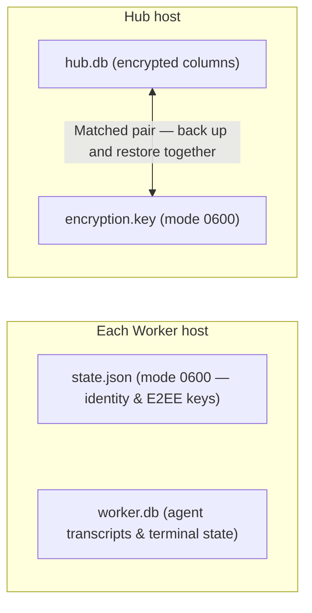

This chapter is for administrators who run a LeapMux **Hub** (or a solo-mode instance). It explains what data is stored and what is encrypted at rest. It also covers key rotation, database migrations, and backup and restore.

It covers two distinct encryption systems that are easy to confuse:

- **Encryption at rest** — the Hub encrypts all eligible sensitive and user-data columns across 15 database tables (14 persistent tables and 1 short-lived transient table) using a local **keystore** (the `encryption.key` file). This chapter is mostly about this.
- **End-to-end encryption (E2EE)** — Frontend-to-Worker traffic is encrypted while the Hub relays it. A Hub that only observes cannot read the content. The Hub remains trusted for identity and Frontend code. That protocol is covered in [Security & Threat Model](/docs/admin/security/); this chapter only touches the Worker key material you must back up.

For where these settings live and how to set them, see [Configuration](/docs/admin/configuration/). For key rotation commands, see [Recovery](/docs/admin/recover/).

## What is stored, and what is encrypted

LeapMux keeps three kinds of persistent state:

| Data | Where it lives | Encrypted at rest? |
| --- | --- | --- |
| Encrypted Hub columns (37 columns across 15 tables — 14 persistent, 1 transient; see list below) | Hub database (`hub.db` or your SQL backend) | **Yes** — XChaCha20-Poly1305 with the keystore key and per-column AAD |
| Indexed routing and lookup columns (user IDs, usernames, emails, display names, timestamps, foreign keys) | Hub database | No — needed for SQL lookups, joins, sorting, and unique constraints |
| API-token and delegation-token secrets | Hub database | HMAC-SHA256 digest (a hash-based message authentication code, keyed by the token pepper) |
| Confidential app client secrets | Hub database | HMAC-SHA256 digest (peppered) |
| Session secrets | Hub database | HMAC-SHA256 digest (peppered) |
| Worker auth tokens | Hub database | HMAC-SHA256 digest (peppered) |
| Registration keys | Hub database | HMAC-SHA256 digest (peppered) |
| OAuth authorization codes | Hub database | HMAC-SHA256 digest (peppered) |
| Worker public keys (pinned at registration) | Hub database | No — public material, stored in the clear |
| Agent transcripts, terminal I/O, worktree/session state | Worker's local SQLite (`worker.db`) | No |
| Worker E2EE private keys + Hub auth token | Worker's `state.json` | No — plain JSON, file mode `0600` |

### What stays on the browser

A Hub that only observes cannot read agent transcripts, tool calls, terminal output, file contents, or diffs. The Worker stores that data, and channels encrypt it in transit.

The browser caches rendered message text and code locally in IndexedDB to speed up display. Keep these retention properties in mind on shared devices:

- After startup, the browser attempts to remove cached entries whose recorded last-use time is at least seven days old.
- Cleanup is best-effort and runs at most once per page load, so entries can remain longer. There is no guaranteed deletion deadline.
- The rendered-message cache is not keyed to the account, and signing out does not clear it. Clear site data in the browser when you need immediate removal.
- Separately, the browser stores per-account Worker trust pins in its own IndexedDB store (`leapmux-trust`, key `leapmux:u:<your-user-id>:key-pins`), kept for one year and refreshed on use. See [Managing Workers](/docs/admin/managing-workers/#tofu-key-pinning) and [Security & Threat Model](/docs/admin/security/).

### Encryption at rest details

The keystore encrypts every eligible Hub column with **XChaCha20-Poly1305** (a 256-bit key and a 24-byte random nonce per ciphertext). Each ciphertext carries a 4-byte key-version prefix, so the Hub picks the right key to decrypt as long as that key version stays in the ring. Each ciphertext also binds its table name, column name, and row key as **additional authenticated data (AAD)**, so ciphertext cannot be swapped between rows or columns.

The Hub encrypts 37 columns across 15 tables at the storage boundary:

**Persistent encrypted tables (14 tables, 33 columns — covered by `reencrypt` and `remove`):**

- `users`: `password_hash`, `prefs`, `pending_email_token`
- `user_sessions`: `user_agent`, `ip_address`
- `workspaces`: `title`
- `workspace_sections`: `name`
- `user_state`: `state_payload`
- `user_op_batches`: `batch_payload`, `transitions_payload`
- `lifecycle_outbox`: `payload`
- `worker_tab_publications`: `response_payload`
- `oauth_clients`: `client_name`, `icon_blob`, `icon_media_type`, `client_uri`, `redirect_uris`, `scopes`, `grant_types`
- `api_tokens`: `installation_name`, `granted_scopes`
- `delegation_tokens`: `granted_scopes`
- `oauth_providers`: `name`, `issuer_url`, `client_id`, `client_secret`, `scopes`
- `passkey_credentials`: `public_key`, `aaguid`, `transports`, `friendly_name`
- `hub_settings`: `value`, `secret`

**Short-lived transient encrypted table (1 table, 4 columns — auto-expiring, excluded from `reencrypt` and `remove`):**

- `oauth_authorization_codes`: `code_challenge`, `redirect_uri`, `granted_scopes`, `installation_name`

The remaining columns stay unencrypted because SQL uses them for lookups, routing, sorting, uniqueness checks, or foreign keys: primary keys, foreign keys, `users.username`, `users.email`, `users.display_name`, `users.display_name_folded`, timestamps, status ordinals, counters, passkey `credential_id` and `sign_count`, and Worker public keys (which are public material).

The key lives in a separate file from the database, so a copy of the database alone leaves all 37 encrypted columns readable only as ciphertext — which is why the two must be backed up together.

Session secrets, Worker auth tokens, registration keys, OAuth authorization codes, API/delegation token secrets, and confidential app client secrets are **not** encrypted. They use HMAC-SHA256 digests keyed by a dedicated, stable pepper that is independent of the encryption key ring. The database therefore holds none of these bearer secrets in plaintext. Device authorization codes are held only in Hub memory as peppered HMAC-SHA256 digests and are never written to the database. See [Accounts & Authentication](/docs/using/accounts/) and the [Control CLI](/docs/using/control-cli/) for token management.

Account passwords are hashed with **Argon2id** using OWASP-recommended parameters, and the resulting `users.password_hash` column is also encrypted at rest; the Hub never stores or transmits the plaintext password after hashing. See [Password requirements](/docs/using/accounts/#password-requirements).

## The encryption key file (`encryption.key`)

The keystore is a **versioned key ring** stored in a single plain-text file.

| Property | Value |
| --- | --- |
| Default path | `{data_dir}/encryption.key` (default data dir: `~/.config/leapmux/hub`) |
| Config override | `encryption_key_path` (YAML or env `LEAPMUX_HUB_ENCRYPTION_KEY_PATH`) — **no CLI flag** |
| File mode | `0600` (owner read/write only); parent directory `0750` |
| Format | one entry per line as `version:base64stdkey` or `pepper:base64key`; blank lines and lines starting with `#` are ignored |
| Auto-generated | yes — the first time the Hub starts, it creates the file with a single version-1 key plus the token pepper |

A key file looks like this:

```text
# leapmux encryption key ring
1:aGVsbG8gd29ybGQgdGhpcyBpcyBub3QgYSByZWFsIGtleQ==
2:YW5vdGhlciBmYWtlIGtleSBmb3IgZG9jdW1lbnRhdGlvbg==
pepper:cGVwcGVyIGlzIGEgc2VwYXJhdGUgc3RhYmxlIHNlY3JldA==
```

The **highest version number is the active key** — it encrypts all newly written protected columns across the 15 encrypted Hub tables. Older versions stay in the file only to decrypt data written before a rotation.


Treat `encryption.key` as a top-grade secret. There is no master-password or HSM wrapping around it — the file contains the raw keys. Anyone who has both this file and a copy of the database can decrypt all 37 encrypted Hub columns across 15 tables. Conversely, **losing this file makes all encrypted columns permanently unreadable** (see [Backup & restore](#backup--restore)).


There is nothing to configure to turn encryption on. Running the Hub once is enough:

```bash
leapmux daemon hub start
# On first start, the Hub generates ~/.config/leapmux/hub/encryption.key
# and logs that it loaded the keystore, with the active version and the
# number of retained versions.
```

## Key rotation

Rotation generates a new active key version. Existing ciphertext stays readable through the retained older versions until you re-encrypt it. The encryption-key commands are:

| Command | Summary |
| --- | --- |
| `leapmux recover encryption-key rotate` | Generate and add a new encryption key version |
| `leapmux recover encryption-key reencrypt` | Re-encrypt all persistent encrypted columns with the active key |
| `leapmux recover encryption-key remove <N>` | Remove an old encryption key version |
| `leapmux recover encryption-key rotate-pepper --yes` | Regenerate the pepper; sign out sessions and invalidate Worker/API/delegation tokens, app client secrets, registration keys, device codes, and OAuth authorization codes |

Every `recover encryption-key` command accepts `--data-dir` and `--config`, plus its own arguments or flags:

| Command | Arguments and flags | What it operates on |
| --- | --- | --- |
| `rotate` | `--data-dir`, `--config` | The local `encryption.key` file |
| `rotate-pepper` | `--data-dir`, `--config`, `--yes` (required) | The local `encryption.key` file |
| `remove <version>` | positional `<version>` (`>= 1`), `--data-dir`, `--config` | The local key file **and** the Hub database |
| `reencrypt` | `--data-dir`, `--config` | The local key file **and** the Hub database |

`reencrypt` and `remove` open the database without running schema migrations, so point `--config` at the same config file the Hub uses when running on PostgreSQL or MySQL. All four commands require an existing `encryption.key` file and never create one. `remove` reads the database to check ciphertext headers across all 14 persistent encrypted tables before deleting a version (see the runbook warning below). `rotate` and `rotate-pepper` work only on the local key file and open no database (with `--config`, they use its `data_dir` and `encryption_key_path`). See [Recovery](/docs/admin/recover/) for the full flag reference.

### Rotation runbook

Follow these steps in order. The `remove` step is guarded — it refuses to delete a version that still encrypts persistent data — so skipping `reencrypt` fails loudly instead of destroying data.

1. **Add a new key version.**

   ```bash
   leapmux recover encryption-key rotate
   # Added encryption key version 2.
   # Restart the hub, then run: leapmux recover encryption-key reencrypt
   ```

   This generates a random 32-byte key as version 2, makes it active, and rewrites `encryption.key`. Existing data is untouched and still decrypts using version 1.

2. **Restart the Hub** so it loads the new active key and uses it for all new writes.

   ```bash
   # systemd example
   sudo systemctl restart leapmux-hub
   ```

3. **Re-encrypt existing persistent rows to the new version.**

   ```bash
   leapmux recover encryption-key reencrypt
   # Re-encrypted 18 encrypted rows to key version 2.
   ```

   This walks all 14 persistent encrypted tables (33 columns), checks each ciphertext's 4-byte key-version header, decrypts every column still encrypted under an older version, and rewrites it under the active version inside a transaction. Rows already at the active version are skipped.

4. **(Optional) Remove the retired version** once nothing refers to it, then restart the Hub.

   ```bash
   leapmux recover encryption-key remove 1
   # Removed encryption key version 1.
   # Restart the hub to apply.
   sudo systemctl restart leapmux-hub
   ```


`remove` permanently destroys a key version, so any ciphertext still encrypted under it would become undecryptable. As a guardrail, `remove` inspects ciphertext headers across all 14 persistent encrypted tables and **refuses** to delete a version that still encrypts any persistent row — it lists each affected table and row count and tells you to run `reencrypt` first.

It also refuses to delete the **active** version (`cannot remove active key version N`) and fails if the version is not in the ring (`keystore: key version N not in ring`). The positional `<version>` argument is required and must be `>= 1`. The short-lived transient table (`oauth_authorization_codes`) is intentionally outside `reencrypt` and `remove`: its rows expire within minutes, so an in-flight authorization simply fails and the user retries.


### Rotation and API tokens

Pepper rotation is separate from the key-rotation runbook above. Rotating, re-encrypting, or removing encryption keys leaves the token pepper unchanged, so existing bearer credentials keep validating.

The pepper is a **dedicated, stable secret** alongside the encryption keys in `encryption.key`. It protects the credential classes listed below.

To deliberately invalidate those credentials, for example after a suspected keystore compromise, regenerate the pepper:

```bash
leapmux recover encryption-key rotate-pepper --yes
# Regenerated the token pepper.
# Restart the Hub to apply the new pepper.
```

The command requires `--yes` and takes effect on the next Hub restart. Rotating the pepper, or losing `encryption.key`, has these effects:

- Signs out every session
- Invalidates every Worker auth token
- Invalidates API and delegation tokens and confidential app client secrets
- Invalidates live registration keys, pending device codes, and pending OAuth authorization codes

Account-recovery links do not use the pepper. Pepper rotation does not invalidate them. Their existing expiry, attempt limits, and consumption checks still apply.

The digests are one-way, so the existing credentials cannot be recovered with the new pepper. Users must sign in again, and app client secrets must be replaced. Solo mode and the desktop app reissue their own Worker's token. For each standalone Worker:

1. Remove it in the Hub's Worker list.
2. Stop it.
3. Delete its `state.json`.
4. Register it with a new registration key. It receives a new Worker ID.

Re-issue API tokens online with `leapmux admin api-token issue`. See the [Control CLI](/docs/using/control-cli/) for token management.

## Databases

### Hub database backends

The Hub stores all relational data in one of six interchangeable SQL backends, selected by `storage.type`. For backup and restore, what matters is which backend you run and whether it needs a DSN:

| `storage.type` | DSN required? |
| --- | --- |
| `sqlite` (default; also used when empty) | No — file-backed |
| `postgres` | Yes — `storage.postgres.dsn` |
| `mysql` | Yes — `storage.mysql.dsn` |
| `cockroachdb` | Yes — `storage.cockroachdb.dsn` |
| `yugabytedb` | Yes — `storage.yugabytedb.dsn` |
| `tidb` | Yes — `storage.tidb.dsn` |

The exact Go drivers and which backends reuse them (CockroachDB and YugabyteDB on the PostgreSQL driver, TiDB on the MySQL driver) are in the full driver-reuse table in [Configuration](/docs/admin/configuration/).

The default SQLite database lives at `{data_dir}/hub.db`. SQLite runs in WAL mode, so while the Hub is running you will also see two sidecar files: `hub.db-wal` and `hub.db-shm`. On a clean shutdown the Hub checkpoints and truncates the WAL.

For the full set of connection-pool, cache, and DSN options for each backend, see [Configuration](/docs/admin/configuration/). The full storage-key reference (max-conns, lifetimes, etc.) lives there and is not repeated here.


Use a config file (or CLI flags) to set storage options. Because of how environment variables are mapped, the nested `storage.*` keys are most reliably set via YAML or flags rather than env vars. See [Configuration](/docs/admin/configuration/).


### Worker database

Each Worker keeps its **own** separate SQLite database at `{data_dir}/worker.db` (default Worker data dir: `~/.config/leapmux/worker`). It holds transient agent and session state — agents, messages, terminals, worktrees, todos, control requests, and so on. It uses the same WAL/foreign-key settings as the Hub's SQLite and is chmod'd to `0600`. Worker SQLite tuning flags (`--db-max-conns`, `--db-cache-size`, `--db-mmap-size`) are documented in [Configuration](/docs/admin/configuration/) and [Running LeapMux](/docs/admin/running-leapmux/).

## Migrations

LeapMux uses **goose** for schema migrations, and migrations are applied **automatically at Hub startup** and during `leapmux recover create-admin`. In normal operation you never have to run migrations by hand; starting the Hub brings the schema up to date.

Each backend embeds its own migrations. The current schema is a single initial migration, so the latest version is `1`.

The `leapmux recover db` commands let you inspect and (where supported) control migrations. Both `db version` and `db migrate` require an existing `encryption.key` file and open the database without auto-migrating first:

| Command | Summary | Notes |
| --- | --- | --- |
| `leapmux recover db path` | Print the database path | Prints the path of the SQLite database: `{data_dir}/hub.db`, or the `storage.sqlite.path` of `--config`. It does **not** consult `storage.type`, so it prints a SQLite path even when a SQL backend is configured. |
| `leapmux recover db version` | Show current schema version | Opens the store without auto-migrating, then prints current and latest versions. |
| `leapmux recover db migrate` | Run schema migrations | `--to <version>` selects a target; the latest version when omitted. |


`db path` prints a SQLite location only. Point `db version` or `db migrate` at a SQL backend with `--config`.


Example:

```bash
leapmux recover db version
# Current schema version: 1
# Latest available version: 1

leapmux recover db migrate
# Current schema version: 1
# Latest available version: 1
# Already at latest version.
```

Supplying an explicit `--to` lower than the current schema attempts a **down**-migration to that version (where the backend's migrations support it). Targeting a specific version reports the version it migrates to, and then the new current version.

```bash
# Target a specific version (down-migration support depends on the backend)
leapmux recover db migrate --to 1
```

Like `encryption-key reencrypt`, both `recover db version` and `recover db migrate` open the store; pass `--config` so the command targets the same backend the Hub uses. Every recover command accepts `--data-dir` and `--config`. See [Recovery](/docs/admin/recover/).

## Backup & restore


The Hub database and the `encryption.key` file are a **matched pair**. Back them up together and restore them together. With the database but no key file, all 37 encrypted Hub columns across 15 tables are permanently unreadable. With the key file but no database, you have nothing to decrypt.




### What to back up

For a Hub:

1. **The Hub database.**
   - SQLite: back up `hub.db`. For a consistent copy, stop the Hub first (it truncates the WAL on clean shutdown) or use a SQLite-aware online-backup tool. If you hot-copy the file, copy the `hub.db-wal` and `hub.db-shm` sidecars alongside it.
   - Postgres / MySQL (and the CockroachDB / YugabyteDB / TiDB variants): take a normal logical dump (for example `pg_dump` or `mysqldump`). LeapMux has no built-in backup, dump, or restore command — use your database's standard tooling.
2. **The `encryption.key` file** (default `~/.config/leapmux/hub/encryption.key`, or wherever `encryption_key_path` points). Store it with the same care as any private key.

For each Worker:

3. **`state.json`** (default `~/.config/leapmux/worker/state.json`). This holds the Worker's identity: its `worker_id`, Hub auth token, and the private halves of its E2EE keys (X25519, ML-KEM-1024, SLH-DSA). Losing it forces re-registration with a new registration key and a new key identity. The Hub pins the public keys a Worker registers with, so re-registering creates a **new Worker ID**: deregister the old Worker entry, then register again. Clients pin the new Worker as a new one, so no key-change dialog appears. The old entry leaves the Worker list at once; the Hub deletes it when the Worker acknowledges the stop, or 7 days later, and until then its token still works. See [Managing Workers](/docs/admin/managing-workers/) and [Security & Threat Model](/docs/admin/security/).
4. `worker.db` is transient agent/session state. It is not a secret, but back it up if you want to preserve agent transcripts and terminal history across a rebuild.


A correct, restorable backup of a single-machine Hub is: a consistent copy of `hub.db` (Hub stopped) **plus** `encryption.key`, both taken at the same time. For a distributed deployment, add each Worker's `state.json`, and its `pending-registration.json` while a registration is unfinished. The registration command needs that file to complete the registration. See [Files in the Worker's data directory](/docs/admin/managing-workers/#files-in-the-workers-data-directory).


### Restore

1. Stop the Hub (and the affected Workers).
2. Restore the database into place (copy the SQLite file back, or load your SQL dump into the target server).
3. Restore `encryption.key` to its original path (or set `encryption_key_path` to wherever you placed it).
4. Restore each Worker's `state.json` to its data dir.
5. Start the Hub. It loads the keystore first, then opens the store and applies any pending migrations automatically.

You can restore a whole data directory at another path, as the same operating-system account. The first command at the new path adopts it; see [Move an instance to another directory](/docs/admin/starting-and-stopping/#move-an-instance-to-another-directory).

A Worker that registered after the backup the database came from has no row in the restored Hub, so its token is unknown there and it keeps retrying. Stop it, delete its `state.json`, and register it again. See [Troubleshooting](/docs/reference/troubleshooting/).

### Disaster-recovery notes

- **Lost `encryption.key`, database intact:** all 37 encrypted columns across 15 Hub tables are permanently unrecoverable — including password hashes, user preferences, workspace titles, workspace section names, CRDT user state and op batches, lifecycle outbox payloads, tab publications, OAuth clients and providers, API/delegation token scopes and names, passkeys, and Hub settings. If a `captcha.altcha` settings row exists and cannot decrypt, Hub startup aborts until you restore `encryption.key`. A new key file also carries a new token pepper, which signs out every session and invalidates every Worker auth token, API/delegation token, confidential app client secret, live registration key, pending device code, and pending OAuth authorization code. Restore the database and matching `encryption.key` from backup together, or re-initialize the Hub and follow the [pepper recovery steps](#rotation-and-api-tokens) for standalone Workers.
- **Lost `hub.db`, key intact:** the key alone cannot reconstruct accounts or workspaces. Restore the database from backup.
- **Lost a Worker's `state.json`:** deregister the old Worker entry, then register again with a fresh registration key from the Hub UI. That creates a new Worker ID, which clients pin as a new Worker, so no key-change dialog appears. See [Managing Workers](/docs/admin/managing-workers/).
- **Lost `worker.db`:** the Worker recovers as a fresh Worker; in-progress agent transcripts and terminal scrollback held only in that database are lost. The Worker's identity (`state.json`) is unaffected.

## Encryption modes (E2EE)

The keystore in this chapter protects data **at rest**. Separately, each Worker negotiates a **transport** encryption mode for Frontend-to-Worker channels. The mode is set with the Worker's `--encryption-mode` flag (or `encryption_mode` in YAML / `LEAPMUX_WORKER_ENCRYPTION_MODE`):

| Mode | Meaning |
| --- | --- |
| `post-quantum` (**default**) | Hybrid classical + post-quantum handshake — secure even if either the classical or the post-quantum algorithm is broken. |
| `classic` | Static ML-KEM authentication without the SLH-DSA signature or post-quantum forward secrecy. Smaller handshake messages. |

Unless you have a specific reason to choose `classic`, leave it at the default. The accepted aliases and the fail-safe resolution of unrecognized values are documented in [Configuration](/docs/admin/configuration/).

The handshake primitives, Worker identity pinning (TOFU), and the key-change dialog are covered in [Security & Threat Model](/docs/admin/security/). Configuration precedence and the full flag list are in [Configuration](/docs/admin/configuration/).

## See also

- [Configuration Guide](/docs/admin/configuration/) and [Configuration Reference](/docs/admin/configuration-reference/) — config precedence, the full storage-key reference, data directories, and listen addresses.
- [Security & Threat Model](/docs/admin/security/) and [Cryptography & Key Architecture](/docs/admin/cryptography/) — the E2EE protocol, the Hub-as-relay trust boundary, Worker TOFU pinning, and the solo-mode caveat.
- [Recovery](/docs/admin/recover/) — the offline break-glass commands (`create-admin`, `reset-password`, `encryption-key`, `db`).
- [Admin CLI](/docs/admin/admin-cli/) — the online `leapmux admin` reference, including token commands.
- [Managing Workers](/docs/admin/managing-workers/) — registering Workers, registration keys, and key-pin handling.
