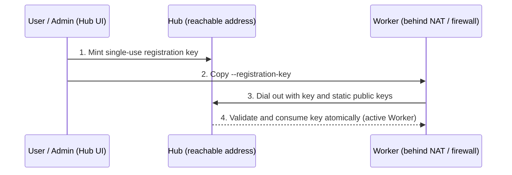
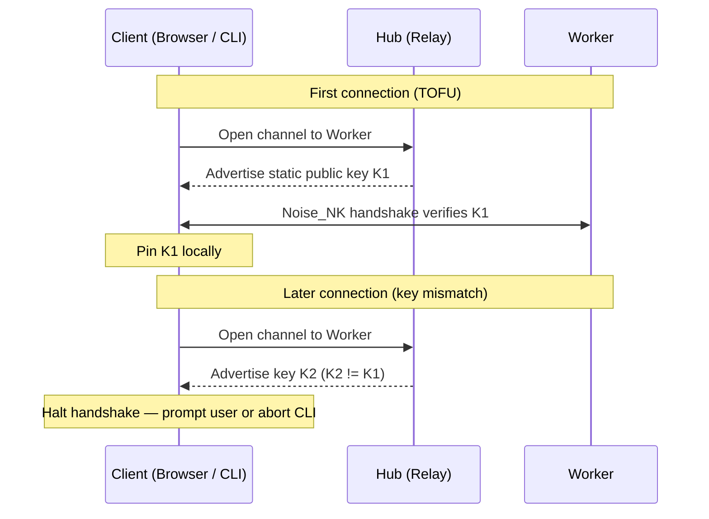

A **Worker** is the long-running daemon that hosts coding agents, terminals, and file access on a machine holding your repositories — a laptop, a workstation, or a remote build server. It connects *out* to a Hub over a single persistent WebSocket. This guide covers Worker connectivity, registration, data files, health and reconnects, deregistration, trust-on-first-use (TOFU) key pinning, and administrator CLI commands.

For day-to-day sidebar controls, choosing which Worker hosts a new tab, and desktop app port-forward or SOCKS5 tunnels, see [Workspaces](/docs/using/workspaces/) and [CLI Guide](/docs/using/cli-guide/). In `solo` mode, LeapMux runs and auto-registers a bundled Worker automatically; see [Running LeapMux](/docs/admin/running-leapmux/).

## How a Worker reaches a Hub

A Worker always **dials the Hub** — nothing ever connects *to* the Worker:

- Workers need **no inbound ports** and operate behind NAT, home routers, and corporate firewalls.
- Only the Hub needs a reachable address (see [Reverse Proxy](/docs/admin/reverse-proxy/)).

You supply the Hub URL once during registration:

```bash
leapmux daemon worker register --hub https://hub.example.com --registration-key <key>
```

Supported `--hub` URL forms:

| Form | Example | When to use |
| --- | --- | --- |
| `http://` / `https://` | `https://hub.example.com` | Remote or networked Hub (standard team setup). |
| `unix:<socket-path>` | `unix:/run/leapmux/hub.sock` | Hub on the same machine over a Unix domain socket (Unix/macOS). |
| `npipe:<pipe-name>` | `npipe:leapmux-hub` | Hub on the same machine over a Windows named pipe (Windows). |

The Worker saves the Hub URL and credentials in `<data_dir>/state.json` and reconnects to that URL on every subsequent start. Only `daemon worker register` accepts `--hub`; to move a Worker to another Hub, [register it again](#register-a-worker-again).

## How registration works

LeapMux has no separate approval queue after a Worker connects. Presenting a valid single-use registration key authorizes and activates the Worker in one atomic transaction:



## Register a Worker

{}

### Mint a registration key



1. In the Hub UI sidebar, click **+** on the **Workers** header (or run `leapmux worker key create`).
2. Select **POSIX** (macOS/Linux) or **PowerShell** (Windows) and copy the registration and start commands.
3. Keep the **Register worker** dialog open until registration completes. Keys live for 5 minutes and auto-extend while the dialog stays open; closing the dialog revokes the key.

When SMTP is configured and the user's email is verified, the dialog also offers **Send email** to deliver the commands to a remote machine (the key still expires if you close the dialog before registering).

### Run the registration command on the Worker host

```bash
leapmux daemon worker register --hub https://hub.example.com --registration-key <key>
```

The command generates the Worker's long-term identity keypairs, registers them with the Hub, and writes `<data_dir>/state.json` (mode `0600`). It retries transient network failures for up to 5 minutes (`--timeout`) and fails immediately if the Hub rejects the key.

### Start the Worker service

```bash
leapmux daemon worker start
```

The first `start` configures login or boot startup; see [Starting and Stopping](/docs/admin/starting-and-stopping/). In Docker, run the Worker container against the same `/data` volume instead; see [Running a Worker container](/docs/admin/running-leapmux/#running-hub-dev-and-worker-containers).

{}

### Handling interrupted or refused registrations

If `daemon worker register` stops before completing (Ctrl+C or timeout), run the exact same command with the same `--hub`, `--registration-key`, and `--data-dir`. While unfinished, `<data_dir>/pending-registration.json` (mode `0600`) preserves the key and private identity material so retrying completes the same Worker without consuming the key twice.

| Error | Cause | Resolution |
| --- | --- | --- |
| Key is invalid or already consumed | Key was used, revoked, or expired. | Mint a new key, delete `<data_dir>/pending-registration.json`, and register again. |
| Account reached `max_workers_per_user` | Account hit its live Worker limit. | Deregister an unused Worker or raise `limits.max_workers_per_user`. |
| Pending registration for another Hub/key exists | Earlier attempt did not finish. | Re-run the earlier command to finish it, or check the Hub's **Workers** list and delete `pending-registration.json` before starting fresh. |
| Worker is already registered | `state.json` already exists. | Run `leapmux daemon worker start`, or [register it again](#register-a-worker-again). |

### Auto-registered Workers (`solo` and `dev`)

`solo` and `dev` modes auto-register their bundled local Worker without a registration key (in `dev`, after `/setup` completes). The Hub refuses to deregister an auto-registered Worker while it is connected; if its local `state.json` is lost, you can deregister the offline entry so the next launch registers a fresh Worker ID.

## Files in the Worker data directory

`--data-dir` defaults to `.` (resolving against the config file directory, or `~/.config/leapmux/worker` without one):

| File | Contents | Secret | Back up |
| --- | --- | --- | --- |
| `state.json` | Hub URL, Worker ID, Hub auth token, and private E2EE identity keys (mode `0600`) | Yes | Yes |
| `pending-registration.json` | Present only during an incomplete registration (mode `0600`) | Yes | Until registration finishes |
| `worker.db` | Local SQLite database holding agent transcripts and terminal state | No | To retain local history |

The `.lifecycle/` directory holds service locks, saved service settings, and recent startup logs — do not edit it directly.

## Register a Worker again

To move a Worker to a new Hub or replace its identity, deregister it first (when the old Hub still knows it) and register fresh. Re-registering generates a new Worker ID, so clients pin it cleanly as a new Worker without triggering a key-change warning:

```bash
leapmux daemon worker stop
leapmux daemon worker deregister
leapmux daemon worker register --hub https://hub.example.com --registration-key <new-key>
leapmux daemon worker start
```

If the old Hub no longer exists or purged the Worker, stop the Worker, delete `<data_dir>/state.json`, and run `daemon worker register`.

## Health, pings, and auto-reconnect

Worker **online** status reflects whether the Hub currently holds an open WebSocket stream to that Worker. The Hub probes each stream every 10 seconds (10-second timeout) and disconnects after two consecutive missed pings; the Worker also drops the stream if it receives no pings for 30 seconds.

After any transient drop (Hub restart, network blip, sleep), a registered Worker reconnects with exponential backoff:

| Property | Value |
| --- | --- |
| Initial retry interval | 1 second |
| Maximum interval | 180 seconds |
| Backoff multiplier | 2.0 |
| Jitter | ±20% |
| Backoff reset | Connection stays up ≥ 30 seconds |

During a graceful Hub shutdown, the Hub sends a suggested reconnect delay that the Worker honors once before resuming normal backoff.


**Revocation vs. transient errors:** If the Hub reports that the Worker was deregistered or deleted, a standalone Worker clears its local credentials and exits. If the Hub refuses the Worker's pinned public keys, the Worker stops and keeps its state. For other refusals (such as proxy `401`/`403` errors), the Worker keeps retrying.


## Deregistering a Worker

Deregistering tells the Hub to forget the Worker and terminate every active workspace tab and terminal running on it.

- **From the Hub UI:** open the Worker's context menu and select **Deregister...**.
- **As an administrator over RPC:**

```bash
leapmux admin worker deregister <worker>
```

- **From the Worker host:**

```bash
leapmux daemon worker stop
leapmux daemon worker deregister
```

When deregistered online, a standalone Worker shuts down gracefully, clears `state.json`, and exits while keeping `worker.db`. Run `leapmux daemon worker disable` afterward if you want to remove the OS service.

## TOFU key pinning

LeapMux end-to-end encrypts Frontend↔Worker traffic using hybrid post-quantum `Noise_NK` (`--encryption-mode`, default `post-quantum`; see [Cryptography & Key Architecture](/docs/admin/cryptography/) for handshake and encryption-mode details). Each Worker generates a composite static keypair at registration, and the Hub pins the public keys permanently to the Worker ID.

Clients also apply **trust on first use (TOFU)** pinning to detect a Hub substituting a different Worker key after first contact:



Three independent pin stores exist (desktop app tunnels reuse the browser's per-account pin; see [Security & Authentication](/docs/admin/security-and-auth/#worker-identity-and-tofu-pinning)):

| Client | Pin store | How to reset a pin after out-of-band verification |
| --- | --- | --- |
| **Browser / Desktop Frontend** | Per-account IndexedDB trust store (refreshed on use for 1 year) | Review the **Worker public key changed** dialog, or remove the pin under **Preferences → Advanced → Trusted worker keys**. |
| **Worker → sibling Worker** | `<data_dir>/cross_worker_pins.json` | `leapmux daemon worker cross-worker-pins remove <worker-id>` |
| **`leapmux` CLI** | `<config-dir>/<scheme>_<hub-host>/pins.json` | `leapmux worker pins remove <worker>` |


A Worker never changes its keys while keeping the same Worker ID. Treat every key mismatch as a security incident: reject it and confirm the 4-word `Actual` fingerprint out of band against `key_fingerprint` in the Worker's startup log before accepting or removing a pin.




Non-browser clients (`leapmux` CLI and cross-worker channels) abort immediately on mismatch and print the exact local pin-removal command; pin commands operate locally without requiring a running Worker. See [CLI Guide](/docs/using/cli-guide/#worker-connections-key-pins-and-tunnels).

## Administrator CLI reference

Administrators manage all Workers and registration keys on a running Hub with `leapmux admin worker`:

| Command | Purpose |
| --- | --- |
| `leapmux admin worker list` | List Workers. Filters: `--user` (username, `username:<name>`, `id:<id>`, or unique 4+ character ID prefix), `--status` (`active`, `deregistering`, `deleted`, `all`; default `active`). |
| `leapmux admin worker get <worker>` | Inspect one Worker's details (includes soft-deleted entries for audit). |
| `leapmux admin worker deregister <worker>` | Force-deregister a Worker. |
| `leapmux admin worker reg-key list` | List live registration keys (`--include-expired` includes revoked/expired keys). |
| `leapmux admin worker reg-key revoke <reg-key>` | Revoke a live registration key. |
| `leapmux admin worker reg-key purge-expired` | Hard-delete expired or revoked registration keys. |

`leapmux admin` deliberately has no `reg-key create`: registration keys are minted only by the owning user (via the **Register worker** dialog or `leapmux worker key create`).

## See also

- [Running LeapMux](/docs/admin/running-leapmux/) — run modes, bundled Workers, and Docker containers.
- [Starting and Stopping](/docs/admin/starting-and-stopping/) — running Workers as login or boot OS services.
- [Configuration Reference](/docs/admin/configuration-reference/#worker-configuration) — Worker flags, environment variables, and SQLite tuning.
- [Security & Authentication](/docs/admin/security-and-auth/) and [Cryptography & Key Architecture](/docs/admin/cryptography/) — E2EE protocol, encryption modes, and trust model.
- [Workspaces](/docs/using/workspaces/) and [CLI Guide](/docs/using/cli-guide/) — end-user Worker selection, desktop tunnels, and CLI pin commands.
