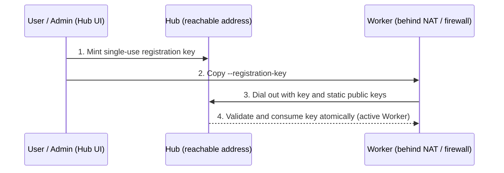
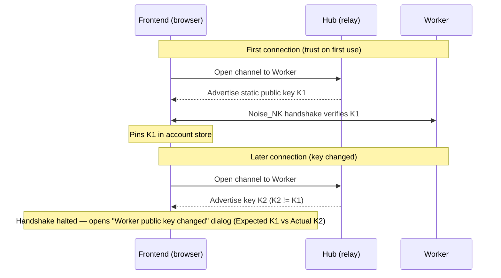

A **Worker** is the long-running daemon that hosts your coding agents, terminals, and file access. It runs on whatever machine holds the code you want to work on — your laptop, a powerful desktop, a remote build box — and connects *out* to a Hub. This chapter covers how a Worker reaches a Hub, how you register one, and how the UI shows Worker status. It also covers TOFU key pinning and how you pick which Worker hosts a new tab.

If you only ever use solo mode, a Worker is started for you in-process and most of this chapter is informational — see [Running LeapMux](/docs/admin/running-leapmux/) for the run modes and [Concepts & Architecture](/docs/getting-started/concepts/) for how the Hub, Worker, and Frontend fit together.

## How a Worker reaches a Hub

The Worker always **dials the Hub** — it opens a single outbound WebSocket and keeps it alive. Nothing ever connects *to* the Worker, so:

- The Worker needs **no inbound port** and works fine behind NAT, a home router, or a corporate firewall.
- Only the Hub needs a reachable address (see [Running LeapMux](/docs/admin/running-leapmux/) and [Configuration](/docs/admin/configuration/)).

You give the Worker its Hub URL once, when you register it:

```bash
leapmux daemon worker register --hub https://hub.example.com --registration-key <key>
```

The `--hub` value accepts three URL forms:

| Form | Example | When to use |
| --- | --- | --- |
| `http://` / `https://` | `https://hub.example.com` | Remote or networked Hub (the common case). |
| `unix:<socket-path>` | `unix:/run/leapmux/hub.sock` | Hub on the same machine, over a Unix domain socket. **Unix/macOS only.** |
| `npipe:<pipe-name>` | `npipe:leapmux-hub` | Hub on the same machine, over a Windows named pipe. **Windows only.** |

The two local-IPC forms exist for co-located setups (notably the desktop app's local-only mode, where the Hub never opens a TCP port at all). On a remote Hub you will always use `http://` or `https://`.

The Worker saves the URL with its credentials and connects to that URL from then on. Only the `--hub` flag of `daemon worker register` sets it: the configuration file and the environment cannot, and the other Worker commands refuse the flag. To move a Worker to another Hub, [register it again](#register-a-worker-again).

## How registration works

Before a Worker can connect, you must register it with the Hub. LeapMux has no separate pending approval queue where an administrator confirms a Worker after it dials in. Instead, presenting a valid single-use registration key authorizes and creates the active Worker in one atomic step.



## Register a Worker

Registration takes three steps, one for each section below.

### 1. Get a registration key



1. In the sidebar, find the **Workers** section header and click the **+** button (titled *Register worker*).
2. The **Register worker** dialog opens, generates a key at once, and shows two commands:
   - The registration command: `leapmux daemon worker register --hub https://hub.example.com --registration-key <key>`
   - The start command, to run after the registration succeeds: `leapmux daemon worker start`

   The `--hub` value is the address your Hub advertises (falling back to your browser's origin).
3. Under **Shell**, choose **POSIX** for a macOS or Linux shell, or **PowerShell** for Windows. The commands change to match that shell.
4. Copy each command with **Copy registration command** and **Copy start command**.

Keep the dialog open until the registration command finishes. The key is valid for 5 minutes, and the dialog extends it for as long as the dialog stays open. Closing the dialog asks the Hub to revoke the key. If the Hub cannot be reached at that moment, the key expires on its own.


If your Hub has email configured and your account email is **verified**, the dialog also offers **Send email**, which mails both commands to your verified address — useful when the target machine is elsewhere. The key in the email works only while the dialog stays open, so keep it open until the registration command finishes. The button is hidden in solo mode and on Hubs without SMTP, and disabled until your email is verified. See [Accounts & Authentication](/docs/using/accounts/) for email verification.


### 2. Run the registration command

Run the registration command on the machine where the Worker should live. It generates the Worker's keys, presents them to the Hub with the registration key, and saves the credentials that the Hub returns:

```text
Worker registered.
Credentials saved to /home/alice/.config/leapmux/worker/state.json

Commands for this instance:
  Start:  leapmux daemon worker start --config /home/alice/.config/leapmux/worker/worker.yaml --data-dir /home/alice/.config/leapmux/worker
  Status: leapmux daemon worker status --config /home/alice/.config/leapmux/worker/worker.yaml --data-dir /home/alice/.config/leapmux/worker
```

The command does not start the Worker. It waits up to 5 minutes for the Hub; change the limit with `--timeout`. While the Hub is unreachable, it retries. When the Hub refuses the key, it fails at once.

### 3. Start the Worker

Start the Worker as a service, so it runs in the background and starts again at the next login or boot. Run the `start` command that the registration printed, or:

```bash
leapmux daemon worker start
```

The first `start` asks when the Worker should start automatically. See [Starting and Stopping](/docs/admin/starting-and-stopping/). In a container, the image runs the Worker for you; see [Running a Worker container](/docs/admin/running-leapmux/#running-a-worker-container).

The Worker appears in the sidebar **Workers** section as soon as it connects.

### If registration fails or stops

**If the command stops before it finishes**, for example after Ctrl+C or at the end of its timeout, run the same `daemon worker register` command again, with the same `--hub`, `--registration-key`, and data directory. If the Hub accepted the first attempt, the command completes it: you get the same Worker, and the key is not used twice.

Until registration succeeds, the data directory holds `pending-registration.json`. It holds the registration key and the Worker's private keys, so protect it like `state.json`. The command deletes it when the registration completes.

**If the Hub refuses the registration**, the error states the reason:

| The error says | Cause | Fix |
| --- | --- | --- |
| The key is invalid or already consumed. | The key was used by another machine, was revoked, or expired. Keys are single-use. | Generate a new key, then [abandon the refused attempt](#abandon-an-attempt). |
| The account reached `max_workers_per_user`. | The account has its maximum number of Workers. | Deregister a Worker, or raise the limit (see [Configuration](/docs/admin/configuration/)). |
| A pending registration for hub *URL* already exists. | An earlier attempt with another key or another Hub did not finish. | Run the earlier command again to complete it, or [abandon it](#abandon-an-attempt). |
| This worker is already registered. | The data directory already holds credentials. | Start the Worker with `leapmux daemon worker start`, or [register it again](#register-a-worker-again). |

#### Abandon an attempt

A new key or another Hub conflicts with an unfinished attempt, so the command refuses it until you abandon that attempt.


Deleting `pending-registration.json` deletes the only proof that this machine made the attempt. If the Hub accepted the attempt, the Hub keeps a Worker that no machine can use, and you must deregister it from the sidebar. Delete the file only when the attempt failed, or after you checked the **Workers** section of the sidebar.


To abandon the attempt, delete `<data-dir>/pending-registration.json`, then run `daemon worker register` with the new key.

### Auto-registered Workers (solo and dev)

In **solo** and **dev** modes the launcher auto-registers a co-located Worker in-process, bypassing the key flow entirely. These Workers are flagged *auto-registered*. In dev mode, the bundled Worker registers after you complete `/setup`. The Hub refuses to deregister an auto-registered Worker while it is connected, from the UI and from `leapmux admin worker deregister`, because the next launch would just register a fresh one. You can remove an offline one, such as the entry that a launch leaves behind when the app's Worker state file was lost: its context menu offers **Deregister...**, and an administrator can use that command. The app then registers a fresh Worker with a new Worker ID, and the old Worker's tabs do not move to it. See [Running LeapMux](/docs/admin/running-leapmux/).

## Files in the Worker's data directory

A Worker keeps its state in its data directory (`--data-dir`). `--data-dir` defaults to `.`. A relative path is resolved against the config file's directory. Without a config file, it resolves to `~/.config/leapmux/worker`.

| File | Contents | Secret | Back up |
| --- | --- | --- | --- |
| `state.json` | The Hub URL, the Worker ID, the auth token, and the private keys of the Worker's long-term identity (see [TOFU key pinning](#tofu-key-pinning)) | Yes | Yes |
| `pending-registration.json` | Present only while a registration is unfinished: the Hub URL, the registration key, and the private keys | Yes | Until the registration completes |
| `worker.db` | The local SQLite database: agent and terminal state | No | To keep transcripts and terminal history |

Both JSON files have file mode `0600`. The auth token in `state.json` lets the Worker reconnect after a restart without registering again. The `.lifecycle` directory holds the lock files, the service settings, and the logs of recent starts. Do not edit it.

## Register a Worker again

A Worker belongs to one Hub. To move it to another Hub, or to give it a new identity, register it again. The new registration gets a new Worker ID. The old Worker's tabs do not move to it, and clients pin it as a new Worker, so no key-change dialog appears.

When the Hub still knows the Worker, deregister it first, so that the Hub deletes the old entry:

```bash
leapmux daemon worker stop
leapmux daemon worker deregister
leapmux daemon worker register --hub https://hub.example.com --registration-key <new-key>
leapmux daemon worker start
```

When the Hub no longer knows the Worker, `deregister` cannot complete. This happens when the Hub lost its data, or deleted the Worker more than 7 days ago. In that case, stop the Worker, delete its `state.json`, and register it again.

## Worker status: online and offline

A Worker's **online** status reflects whether the Hub holds an open stream to that Worker. It is computed live, rather than stored as a flag. A closed connection shows offline at once, and a reconnect shows online again. The Hub records `last_seen_at` on connect and on each answered ping, every 10 seconds.

A silent drop normally shows offline within about 30 seconds. The Worker also drops its connection when the Hub stops sending pings for 30 seconds.


The Hub probes each Worker's stream every 10 seconds. Each probe has a ten-second timeout, and two consecutive failures drop the connection. The Worker watches those pings and sends no pings of its own.


### In the sidebar



Each Worker appears as a row in the sidebar **Workers** section showing its name (or an em-dash `—` if the name hasn't been fetched yet) and a status dot. The dot reflects whether your browser currently has a live end-to-end-encrypted channel open to that Worker — *connected* or *disconnected*. When you have no Workers, the section reads **No workers**.

Right-click a Worker row (or open its context menu) to:

- View and copy its details — **Name**, **Version** (with commit hash), and **OS** (with architecture) are always shown when the Worker's info is available; a **Built at** row appears only when the Worker reports a build time. Clicking the info block copies the full metadata as JSON to your clipboard.
- Manage [tunnels](#tunnels-desktop-app) (when available and you own the Worker).
- **Deregister...** the Worker — shown for every Worker except a connected auto-registered one.

## Selecting which Worker hosts a new tab

When you open a new agent, terminal, or workspace, the dialog includes a **Worker** dropdown (with a **Refresh workers** button next to the label). This is where you choose the machine that will host the new tab.

Key behaviors:

- The dropdown lists **only online Workers**. If none are online, it shows a single, unselectable option: **No workers online**.
- Each option is labeled `name (version, os, arch)` — for example `build-box (1.4.0, linux, arm64)` — falling back to the raw Worker ID if the Worker's details haven't been fetched yet.
- When something is online and nothing is selected, the dialog preselects a sensible default (the current tab's Worker if it's online, otherwise the first online Worker).
- Some dialogs are locked to a single Worker and show no dropdown at all — for example *Change branch*, *Delete worktree* and *Delete branch*, which must act on the Worker that already hosts the checkout.

Worker details are cached for about a minute, so reopening a dialog doesn't re-fetch worker details; click **Refresh workers** to force a re-list (for example, right after a new Worker comes online).

To open an agent or terminal on a chosen Worker, see [Coding Agents](/docs/using/coding-agents/) and [Terminals](/docs/using/terminals/). To script the same thing, `leapmux agent open --worker <worker> ...` or `leapmux terminal open --worker <worker> ...` — see [Control CLI](/docs/using/control-cli/).

## Auto-reconnect

A registered Worker reconnects on its own. If the connection drops — Hub restart, network blip, laptop sleep — the Worker retries with exponential backoff:

| Property | Value |
| --- | --- |
| Initial retry interval | 1 second |
| Maximum interval | 180 seconds |
| Backoff multiplier | 2.0 |
| Jitter | ±20% |
| Backoff reset | After a connection survives ≥ 30 seconds |

So a Worker that briefly loses its link reconnects within seconds, while a Worker that can't reach a down Hub backs off from 1 s, doubling to 180 s, with ±20% jitter, so one wait reaches at most about 3.6 minutes. Once a connection holds for at least 30 seconds, the backoff resets, so the *next* outage starts fresh from 1 second again.

When the Hub shuts down gracefully it tells the Worker how long to wait before reconnecting; the Worker honors that requested delay once, then resumes normal backoff.


Auto-reconnect handles transient failures, **not** revocation. What the Worker does depends on what the Hub tells it:

- When the Hub tells the Worker that it was deregistered or deleted, a standalone Worker clears its local state and exits, and an auto-registered Worker stops.
- When the Hub refuses the Worker's keys, the Worker stops and keeps its state.
- The Worker keeps retrying every other refusal, such as a 401 or 403 from a proxy in front of the Hub.

A standalone Worker needs a fresh registration key to [register again](#register-a-worker-again). The launcher of an auto-registered Worker registers a fresh Worker at the next launch.


## Deregistering a Worker

Deregistering tells the Hub to forget a Worker and tear down everything running on it.

**From the UI:** choose **Deregister...** from a Worker's context menu. The **Deregister worker** dialog warns that the action terminates every active workspace and terminal on that Worker, and that you cannot undo it. Confirm to proceed. The menu does not offer this for an auto-registered (bundled local) Worker while it is connected, and the Hub refuses such a request. See [Auto-registered Workers (solo and dev)](#auto-registered-workers-solo-and-dev).

**From the control CLI** (administrators):

```bash
leapmux admin worker deregister <worker-id>
```

On deregistration a standalone Worker acknowledges the request, shuts down gracefully, clears its local credentials, and exits. The Hub refuses this command for an auto-registered Worker while it is connected. An offline one leaves the Worker list at once. See [Control CLI](/docs/using/control-cli/) for the full administrator surface.

**From the Worker's machine:** stop the Worker, then deregister it:

```bash
leapmux daemon worker stop
leapmux daemon worker deregister
```

`deregister` uses the Worker's saved credentials to ask the Hub to delete the Worker. After the Hub confirms, it removes the credentials, and it keeps `worker.db` with the agent and terminal history. If the Hub cannot confirm, for example because it is unreachable, `deregister` keeps the credentials, so that you can run it again. Give it the same `--data-dir` or `--config` as the Worker. If the Worker runs as a service, `deregister` ends with the `leapmux daemon worker disable` command that removes the service.

## Tunnels (desktop app)

A **tunnel** gives you local access to a service the Worker can reach — a dev server, a database, or any TCP endpoint on the Worker's machine or private network. The traffic uses the Worker's existing end-to-end-encrypted channel. While the Hub only relays ciphertext, it cannot read the tunneled traffic. In remote-Hub mode a tunnel uses the same Hub session as the rest of the desktop app, and signing out ends the tunnels. A tunnel keeps no pin of its own. It carries the Worker key the desktop app already trusts as its admission expectation, so a Hub that substitutes a Worker key stops the tunnel instead of reading it. See [Tunnel key trust](#tunnel-key-trust) below.

Tunnels are a **desktop-app feature**. They are available in both solo and distributed desktop modes, but not in a plain browser (the browser cannot open the local listening sockets a tunnel needs). You manage them from a Worker's sidebar context menu, where — **when tunnels are available and you own the Worker** — these items appear:

- **Add tunnel...** — open a new tunnel to the selected Worker. This always appears when tunnels are available and you own the Worker.
- **Delete all tunnels...** — tear down every tunnel to that Worker. This appears only once the Worker has at least one tunnel.

### The two tunnel types

| Type | What it does |
| --- | --- |
| **Port-forward** (`port_forward`) | Binds a local port and forwards every connection to a single address-and-port reachable *from the Worker*. Use this to reach one specific service — e.g. forward `127.0.0.1:8080` on your machine to a dev server the Worker can see. |
| **SOCKS5** (`socks5`) | Runs a SOCKS5 proxy locally; connections through it are dialed *from the Worker*, so they resolve and route as if they originated on the Worker's machine. Use this to reach many destinations through the Worker without one tunnel per service. |

### Fields and defaults

A tunnel's configuration has these fields:

| Field | Applies to | Required? | Default |
| --- | --- | --- | --- |
| `workerId` | both | required | — (the Worker you opened the menu on) |
| `targetAddr` | port-forward | required | `127.0.0.1` (prefilled) |
| `targetPort` | port-forward | required | — (must be 1–65535) |
| `bindAddr` | both | optional | `127.0.0.1` (must be loopback: `127.0.0.1` or `::1`) |
| `bindPort` | both | optional | `targetPort` (port-forward) or `1080` (SOCKS5); must be 1–65535 |

So a port-forward needs a `targetAddr` and `targetPort` (the service the Worker should reach) and, by default, binds the same port locally on loopback. A SOCKS5 tunnel needs no target — it binds `127.0.0.1:1080` by default and dials each destination from the Worker.

In both cases you can override `bindAddr`/`bindPort` if the default port is taken. The bind address must be loopback, because the tunnel listener is unauthenticated. The dialog reports the IP and port the tunnel actually bound to once it is running.

### Tunnel key trust

A tunnel uses the account’s browser pin for the Worker. Browser channels use the same record, listed under **Preferences → Advanced → Trusted worker keys**.

- **First contact.** If the account has no pin, **Create** opens a browser channel using the key the Hub presents. The browser verifies that the peer holds the corresponding private keys and that the session responds before recording the composite public key. This first verified session establishes which key the account trusts. Compare the fingerprint with the Worker log over a trusted channel on first use if you can.
- **Shared trust.** Each new tunnel uses the stored browser pin. If you removed the pin, the next standard creation must verify a new browser session. An existing tunnel keeps the key it started with.
- **Mismatch on reconnect.** When the Hub reports a key that differs from the one the tunnel started with, the tunnel stops. Its row shows the expected and presented fingerprints.
- **Exact-key confirmation before recreation.** Select **Verify Worker key** on the stopped row or in the **Add tunnel** dialog. When the browser shows *Worker public key changed*, compare the presented fingerprint with the one in the Worker log before accepting. The stopped row opens a prefilled form after verification. Select **Create** to submit it. If the pin disappears, the form preserves its fields and offers **Trust Worker on first contact**. This action proves and records the Hub's next Worker announcement. If another tab records a pin first, the form returns to **Verify Worker key**. Creation always requires a separate **Create** submission after either proof.


Every key mismatch is a serious signal. Do not accept a changed key to make it work. Reject it, and confirm the fingerprint with whoever runs the Worker. See [Security & Threat Model](/docs/admin/security/#tunnel-key-trust) for the reasoning.


## TOFU key pinning

LeapMux end-to-end encrypts Frontend↔Worker traffic. A Hub that only relays it cannot read the content. The Hub is still trusted for identity and Frontend code. **TOFU (trust on first use) static-key pinning** detects a Hub substituting a different Worker key after the browser records a pin. Pinning does not stop a Hub opening its own channel or serving modified Frontend code.

[Security & Threat Model](/docs/admin/security/) covers that protection's scope, the composite keypair, and the fingerprint scheme. This section explains the three pin stores and how to reset a pin in each.



There are three independent pin stores, depending on *who* is connecting. The desktop app's tunnels keep none of their own: they admit the browser's pin (see [Tunnel key trust](#tunnel-key-trust)). The browser store is per account, so two users in the same browser pin Workers independently; see [What stays on the browser](/docs/admin/encryption-and-data/#what-stays-on-the-browser) for browser storage details.

| Client | Pin store | How to reset a pin |
| --- | --- | --- |
| **Your browser** (Frontend) | Per-account browser pin store in IndexedDB (`leapmux-trust`, refreshed on use for one year) | Accept the in-app *Worker public key changed* dialog, or remove the pin under **Preferences → Advanced → Trusted worker keys**. |
| **A Worker → a sibling Worker** (cross-worker channels) | `<data_dir>/cross_worker_pins.json` on the Worker | `leapmux daemon worker cross-worker-pins remove <worker-id>` |
| **The `leapmux` CLI** | `<config-dir>/<scheme>_<hub-host>/pins.json` | `leapmux worker pins remove <worker>` |

### What a mismatch looks like in the browser

When a Worker's key differs from the key pinned for it at an earlier connection, the Frontend stops and shows a dialog titled **Worker public key changed**. It displays the **Expected:** and **Actual:** fingerprints (short, human-comparable four-word strings) and asks you to **Reject** or **Accept** the changed key.

A Worker keeps its keys for as long as it stays registered, so one of the two keys did not come from this Worker. Accept only after you confirm, out of band, that the Actual fingerprint matches the one the Worker logs when it starts. See [Security & Threat Model](/docs/admin/security/) for the full dialog text, the fingerprint scheme, and the accept-vs-reject reasoning.


Every key mismatch is a serious signal. Do not click **Accept** to make it work. **Reject**, and confirm the fingerprint with whoever runs the Worker.


### What a mismatch looks like on the CLI / a sibling Worker

For non-browser clients there is no dialog — agents and scripts can't answer interactive prompts — so a mismatch **aborts the connection** with an error of the form `worker <id> key mismatch: pinned <fingerprint>, presented <fingerprint> — <hint>`. The hint gives the exact command that clears the pin, so the next connect pins the presented key. Confirm the fingerprint before running it:

```bash
# A leapmux agent or script hit a pin mismatch:
leapmux worker pins remove <worker>

# One Worker connecting to a sibling Worker hit a pin mismatch:
leapmux daemon worker cross-worker-pins remove <worker-id>
```

Both pin-management commands run entirely against local pin files — no Worker process needs to be running to manage them. For the full `leapmux worker pins list|get|remove` reference, see [Control CLI](/docs/using/control-cli/#worker-key-pins).


Browser pins are managed under **Preferences → Advanced → Trusted worker keys**, which lists and removes pinned keys. For a deeper look at the handshake, fingerprints, and the full trust model, see [Security & Threat Model](/docs/admin/security/).


## Administrator reference: admin worker commands

Administrators manage all Workers on a Hub (not just their own) with `leapmux admin worker`. These are RPC calls to a **running** Hub, so the Hub must be up and you must be signed in as an administrator. Only `leapmux recover` opens the database directly. Highlights:

| Command | Purpose |
| --- | --- |
| `leapmux admin worker list` | List Workers. Filters: `--user` (username, `username:<name>`, `id:<id>`, or unique ID prefix), `--status` (`active`, `deregistering`, `deleted`, `all`; default `active`). |
| `leapmux admin worker get <worker>` | Show one Worker's details (includes soft-deleted Workers for auditing). |
| `leapmux admin worker deregister <worker>` | Force-deregister a Worker. |
| `leapmux admin worker reg-key list` | List live registration keys (`--include-expired` to include revoked/expired). |
| `leapmux admin worker reg-key revoke <reg-key>` | Revoke a registration key. |
| `leapmux admin worker reg-key purge-expired` | Hard-delete all expired or revoked keys. |


`leapmux admin` deliberately has **no** `reg-key create` — registration keys are minted only by an authenticated user (via the **Register worker** dialog or `leapmux worker key create`), which is itself the authorization step. `leapmux admin` lists, revokes, and purges keys but does not issue them.


For the complete administrator surface — including sessions, API tokens, and delegation tokens — see [`admin` — hub administration over RPC](/docs/admin/admin-cli/). Encryption keys are offline work; see [Recovery](/docs/admin/recover/).

## Encryption mode

A Worker runs in one of two encryption modes, set with `--encryption-mode`:

- `post-quantum` (the default) — the hybrid post-quantum handshake.
- `classic` — static Module-Lattice-Based Key-Encapsulation Mechanism (ML-KEM) authentication without the Stateless Hash-Based Digital Signature Algorithm (SLH-DSA) signature or post-quantum forward secrecy.

Both modes register and advertise all three static keys, because the keys are the Worker's identity: the Hub pins them and refuses a connection that presents others. `classic` selects the handshake without the SLH-DSA signature or post-quantum forward secrecy.

Leave this at the default unless you have a specific reason to change it; both ends must agree, and the Hub tracks the mode the Worker declares. The cryptographic details are covered in [Security & Threat Model](/docs/admin/security/).

## See also

- [Running LeapMux](/docs/admin/running-leapmux/) — run modes, ports, data directories, the bundled Worker.
- [Starting and Stopping](/docs/admin/starting-and-stopping/) — keep a Worker running in the background at login or at boot.
- [Configuration Guide](/docs/admin/configuration/) and [Configuration Reference](/docs/admin/configuration-reference/) — Worker flags, env vars, and config-file precedence.
- [Security & Threat Model](/docs/admin/security/) and [Cryptography & Key Architecture](/docs/admin/cryptography/) — the E2EE protocol, TOFU pinning, and what the Hub can and cannot see.
- [Control CLI](/docs/using/control-cli/) — `leapmux worker` and `leapmux worker pins` for scripting and pin management, plus the full [`leapmux admin worker`](/docs/admin/admin-cli/) and registration-key reference.
