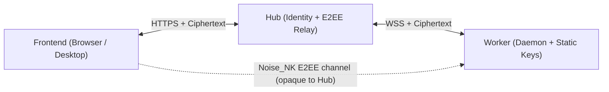
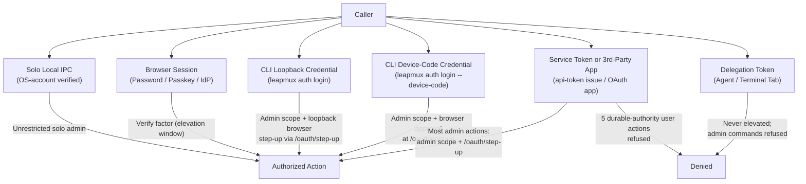

This page defines the LeapMux trust model and authentication architecture: what the Hub can and cannot see, how solo mode differs from a multi-user Hub, how session elevation and CLI step-up protect sensitive actions, and how passkeys, OAuth flows, app tokens, delegation tokens, bot protection, and credential revocation work.

For cryptographic primitives, hybrid post-quantum `Noise_NK` handshakes, and Worker key storage, see [Cryptography & Key Architecture](/docs/admin/cryptography/). For at-rest database encryption, key rotation, and backups, see [Encryption & Data](/docs/admin/encryption-and-data/).

## Trust model and boundaries

LeapMux separates **control-plane metadata** (owned by the Hub) from **session content** (end-to-end encrypted between Frontend and Worker).

- **The Hub is trusted for identity.** End-to-end encryption (E2EE) protects agent chats, tool outputs, terminal I/O, and files from a Hub that only observes its database, logs, and relayed traffic.
- **Browser vs. Desktop code trust.** A browser runs the Frontend served by the Hub, so it trusts the Hub for client code. The desktop app runs its bundled Frontend in both solo and remote-Hub modes, so a remote Hub cannot serve it modified code.
- **What E2EE does not prevent.** Because the Worker relies on the Hub to authenticate callers, E2EE does not protect against a compromised or malicious Hub, an administrator who resets your password, your identity provider, or anyone holding a stolen session cookie.

| Path | Protocol | Protection |
| --- | --- | --- |
| Frontend → Hub | ConnectRPC over HTTPS | Transport TLS terminated by your reverse proxy |
| Frontend → Worker | Hybrid post-quantum `Noise_NK` relayed over `/ws/channel` | End-to-end encrypted; an observing Hub cannot decrypt |
| Worker → Hub | ConnectRPC + outbound WebSocket (`/ws/worker`) | Transport TLS; channel payloads stay inside the E2EE tunnel |

### What the Hub can and cannot see

| An observing Hub **can** see | An observing Hub **cannot** see |
| --- | --- |
| Account metadata (usernames, emails, password hashes, session IDs, session IPs and user agents, passkey metadata) | Agent chat transcripts, prompts, tool arguments, or tool outputs |
| Workspace titles, custom sidebar sections, tab types, hosting Worker IDs, layout geometry, and timestamps | Terminal I/O, shell history, or PTY state |
| File tab display mode, view mode, and diff base (revealing staged/unstaged status) | File contents or diffs |
| Worker registration records (Worker ID, online status, last-seen time, encryption mode, pinned public keys) | Worker hostname, OS, or filesystem paths (exchanged only inside the E2EE channel) |
| Account preferences and active presence (active workspace, client, timing) | Any plaintext inside Frontend↔Worker channels |
| Channel transport metadata (channel ID, correlation ID, ciphertext size, timing) | — |

Traffic analysis (message timing, sizes, and active Worker mappings) remains visible to the Hub host. Separately, `leapmux auth login` labels CLI credentials with `user@host` by default; pass `--device-name` to choose another label.

## Worker identity and TOFU pinning

Each Worker generates a persistent composite static keypair at registration, and the Hub pins the public keys permanently to that Worker ID. Clients also verify Worker identity with **trust on first use (TOFU)** pinning:

- **First contact:** after the channel opens and answers an encrypted liveness ping, the client records the Worker's public key. Compare its 4-word fingerprint out of band with `key_fingerprint` in the Worker's startup log when possible.
- **Mismatch:** browsers halt and display **Worker public key changed** (with **Expected** and **Actual** 4-word fingerprints); non-browser clients (`leapmux` CLI and cross-worker channels) abort immediately. Desktop tunnels reuse the account's browser pin and stop before dialing on mismatch.



A Worker never changes keys on the same Worker ID — always reject an unexpected mismatch and verify out of band. For pin stores, fingerprint verification, and tunnel key trust, see [Managing Workers](/docs/admin/managing-workers/#tofu-key-pinning) and [Cryptography & Key Architecture](/docs/admin/cryptography/#pinning-verification-and-audit).

## Solo mode: a reduced threat model

Solo mode collapses the local inter-process communication (IPC) trust boundary on purpose so the desktop app and local CLI work without sign-in:

- On Linux and macOS, the Unix socket verifies that the connecting peer's OS user ID matches the process effective user ID before serving HTTP.
- On Windows, the named pipe ACL admits only the current user's security identifier (SID).

TCP callers never receive credential-free access. Before a `solo` password is set, TCP callers can only invoke initial solo password setup; the first successful caller sets the password and receives an elevated session atomically.

| Transport | `solo` password | Result |
| --- | --- | --- |
| Local IPC socket | Either | Credential-free `solo` admin (OS-account verified). |
| TCP, any address | Not set | Only initial password setup is open; first caller claims the account. |
| TCP, any address | Set | Full sign-in as `solo` required on `127.0.0.1` and every added address. |


Only `solo` mode grants credential-free local IPC. In `hub` and `dev` modes, local IPC requires full authentication. In `solo` mode, always set a password from a trusted connection before binding non-loopback addresses.


The desktop app disables its in-process Hub TCP listener and uses local IPC only.

## Admin authorization and elevation

How a caller authenticates determines whether and how it can run sensitive account or Hub administration actions:

## Session elevation

Sensitive account changes, app authorizations, and Hub administration require a **recently proven factor**, not only a live session cookie. Proving a factor elevates the session for ****, sliding forward on each sensitive write up to a hard cap of **** from the original proof. Signing in with a password or passkey starts a **** window under the same rules.

In the browser, elevated sessions show their remaining deadline and an **End now** button at the top of **Account** and **Administration** panels.



### Actions requiring elevation

- Changing or setting a password, changing account email, or unlinking an OAuth provider
- Registering, renaming, removing, or disabling passkeys
- Authorizing an app, registering or editing an app, changing an app's elevation setting, or verifying an app
- All Hub administration procedures (settings, captcha, rate limits, users, sessions, Workers, IdPs, tokens, and network status — including admin reads, which require the window without sliding it)

Access-reducing app actions (**disconnecting** an app, **retiring** a registration, and **deleting** an unused registration) require no elevation so users and administrators can revoke a malicious app immediately.

### How you elevate

| Account authenticators | How you elevate |
| --- | --- |
| Password set | Enter your password. |
| Passkey registered | Authenticate with an existing passkey. |
| Linked OAuth provider only (no password, no passkey) | Re-authenticate at that provider. |
| No password, passkey, or linked provider | Add a first password or passkey within  of sign-in (requires a verified email or linked provider). |

Provider re-authentication is offered only when an account has neither a password nor a passkey; add a password or passkey for a stronger factor.

### Verifying a command-line credential

CLI credentials cannot prove a factor in the terminal. When an admin or sensitive CLI command needs elevation, `leapmux` automatically initiates browser step-up through `/oauth/step-up` (provided the app registration allows elevation; built-in CLI and service-account apps allow it by default):

- **Loopback ceremony** (default `leapmux auth login` credentials): opens your local browser, prompts you to verify your identity if needed, and redeems the authorization code on a loopback listener before retrying the command.
- **Device-code ceremony** (`leapmux auth login --device-code` and `leapmux admin api-token issue` credentials): prints a verification URL and short user code to approve from any elevated browser session.

Key security rules:

- **A credential cannot approve its own step-up.** Only an elevated browser session can approve `/oauth/step-up`, so a stolen CLI credential file cannot self-elevate.
- **Durable-authority user actions require an elevated browser session or interactive CLI credential.** `admin user create`, `reset-password`, `grant-admin`, `revoke-admin`, and `update --email`/`--email-verified` work from an elevated `leapmux auth login` credential (loopback or `--device-code`) that holds `admin:users` scope. Service-account tokens (`api-token issue`) and third-party OAuth apps can elevate for other admin actions, but the Hub refuses them for these five user actions.
- **Desktop remote-Hub mode** uses the same browser step-up flow through your system browser.

### Additional account-change safeguards

- Registering a new passkey always requires a browser (WebAuthn ceremony).
- Changing a password revokes every other session, API token, and delegation token; only the credential performing the change survives.
- Self-service account recovery and `reset-password` delete every passkey on the account. Review and deregister unknown Workers separately after a suspected compromise, because Workers retain their own credentials.

## Passkeys, OAuth, and app credentials

- **Passkeys (WebAuthn):** run automatically in secure contexts (HTTPS or loopback) matching the Hub's published origin (`public_url`, or loopback `listen` addresses). Passkey public keys and metadata are encrypted at rest; ceremony challenges live in Hub memory only.
- **OAuth and OIDC flow binding:** each login sets a short-lived `HttpOnly` nonce cookie bound to that browser (using `SameSite=None; Secure` for cross-site `form_post` callbacks such as Sign in with Apple) to prevent login CSRF. Providers must return a verified email; auto-linking runs only when `--trust-email=true`. See [Sign-in Providers](/docs/admin/sign-in-providers/).
- **App credentials:** `leapmux auth login` mints a scoped access token () backed by a refresh token (, hard-capped at ), stored in a mode-`0600` file. Grants only subtract from owner permissions, `admin:*` scopes are opt-in, account authenticators remain outside every grant, and credentials minted by another credential do not renew and never outlive or out-scope their issuer. See [App Authorization](/docs/admin/app-authorization/).

## Delegation tokens and Git safety

- **Delegation tokens:** Workers mint short-lived delegation tokens (, revoked when the tab closes) for coding agents and terminals. A delegation token carries the Worker owner's identity and is **limited by owner and machine, not by workspace or tab** — an agent in one workspace can reach all of its owner's tabs and Hub workspace inventory, but cannot elevate or run `leapmux admin` commands. Use separate user accounts for hard isolation between projects.
- **Git browsing safety:** when browsing repositories, the Worker disables `core.fsmonitor`, refuses discovered bare repositories (Git 2.38+), disables external diff/textconv helpers on diff probes, and runs `git status` only for open tabs or branch/worktree operations. Agents running inside tabs still invoke Git directly as authorized by the user.

## Bot protection: rate limits and ALTCHA

The Hub guards unauthenticated and sensitive endpoints with proof-of-work captcha and five configurable rate-limit rules (see [Configuration Guide — Bot protection](/docs/admin/configuration/#bot-protection-captcha-and-rate-limits)):

- **Built-in ALTCHA (default):** client-side `PBKDF2/SHA-256` proof-of-work with zero outbound network calls, active automatically when `public_url` uses HTTPS or `secure_cookies` is `true` (honeypot stays active even when captcha is off). External providers (`recaptcha_v3`, `turnstile`) verify online.
- **Rate limits:**
  - `elevation` (per user, default `5/15m`)
  - `email_change` (per user, default `6/15m`, paired with `mail_limits` per recipient)
  - `login_anonymous` (verified client IP, default `10/15m`; active in `solo`, `dev`, and `hub`)
  - `oauth_anonymous` (verified client IP, default `600/10m`; active in `solo`, `dev`, and `hub`)
  - `solo_password_setup` (verified client IP, default `10/15m`; active in `solo`)

IP-keyed limits use the physical TCP peer unless `trusted_proxy_ranges` authorizes a reverse proxy; see [Trusted reverse proxies](/docs/admin/configuration/#trusted-reverse-proxies).

## Credential and device revocation

Open Noise channels never outlive their authorizing credential. The Hub immediately closes affected channels on:

- Sign-out, admin session revocation (`session revoke`, `session revoke-user`), or account deletion
- Password change (sparing only the active session that made the change) or password reset
- API token or delegation token revocation
- Refresh-token reuse outside the 60-second retry window (automatically revokes the credential)
- Token rotation that narrows granted scopes (rotations preserving or widening scope extend channel expiry without dropping connections)

Offline revocations written by `leapmux recover` propagate on the Hub's next revocation sweep.

## Administrator hardening checklist

1. **Protect the Hub host and terminate TLS in front of it** — block `/metrics` at the proxy and configure `public_url`, `secure_cookies`, and `trusted_proxy_ranges` ([Reverse Proxy](/docs/admin/reverse-proxy/)).
2. **Back up `encryption.key` and the database together as an encrypted pair** — see [Encryption & Data](/docs/admin/encryption-and-data/#backup-and-restore).
3. **Treat Worker registration keys and `state.json` as secrets** — registration keys activate a Worker immediately; close the dialog when done.
4. **Train users to verify 4-word fingerprints** and reject unexpected Worker key changes.
5. **Revoke compromised credentials promptly** via `leapmux admin session`, `api-token`, `delegation-token`, and `worker deregister`.


**Key lifetimes quick reference:** elevation window **** (cap ****) · fresh sign-in window **** · access token **** · refresh token **** (cap ****) · OAuth authorization code **** · device code ****.


## See also

- [Cryptography & Key Architecture](/docs/admin/cryptography/) — `Noise_NK` primitives, transport hardening, in-band rekey, and Worker keypins.
- [Encryption & Data](/docs/admin/encryption-and-data/) — at-rest database encryption, key/pepper rotation, and backups.
- [App Authorization](/docs/admin/app-authorization/) — OAuth 2.1 app scopes, verification, and elevation opt-in.
- [Sign-in Providers](/docs/admin/sign-in-providers/) — GitHub, Google, Sign in with Apple, and OIDC setup.
- [Admin CLI](/docs/admin/admin-cli/) and [Recovery](/docs/admin/recover/) — online and offline administration.
