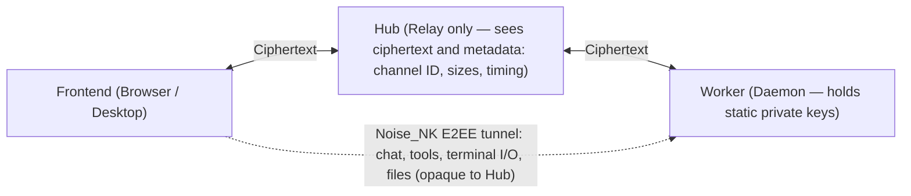

This page is the security overview for administrators and security-conscious users. It defines the trust boundaries, summarizes end-to-end encryption (E2EE) and Worker trust-on-first-use (TOFU) pinning, explains what changes in solo mode, and lists concrete steps to operate LeapMux safely.

Two companion deep dives cover the mechanics in full:

- [Authentication & Session Security](/docs/admin/authentication-security/) — session elevation rules, passkeys and WebAuthn, OAuth flow binding, app credentials and scopes, delegation tokens, rate limits, ALTCHA, and credential revocation.
- [Cryptography & Key Architecture](/docs/admin/cryptography/) — hybrid post-quantum `Noise_NK` handshake (ML-KEM-1024 + X25519 + SLH-DSA), transport hardening, in-band rekey, Worker key storage, and pinning verification.

**The Hub is trusted for identity.** End-to-end encryption protects content from a Hub that only observes its database, logs, and relayed traffic. A browser runs the Frontend that the Hub serves, so it trusts the Hub for code as well. The desktop app runs its bundled Frontend in both modes, so no Hub can serve it code.

End-to-end encryption does not protect against a compromised or malicious Hub, or against anyone who can sign in at the Hub as you. The Worker accepts the caller identity that the Hub states.

## The trust model

LeapMux is built around one deliberate trust boundary. In distributed mode, someone else — a teammate, a platform team, or a hosting provider — may operate the Hub. The design withstands an honest-but-curious Hub. A compromised or malicious Hub can still open its own channel to any of your Workers as you, and it can serve modified Frontend code to a browser. The desktop app runs its bundled Frontend in both modes, so a Hub cannot serve it code. The Hub remains trusted for identity in every client.

Three protocol paths carry traffic, each with a different security posture:

| Path | Protocol | Encryption |
| --- | --- | --- |
| Frontend → Hub | ConnectRPC (gRPC-compatible) — login, workspace management, Worker registration | TLS in front of the Hub (administrator's responsibility) |
| Frontend → Worker | Hybrid post-quantum `Noise_NK`. Handshake rides Hub-relayed unary RPCs; encrypted traffic is multiplexed over one relayed WebSocket | End-to-end encrypted; an observing Hub cannot decrypt |
| Worker → Hub | ConnectRPC for registration and control calls, plus one outbound WebSocket (`/ws/worker`). Workers need no inbound ports | TLS in front of the Hub; channel payloads ride inside the E2EE tunnel |

Control-plane data (accounts, workspace records, layout, Worker registration) reaches the Hub in readable form, while everything you do inside an agent or terminal travels inside an encrypted channel that the Hub only forwards.


"End-to-end" means the two ends are the Frontend (browser or desktop app) and the Worker daemon, with the Hub in the middle. See [Concepts & Architecture](/docs/getting-started/concepts/) and [Running LeapMux](/docs/admin/running-leapmux/).


## What the Hub can and cannot see

This table describes a Hub that only observes. Treat everything in the **can see** column as data entrusted to the Hub operator.

| The Hub **can** see | The Hub **cannot** see |
| --- | --- |
| Account metadata: usernames, emails, password hashes, public session IDs and session-secret digests, passkey credential metadata (friendly names, credential IDs, encrypted public keys) | Agent chat transcripts, tool-call arguments, or tool outputs |
| Account and workspace records | Terminal I/O, shell history, or PTY state |
| Workspace **titles**, tab positions, and tiling layout geometry | File contents or diffs |
| Worker registration data (Worker ID, online status, last-seen time) and each Worker's pinned composite public keys | Worker hostname, OS, or filesystem paths (sent only inside the encrypted channel) |
| Per-message transport metadata: channel ID, correlation ID, ciphertext size, timing | Any plaintext of Frontend↔Worker traffic |
| Each tab's type and hosting Worker | — |
| A file tab's display mode, view mode, and diff base | — |
| Custom sidebar section names, workspace placement, and floating-window geometry | — |
| Account preferences | — |
| Presence: active workspace, client, and timing | — |
| Each session's IP address and user agent | — |
| Each Worker's encryption mode | — |
| Timestamps of tab and layout changes | — |

A file tab's diff base reveals to the Hub that the file had staged or unstaged changes.


**Traffic analysis is in scope.** The Hub observes message timing, sizes, and which channel maps to which Worker. It cannot read content, but it can infer activity patterns — when you work, how much you type, and which Worker is busy. Protect the Hub host accordingly when that metadata is sensitive.


Four specifics matter:

- **Workspace titles are visible; agent content is not.** Name workspaces accordingly. Tab positions and tiling geometry sync through the Hub so layout stays consistent across devices (see [Device Sync](/docs/using/device-sync/)).
- **Worker public keys are visible; private keys never leave the Worker.** A Worker registers its composite public keys once, and the Hub refuses connections presenting different keys. Private keys remain in `<data_dir>/state.json`.
- **Agent and terminal state live in the Worker's local SQLite database** (`worker.db`) and are never uploaded to the Hub. The browser caches rendered message text and code locally in IndexedDB; see [What stays on the browser](/docs/admin/encryption-and-data/#what-stays-on-the-browser).
- **The Worker reveals no machine identity to the Hub** — no hostname, OS, or path appears in registration or stream metadata. Separately, `leapmux auth login` labels an API token with `user@host` by default; pass `--device-name` at login to choose another label. Step-up verification always records the default `user@host` label.

## End-to-end encryption overview

Frontend↔Worker traffic uses a **hybrid post-quantum `Noise_NK` handshake** combining classical X25519 with post-quantum Module-Lattice-Based Key-Encapsulation Mechanism (`ML-KEM-1024`) and Stateless Hash-Based Digital Signature Algorithm (`SLH-DSA-SHAKE-256f`), plus `ChaCha20-Poly1305` transport encryption and `BLAKE2b` hashing.

- **`post-quantum` (default):** hybrid X25519 + ML-KEM-1024 + SLH-DSA signature with post-quantum forward secrecy.
- **`classic`:** static ML-KEM-1024 authentication without the SLH-DSA signature or post-quantum forward secrecy.

Because `Noise_NK` leaves the initiator anonymous, the Hub authenticates `OpenChannel` and states the caller identity to both ends. Therefore, these parties can reach your Workers with your authority:

- The Hub operator or a compromised Hub
- An administrator who resets your password
- Your identity provider
- Anyone holding a stolen session cookie

For the full cryptographic primitives, handshake sequence, transport hardening, and hourly in-band rekey design, see [Cryptography & Key Architecture](/docs/admin/cryptography/).

## Worker identity and TOFU pinning

Each Worker generates a persistent **composite static keypair** (`X25519` + `ML-KEM-1024` + `SLH-DSA-SHAKE-256f`) at registration. The Hub pins the public halves and refuses a Worker connection that presents other keys.

The Frontend checks Worker identity with **TOFU (trust on first use)** pinning in both the browser and the desktop app:

- **First use:** records the composite public key after the channel opens and answers its initial `Ping`. Verify the 4-word fingerprint out of band on first connect when possible.
- **Match:** connects silently.
- **Mismatch:** stops and shows **"Worker public key changed"** with **Expected** and **Actual** 4-word fingerprints. Reject by default; accept only after confirming out of band that the Actual fingerprint matches `key_fingerprint` in the Worker's startup log.

Because the Hub pins keys too, a stolen Worker auth token alone cannot attach different keys — though a token holder can still take the Worker offline, read tab IDs, mint or revoke delegation tokens for the owner, or tombstone tabs. Treat `state.json` as a secret.

For pin stores, fingerprint verification, desktop sidecar logs, and cross-worker / CLI pin commands, see [Managing Workers](/docs/admin/managing-workers/#tofu-key-pinning) and [Cryptography & Key Architecture](/docs/admin/cryptography/#pinning-verification-and-audit).

### Tunnel key trust

Desktop tunnels reuse the account's stored browser pin for the target Worker — listed under **Preferences → Advanced → Trusted worker keys** — rather than maintaining a separate trust list:

- **First contact:** if no pin exists, **Create** opens a browser channel to prove the peer holds the matching private keys before recording the pin.
- **Shared trust:** browser channels and new tunnels share the same pin; a running tunnel keeps the key expectation it started with.
- **Mismatch on reconnect:** if the Hub reports a different key, the tunnel stops before dialing and retains the row with both fingerprints.
- **Exact-key confirmation:** **Verify Worker key** opens a fresh browser channel to review the changed key before you submit **Create** again.

Once a tunnel has an expected key, it rejects a substituted key on reconnect. See [Cryptography & Key Architecture — Tunnel key trust](/docs/admin/cryptography/#tunnel-key-trust) for the complete flow.

## Solo mode: a reduced threat model

Solo mode collapses the local IPC trust boundary on purpose. It runs the Hub and Worker in one process, and its single account (`solo`) starts with no password. Local IPC grants the synthetic administrator only after the listener verifies the operating-system account:

- On Linux and macOS, Unix socket listeners check the peer user ID against the process effective user ID before HTTP handles the connection, including connections queued before `chmod 0600`.
- On Windows, named pipes carry an access-control list admitting only the current account's security identifier (SID).

TCP callers never receive that automatic administrator access. Before a password exists, TCP callers can call only `SetInitialSoloPassword`. The first successful caller sets the password and receives an elevated session atomically; concurrent callers fail.

### What a password changes

| Transport | `solo` password | Result |
| --- | --- | --- |
| Local socket (desktop app) | either | No sign-in. Listener admits only your OS account. |
| TCP, any address | not set | Only first-password setup. First successful caller claims the account. |
| TCP, any address | set | Sign in as `solo` on `127.0.0.1` and every added address. |

Loopback gets no exemption once a password is set because wildcard binds like `*:4327` serve loopback and LAN from one socket. Setting the password is required before [Network access](/docs/admin/configuration/#network-access) publishes additional addresses. Solo runs no captcha, so `rate_limit.login_anonymous` (10 failed passwords per 15 minutes per client IP) guards the sign-in form; see [Bot protection](/docs/admin/configuration/#bot-protection-captcha--rate-limits).


Binding solo mode to a non-loopback address before setting a password logs a startup warning because another machine can win the first-password setup race. Set the password from a trusted connection and firewall or tunnel non-loopback access.


The desktop app disables its in-process Hub's TCP listener entirely and uses only the local IPC socket, so it opens no loopback Hub port. User-created tunnels still bind loopback TCP ports by design.

## Git in folders you browse

The Worker disables `core.fsmonitor` for its Git commands, refuses bare repositories found by discovery on Git 2.38+, reads blobs with `cat-file`, and disables external diff and textconv programs on `diff` probes.

While browsing in the new-tab dialog, the Worker reads only refs and config. `git status` (which can run repository clean filters) runs only when:

- Checking uncommitted changes for **Switch branch**, **Create branch**, or **Create worktree**
- Reading status and diff for open tabs
- Checking out, committing, pushing, or creating a worktree (which also runs repository hooks)

Agents running inside a tab invoke Git as they choose.

## Trusted reverse proxies

Every Hub mode reads `trusted_proxy_ranges` (default `[]`, trusting no proxy). The Hub verifies the physical TCP peer before reading `Forwarded` (preferred) or `X-Forwarded-For` / `X-Forwarded-Proto`. Provider presets (`cloudflare`, `cloudfront`) trust shared provider infrastructure from a bundled snapshot; restrict your origin to your distribution or use authenticated origin requests.

The verified client IP governs address-keyed rate limits and session records, and a verified `https` protocol turns `secure_cookies` on for that request (one-way; it never disables `secure_cookies`). See [Trusted reverse proxies](/docs/admin/configuration/#trusted-reverse-proxies).

## Session elevation

Sensitive account changes, app authorizations, and Hub administration require a **recently proven factor** rather than only a live session cookie. Proving a factor elevates the session for , extended by each sensitive write up to a hard cap of  from the original proof. A password or passkey sign-in starts a  window under the same rules.

| Your account today | How you elevate |
| --- | --- |
| Password set | Enter your password. |
| Passkey registered | Authenticate with an existing passkey. |
| Linked OAuth provider only (no password, no passkey) | Sign in again at that provider. |
| No password, no passkey, no linked provider | Cannot elevate; set a password first. |

For the complete elevation rules, list of protected actions, `Admin*` vs `AppService` boundaries, and desktop remote-Hub step-up flow, see [Authentication & Session Security — Session elevation](/docs/admin/authentication-security/#session-elevation).

### Verifying a command-line credential

CLI credentials cannot prove a factor from the terminal. Default `leapmux auth login` credentials use a **loopback browser ceremony**, while `--device-code` and administrator-issued credentials use the **device-code ceremony** approved in an elevated browser session. See [Authentication & Session Security — Verifying a command-line credential](/docs/admin/authentication-security/#verifying-a-command-line-credential).

### The account with nothing to prove

An account with no password, no passkey, and no linked provider can attach its first password or passkey within  of signing in when it holds a verified email or linked OAuth provider. See [Authentication & Session Security — The account with nothing to prove](/docs/admin/authentication-security/#the-account-with-nothing-to-prove).

### App credentials

`leapmux auth login` issues a scoped access token () backed by a refresh token (, capped at ). Grants only subtract from owner permissions, Hub administration is opt-in, and account authenticators remain outside every grant. See [Authentication & Session Security — App credentials](/docs/admin/authentication-security/#app-credentials).

### What a delegation token can reach

A Worker mints a short-lived delegation token for each tab's agent or terminal carrying the Worker owner's identity. Its scope is limited by **owner and machine, not by workspace or tab** — an agent in one workspace can reach all of its owner's tabs and Hub workspace inventory. Use separate user accounts when you need a hard boundary between projects. See [Authentication & Session Security — What a delegation token can reach](/docs/admin/authentication-security/#what-a-delegation-token-can-reach).

## At-rest encryption (separate from E2EE)

Separately from channel E2EE, the Hub encrypts 37 columns across 15 database tables (14 persistent tables and 1 short-lived transient table) at rest with a versioned `XChaCha20-Poly1305` key ring in `encryption.key` (mode `0600`), binding table, column, and row key as additional authenticated data (AAD). Passwords use `Argon2id` hashes (also encrypted at rest), and bearer secrets (sessions, Worker auth tokens, registration keys, OAuth codes, API/delegation tokens, confidential app secrets) use peppered `HMAC-SHA256` digests.

See [Encryption & Data](/docs/admin/encryption-and-data/) for the complete 15-table list, key rotation runbook, pepper rotation impact, and backup/restore steps.

## Local control and service accounts

`leapmux daemon <mode> stop`, `restart`, and `status` communicate with a running instance over a private local socket or Windows named pipe accessible only to the running OS account, authenticated with the process identity and a control token inside the data directory. Background services always run as your own user account — never as `root` or `SYSTEM`.

Protect these files as credentials:

- Each instance's data directory (holds the control token and, for Hubs, `encryption.key`)
- Each Worker's `state.json` and `pending-registration.json`
- Any service environment file containing secrets

See [Starting and Stopping](/docs/admin/starting-and-stopping/).

## Recommendations for administrators

1. **Protect the Hub host.** It reads all control-plane metadata and observes channel traffic patterns. Minimize access, keep the OS patched, and monitor it.
2. **Terminate TLS in front of the Hub.** The Frontend↔Hub and Worker↔Hub connections rely on transport TLS. Place the Hub behind a reverse proxy with valid certificates; see [Reverse Proxy](/docs/admin/reverse-proxy/).
3. **Protect `encryption.key` as a top-grade secret.** It holds raw base64 key material and the token pepper in mode `0600` with no external KMS wrapper. Back it up together with the database, encrypt backups, and restrict access. See [Encryption & Data](/docs/admin/encryption-and-data/#disaster-recovery-notes) for loss recovery steps.
4. **Rotate encryption keys deliberately.** Follow `rotate` → restart → `reencrypt` → `remove`; see [Rotation runbook](/docs/admin/encryption-and-data/#rotation-runbook).
5. **Set a `solo` password before exposing solo mode beyond loopback.** Use `hub` mode for multi-user deployments and firewall or tunnel any non-loopback solo listener; see [Network access](/docs/admin/configuration/#network-access).
6. **Handle registration keys as one-time secrets.** Presenting a valid key creates an active Worker immediately with no secondary approval step. Keys are single-use with a 5-minute lifetime (auto-extended while the UI dialog stays open); close the dialog when finished. See [Managing Workers](/docs/admin/managing-workers/).
7. **Train users to reject unexpected key changes.** Users must reject **"Worker public key changed"** prompts unless the 4-word Actual fingerprint matches the Worker's startup log out of band.
8. **Revoke credentials promptly when compromised.** Revocation tears down open Noise channels immediately on the live Hub; see [Credential and device revocation](/docs/admin/authentication-security/#credential-and-device-revocation) and [Admin CLI](/docs/admin/admin-cli/).

## Quick reference

| Property | Value |
| --- | --- |
| Noise protocol label | Classic: `Noise_NK+skem_25519+MLKEM1024_ChaChaPoly_BLAKE2b`; post-quantum: `Noise_NKhfs+skem+sig_25519+MLKEM1024+SLHDSASHAKE256f_ChaChaPoly_BLAKE2b` |
| Worker encryption mode flag | `--encryption-mode classic` \| `post-quantum` (default `post-quantum`) |
| Solo mode default bind | `127.0.0.1:4327` plus the local socket. Local socket needs no sign-in; TCP requires first-password setup and then sign-in as `solo`. |
| At-rest secret key file | `encryption.key` (mode `0600`, default `<DataDir>/encryption.key`) |
| Session elevation window | , extended by each sensitive write;  maximum from the proven factor |
| Fresh sign-in window | , the window a password or passkey sign-in starts |
| App credential lifetime | Access token  (auto-renewed) · refresh  ·  absolute |
| OAuth code lifetimes |  (authorization code) ·  (device code) |

See also: [Authentication & Session Security](/docs/admin/authentication-security/) · [Cryptography & Key Architecture](/docs/admin/cryptography/) · [Managing Workers](/docs/admin/managing-workers/) · [Encryption & Data](/docs/admin/encryption-and-data/) · [Sign-in Providers](/docs/admin/sign-in-providers/) · [Accounts & Authentication](/docs/using/accounts/).
