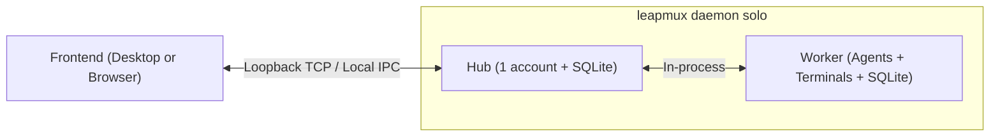
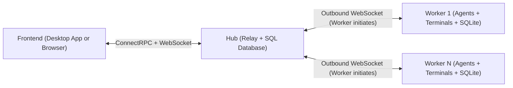
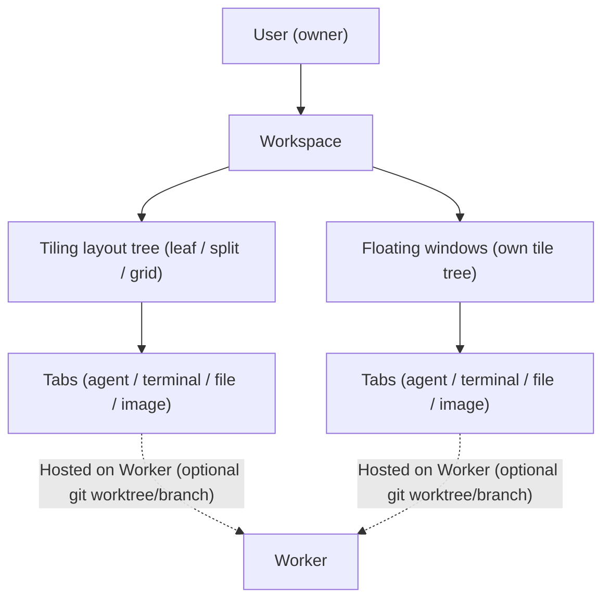

This chapter explains the three components LeapMux is built from, the two shapes you can deploy it in, and the objects you work with every day — workspaces, layouts, tiles, tabs, worktrees, Workers, and encrypted channels. Every concept links to the chapter that covers it in depth.

## The three components

LeapMux has three components. The **Hub** and the **Worker** are roles of one Go binary, `leapmux`. The **Frontend** is a web application that runs in your browser or inside **LeapMux Desktop**. Every running system contains all three; deployment shapes differ only in whether the Hub and Worker share one process.

| Component | Responsibility | Runs where | State it holds |
| --- | --- | --- | --- |
| **Frontend** | Renders the workspace UI: tiling layout, agent chats, terminals, and file browser. | Your browser or the native desktop app. | Keeps a local IndexedDB cache of rendered content for fast display; see [What stays on the browser](/docs/admin/encryption-and-data/#what-stays-on-the-browser). |
| **Hub** | Handles login, workspace metadata, layout sync, Worker registration, and **relays** encrypted Frontend-to-Worker traffic. | A central Go service. | Central database (SQLite by default, or PostgreSQL, MySQL, CockroachDB, YugabyteDB, TiDB). |
| **Worker** | Runs coding agents, pseudo-terminal (PTY) shells, file browsing, and git operations. Auto-reconnects to the Hub after drops. | A Go process on the machine that holds your repositories. | Its own local SQLite database (`worker.db`) and identity file (`state.json`). |

**Your agent transcripts, terminal output, and file contents live on the Worker, never on the Hub.**

This split protects your content while the Hub only observes its database, logs, and relayed ciphertext. The Hub remains trusted for identity, and a web browser trusts it for Frontend code too. A compromised or malicious Hub can open its own channel as you, or serve modified Frontend code to a browser — the desktop app runs its own bundled Frontend, so no Hub can serve it code.


**LeapMux Desktop** packages the Frontend with an embedded `leapmux` binary. It can run a local Hub and Worker in solo mode, or connect to a remote Hub in distributed mode. See [Installation](/docs/getting-started/installation/) and [Ways to Run LeapMux](/docs/getting-started/ways-to-run/).


## The two deployment shapes

LeapMux runs in two deployment shapes. Both use the same components and the same end-to-end encryption (E2EE); they differ in whether the Hub and Worker share a process and how you sign in.

### Solo mode

Solo mode (`leapmux daemon solo`) runs the Hub and Worker **in the same process**, listening on loopback `127.0.0.1:4327` plus a local inter-process communication (IPC) socket. The desktop app connects over local IPC with no login. A browser connecting over TCP sets a password for the `solo` account on first visit, and later TCP visits require that password.

Solo mode is built for one person. End-to-end encryption still runs between Frontend and Worker, but it does not defend against an attacker who already controls your OS user account.


If solo mode listens on a non-loopback address, it logs a warning. Another machine can claim the `solo` account by setting its first password until setup finishes. Set the password from a trusted connection and restrict access with a firewall, VPN, or Secure Shell (SSH) tunnel. The desktop app uses a Unix domain socket or Windows named pipe instead of TCP.


### Distributed mode

For remote machines or multiple users, run a Hub (`leapmux daemon hub`) and one or more Workers (`leapmux daemon worker`) as separate processes. The Hub requires authentication (passwords, passkeys, OAuth, or API tokens) and relays encrypted traffic between Frontends and Workers. **Workers initiate outbound connections to the Hub**, so they run behind firewalls and network address translation (NAT) with no inbound ports open.

Each Worker runs on the machine that holds your repositories (a laptop, a Linux devbox, or a build server). When you open a tab, you pick which Worker hosts it so filesystem and git operations stay local to that machine.

There is also **dev mode** (`leapmux daemon dev`): Hub and Worker in one process, bound to all interfaces (`:4327`), with real password authentication bootstrapped through `/setup`. Use it for development or container testing, not multi-user production.

| Aspect | Solo (`leapmux daemon solo`) | Distributed (`leapmux daemon hub` + `leapmux daemon worker`) |
| --- | --- | --- |
| Processes | One (Hub + Worker together) | Two or more (one Hub, one or more Workers) |
| Default listen | `127.0.0.1:4327` (loopback) plus local IPC | Hub `:4327` (all interfaces); Workers dial out |
| Login | Local IPC: none. TCP: set the `solo` password, then sign in. | Full auth (password, passkey, OAuth, sessions) |
| Workers | One local, in-process | One or more, local or remote, NAT-friendly |
| Multiple user accounts | No | Yes |
| Trust model | Local-host trust | Hub trusted for identity; browser trusts Hub for code; content end-to-end encrypted |

The default TCP port is **4327**. See [Ways to Run LeapMux](/docs/getting-started/ways-to-run/) and [Running LeapMux](/docs/admin/running-leapmux/) for operational guidance.

## The object hierarchy

Everything in the UI fits into one nested hierarchy:

### Ownership

You own everything you create — workspaces, agents, and terminals. Workspace access is strictly owner-only with no sharing or team tenancy; you see only the workspaces you own. See [Accounts & Authentication](/docs/using/accounts/).

### Workspace

A **workspace** is the top-level container for a unit of work. It holds a tiling layout of tabs. One workspace is open at a time, and LeapMux remembers the last workspace you used. The left sidebar groups workspaces into **In progress** and **Archived**. See [Workspaces](/docs/using/workspaces/).

### Layout, tiles, and floating windows

Inside a workspace, the center panel is a recursive **tiling layout**:

- A **tile (leaf)** is a rectangular pane showing a tab bar and its active tab.
- A **split** divides a tile horizontally or vertically with a draggable divider.
- A **grid** arranges a tile into rows and columns.
- A **floating window** lifts a tab out of the layout into a movable, resizable overlay with its own internal tile tree.

You can split, grid, resize, pop tabs out and back in, and drag tabs between tiles or workspaces. See [Tabs & Layout](/docs/using/tabs-and-layout/).

### Tab

A **tab** holds one of four kinds of content:

- **Agent** — a coding-agent chat session (Claude Code, Codex, and other supported providers).
- **Terminal** — a PTY shell session.
- **File** — a file viewer or git diff.
- **Image** — an image returned by an agent, opened for zooming.

Each tab lives on a specific Worker and can be bound to a git worktree and branch. When you create a tab, the Worker stores the resource, commits its tab identity and placement through the Hub, and synchronizes it to all of your open clients while startup completes asynchronously. Retries reuse the same creation identity so transient drops never create duplicate tabs. See [Coding Agents](/docs/using/coding-agents/), [Terminals](/docs/using/terminals/), [File Browser](/docs/using/file-browser/), and [Worktrees & Branches](/docs/using/worktrees-and-branches/).

## Workers: where the work runs

A **Worker** runs your coding agents, terminals, file browsing, and git operations on the machine that holds your code.

- Each Worker keeps its own local SQLite database (`worker.db`), so transcripts and session metadata never touch the Hub.
- Workers dial out to the Hub and reconnect automatically with exponential backoff after drops.
- In distributed mode, you register a Worker once with a single-use registration key minted in the Hub UI (`leapmux daemon worker register --hub https://hub.example.com --registration-key <key>`).

For registering, pinning, and selecting Workers, see [Managing Workers](/docs/admin/managing-workers/).


A tab can be used only while its Worker is online. If the hosting Worker goes offline, channel requests fail until it reconnects.


## End-to-end encrypted channels

All Frontend-to-Worker traffic is **end-to-end encrypted**. While the Hub relays ciphertext over a WebSocket, it cannot decrypt agent transcripts, tool calls, terminal I/O, or file contents.

- By default, channels use a hybrid **post-quantum** handshake combining classical and post-quantum key exchange with authenticated encryption. A **classic** mode is also available when smaller handshake messages are needed.
- The Hub authenticates the channel open and identifies the signed-in user on the channel. The Frontend verifies that identity, and the Worker rejects any channel without one.
- Each Worker has a persistent static keypair pinned by each client via **trust on first use (TOFU)**. If a Worker's presented key changes later, the Frontend blocks the connection and displays a **Worker public key changed** dialog with four-word fingerprints so you can reject or verify out of band.

For trust boundaries, threat analysis, and handshake internals, see [Security & Threat Model](/docs/admin/security/) and [Cryptography](/docs/admin/cryptography/). For Hub encryption at rest, see [Encryption & Data](/docs/admin/encryption-and-data/).

## Persistence

LeapMux is designed to survive disconnects and restarts:

- **Agent sessions** persist in the Worker's local database and re-attach automatically when the Worker reconnects — no manual `--resume`.
- **Terminals** re-attach across disconnects. After a Worker reboot ends the shell process, LeapMux restores the last screen and starts a fresh shell when you press **Enter**.
- **Workspaces, layouts, tabs, and floating windows** persist on the Hub so your layout returns across reloads and devices.

## Presence and device sync

A workspace's layout — tiles, tabs, splits, grids, floating windows, and workspace lifecycle — syncs in near real time across all of your own browser tabs, windows, and devices.

The only presence signal LeapMux tracks is which of your own clients is currently active, so only the window you are looking at plays turn-end notification sounds. There are no avatars, remote cursors, or typing indicators. See [Device Sync](/docs/using/device-sync/).

## Putting it together

1. Connect to your Hub — **LeapMux Desktop** in solo mode connects over local IPC with no login, browser TCP solo prompts for your local `solo` password, and distributed mode signs in to your remote Hub.
2. Open or create a **workspace** from the left sidebar.
3. Arrange **tiles** (splits, grids, or floating windows) and open **tabs** (agents, terminals, file viewers) hosted on any online **Worker**, each in its own git **worktree and branch**.
4. Your Frontend talks to each Worker over an **end-to-end encrypted channel** relayed by the Hub.
5. Agents and terminals keep running when you close the app, and your layout stays synced across your devices.

Continue with [Installation](/docs/getting-started/installation/) or [Quick Start](/docs/getting-started/quick-start/), or look up unfamiliar terms in the [Glossary](/docs/reference/glossary/).
