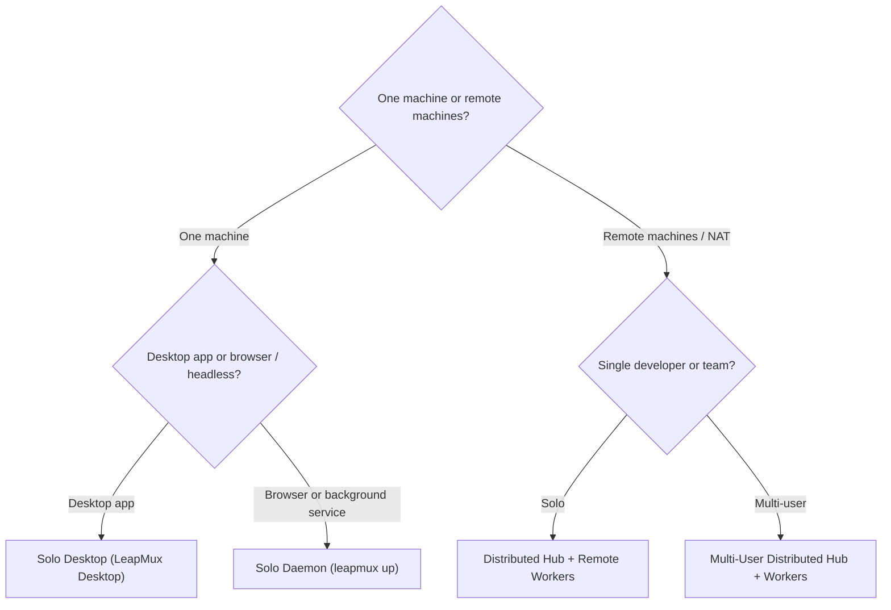
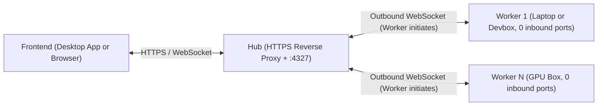

Every LeapMux setup runs the same three components — **Frontend**, **Hub**, and **Worker** — with the same end-to-end encryption (E2EE). Topologies differ only in where those components run, how you sign in, and how many machines hold your repositories.

## Choose your topology

Start with this decision tree to pick the deployment mode that fits your setup today. You can move from Solo to a Distributed Hub later without relearning the app.

### Deployment modes compared

| Mode | Best for | Processes | Network & ports | Login |
| --- | --- | --- | --- | --- |
| **Solo Desktop** | One developer on macOS, Linux, or Windows | Bundled Hub + Worker inside **LeapMux Desktop** | Local inter-process communication (IPC) only; no TCP port opened by default | None (local OS user trust) |
| **Solo Daemon** (`leapmux up`) | One developer using a browser, CLI, or persistent local service | One `leapmux daemon solo` process (Hub + Worker) | Loopback `127.0.0.1:4327` plus local IPC | First browser visit sets the `solo` password |
| **Distributed (Hub + Workers)** | Remote Linux/GPU devboxes behind firewalls, or a team sharing one Hub | One Hub (`daemon hub`) + one or more Workers (`daemon worker`) | Hub listens on `:4327` behind an HTTPS reverse proxy; Workers open zero inbound ports | Passwords, passkeys, OAuth/OIDC, API tokens |
| **Dev** (`leapmux daemon dev`) | All-in-one Docker or remote single-host testing | One process (Hub + Worker) | All interfaces (`:4327`) | Full authentication bootstrapped via `/setup` |

Notes on Solo Desktop:

- By default, closing the **LeapMux Desktop** window quits the app and stops its embedded sidecar's live processes. Enable **Tray icon** / **Menu bar icon** in **Preferences → Desktop** if you want closing the window to hide LeapMux to the tray while live agents and terminals keep running; use **Solo Daemon** (`leapmux up`) or **Distributed** mode when you want agents and shells to keep running across app quits or logouts.
- Cross-device layout sync requires **Network Access** enabled in Solo mode or a **Distributed** Hub.
- The Linux `.AppImage` package bundles no `leapmux` CLI. Use the `.deb` package or the standalone binary on Linux if you want the control CLI or Agent Skills.

## The three components

The **Hub** and the **Worker** are roles of one Go binary (`leapmux`). The **Frontend** runs in your web browser or inside **LeapMux Desktop**.

| Component | Responsibility | Runs where | State it holds |
| --- | --- | --- | --- |
| **Frontend** | Renders workspaces, tiling layouts, agent chats, terminals, and the file browser. | Your browser or **LeapMux Desktop**. | Local client cache for fast rendering; see [Encryption & Data](/docs/admin/encryption-and-data/). |
| **Hub** | Handles sign-in, workspace metadata, layout sync, Worker registration, and encrypted traffic relay. | A central Go service (or embedded in Solo). | Central SQL database (SQLite by default, or PostgreSQL, MySQL, CockroachDB, YugabyteDB, TiDB). |
| **Worker** | Runs coding agents, pseudo-terminal (PTY) shells, file browsing, and git operations. | The machine that holds your repositories. | Its own local SQLite database and Worker identity. |

**Your repositories, agent transcripts, and terminal output live on the Worker, never on the Hub.**

The Hub relays encrypted traffic and cannot read agent chats, terminal output, or files. A compromised Hub still controls identity and could serve modified browser client code unless you run the desktop app (which ships its own Frontend) or pin trusted origins. See [Security & Authentication](/docs/admin/security-and-auth/).

## How outbound Workers work

In Distributed mode — whether one developer with two remote devboxes or a fifty-person team — every Worker **dials out** to the Hub over a persistent WebSocket and reconnects automatically after network drops. Nothing connects inbound to a Worker, so devboxes behind home routers, corporate firewalls, or network address translation (NAT) gateways need zero open inbound ports.

When you open a tab, you choose which Worker hosts it so filesystem and git operations stay local to that machine. You can even register your laptop alongside a remote GPU server on the same Hub and tile local and remote tabs in one workspace. A tab can run only while its hosting Worker is online.

## The object hierarchy

Everything in the LeapMux interface fits into one nested hierarchy:

- **Owner (user account)** — You own every workspace, agent, and terminal you create. Workspaces are strictly owner-only with no cross-user sharing, even on a multi-user Hub. See [Accounts & Connected Apps](/docs/using/accounts-and-apps/).
- **Workspace** — The top-level container for a unit of work, grouped under **In progress** and **Archived** in the left sidebar. See [Workspaces](/docs/using/workspaces/).
- **Tiling layout and floating windows** — Inside a workspace, the center panel arranges panes into **tiles** (a single tab bar and active view), horizontal or vertical **splits**, multi-pane **grids**, and movable **floating windows**. See [Tabs & Layout](/docs/using/tabs-and-layout/).
- **Tab** — Holds an **Agent** chat, a **Terminal** shell, a **File** viewer or git diff, or an **Image** viewer. Each tab runs on a specific Worker and can use its own linked git worktree and branch. Creating a tab saves its placement on the Hub, starts the resource on the Worker, and syncs it to your other open clients.

See [Coding Agents](/docs/using/coding-agents/), [Terminals](/docs/using/terminals/), [File Browser](/docs/using/file-browser/), and [Worktrees & Branches](/docs/using/worktrees-and-branches/).

## End-to-end encrypted channels

All Frontend-to-Worker traffic is **end-to-end encrypted** with a hybrid post-quantum handshake. The Hub relays ciphertext over WebSockets and cannot decrypt agent conversations, tool calls, terminal I/O, or file contents.

Each Worker keeps a persistent static keypair that every client pins via **trust on first use (TOFU)**. If a Worker's presented key ever changes, the Frontend blocks the connection and displays a **Worker public key changed** dialog with four-word fingerprints so you can verify out of band before re-trusting it.

For trust boundaries, authentication rules, handshake details, and Hub encryption at rest, see [Security & Authentication](/docs/admin/security-and-auth/), [Cryptography & Key Architecture](/docs/admin/cryptography/), and [Encryption & Data](/docs/admin/encryption-and-data/).


If Solo Daemon listens on a non-loopback address before setup completes, another host on that network can claim the `solo` account by setting its first password. Set the password over a trusted connection and restrict network access with a firewall, VPN, or Secure Shell (SSH) tunnel.


## Persistence and device sync

LeapMux keeps your work intact across disconnects and restarts:

- **Agent sessions** persist in the Worker's local database and re-attach automatically when the Worker reconnects — no manual `--resume`.
- **Terminals** stay attached across disconnects. After a Worker reboot or Solo Desktop quit ends a shell process, LeapMux restores the last screen and starts a fresh shell when you press **Enter**.
- **Workspaces, layouts, tabs, and floating windows** persist on the Hub and sync in near real time across your own windows and devices (in Distributed mode, or in Solo mode when **Network Access** is enabled).

The only presence signal LeapMux tracks is which of your own windows is active, so only the window you are looking at plays turn-end notification sounds. See [Workspaces — Live sync across devices](/docs/using/workspaces/#live-sync-across-devices).

## Next steps

- [Installation](/docs/getting-started/installation/) — install the desktop app, standalone binary, or Docker image.
- [Quick Start](/docs/getting-started/quick-start/) — launch Solo mode and run two parallel agents in under five minutes.
- [Connect a Remote Devbox Behind NAT](/docs/recipes/remote-devbox/) — attach a remote Linux or GPU machine behind NAT.
- [Production Checklist](/docs/admin/production-checklist/) — prepare a Distributed Hub for daily team use.
- [Glossary](/docs/reference/glossary/) — look up LeapMux terms.
