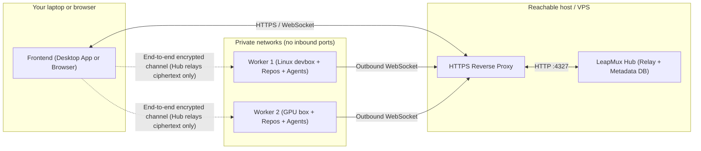

Every LeapMux setup runs the same three components — **Frontend**, **Hub**, and **Worker** — with the same end-to-end encryption (E2EE). What changes between topologies is where those pieces run, how you authenticate, and how many machines hold your repositories.

Use this page to pick the topology that matches your workflow today. You can move from Solo to a Distributed Hub later without relearning the app.

## Compare the four topologies

| Topology | Best for | Processes | Network & ports | Login |
| --- | --- | --- | --- | --- |
| **Solo Desktop** | One developer on macOS, Linux, or Windows | Bundled Hub + Worker inside **LeapMux Desktop** | Local inter-process communication (IPC) only; no TCP port opened | None (local OS user trust) |
| **Solo Browser / CLI** | One developer using a browser or the standalone `leapmux` binary | One `leapmux daemon solo` process (Hub + Worker) | Loopback `127.0.0.1:4327` plus local IPC | First browser visit sets the `solo` password |
| **Remote Workers behind NAT** | One developer driving agents on Linux servers, cloud VMs, or GPU devboxes | One reachable Hub + one or more outbound Workers | Hub listens on `:4327` (behind HTTPS reverse proxy); Workers open **zero** inbound ports | Account password, passkey, or OAuth/OIDC |
| **Multi-User Distributed Hub** | A team sharing one central Hub while keeping each developer's workspaces private | Central Hub (SQLite or external SQL database) + per-user Workers | Hub listens on `:4327` behind HTTPS reverse proxy; Workers dial out | Passwords, passkeys, OAuth/OIDC, per-app OAuth tokens |

## How outbound Workers and encryption work

In any distributed setup — whether one person with two remote devboxes or a fifty-person team — Workers always **dial out** to the Hub over a single persistent WebSocket. Nothing connects inbound to a Worker, so a devbox behind a home router, corporate firewall, or cloud network address translation (NAT) gateway works with no firewall rules or bastion host.

Your code, agent transcripts, and terminal output remain on each Worker's local disk. The Hub stores only workspace titles, layout structure, user accounts, and encrypted control-plane metadata.

## Topology breakdown

### 1. Solo Desktop

Start here if your code lives on your laptop or workstation. **LeapMux Desktop** embeds a local Hub and Worker and communicates over a Unix domain socket or Windows named pipe. It requires no server, no password, and no open TCP ports, and unlocks the **Open in …** button to launch your local editor on any worktree.

### 2. Solo Browser / CLI

Choose this if you prefer running in your regular web browser or already manage services with the standalone `leapmux` binary (`leapmux daemon solo start`). It binds loopback `127.0.0.1:4327` by default. On your first browser visit, you set a password for the single `solo` account so local processes on the machine cannot connect over TCP unauthenticated.

### 3. Remote Workers behind NAT

Choose this when your repositories live on a remote Linux workstation, a beefy build server, or a GPU box — or when you want to reach your desktop from a laptop while traveling. Run one Hub on a small reachable server (or inside Docker behind Caddy/nginx), then register each machine with `leapmux daemon worker register`. You can still register your own laptop as a second Worker on the same Hub so local and remote tabs live in one workspace.

### 4. Multi-User Distributed Hub

Choose this when a team wants one centrally managed Hub with single sign-on (OIDC/OAuth), pluggable SQL storage (PostgreSQL, MySQL, CockroachDB, YugabyteDB, or TiDB), and audit/admin controls. Each user still owns their own workspaces and registers their own Workers — LeapMux never mixes workspaces across accounts.


Running an all-in-one container for quick remote testing? Use `LEAPMUX_MODE=dev` instead of `solo`. `dev` binds `:4327` on all interfaces and uses real authentication through `/setup`, whereas `solo` binds loopback only.


## How to choose

- **All code is on this machine, and you want the fastest start:** Install [LeapMux Desktop](/docs/getting-started/installation/#desktop-app) and follow [Quick Start](/docs/getting-started/quick-start/).
- **You prefer a browser over a desktop app on one machine:** Install the [Standalone binary](/docs/getting-started/installation/#standalone-binary) and run `leapmux daemon solo start`.
- **Your code lives on one or more remote Linux or GPU machines:** Follow the [Connect a Remote Devbox](/docs/recipes/remote-devbox/) recipe.
- **You are deploying a Hub for a team:** Read [Running LeapMux](/docs/admin/running-leapmux/), [Reverse Proxy](/docs/admin/reverse-proxy/), and [Configuration](/docs/admin/configuration/).
