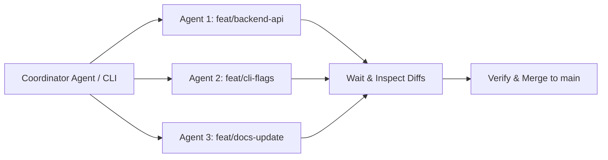

When a feature splits into independent slices — or when you want three providers to attempt the same refactor in parallel — linked git worktrees keep every agent from colliding with the others.



## Prerequisites

- LeapMux running in solo or distributed mode with a git repository on your Worker.
- Optional: install the bundled `leapmux-delegate` skill so your coordinator agent knows this playbook natively. By default skills install to `~/.agents/skills`; Claude Code users pass `--target claude`:

```sh
# Default (~/.agents/skills):
leapmux skill install leapmux leapmux-delegate

# Claude Code (~/.claude/skills):
leapmux skill install leapmux leapmux-delegate --target claude
```

## Prompt your coordinator agent

If you installed `leapmux-delegate`, open one coordinator agent in your repository and invoke `/leapmux-delegate`:

```text
/leapmux-delegate Split this task across three parallel agents in isolated worktrees off main:
1. backend-api: implement the rate-limiter middleware under src/api/ and add unit tests.
2. cli-flags: add the --rate-limit flag under src/cli/ with tests.
3. docs-update: document the rate-limit options in docs/config.md.
Wait without polling, inspect each diff, verify tests pass, and summarize what is ready to merge.
```



## Run the same workflow from the CLI

You can also drive all three agents from a shell or script inside your repository root. First create `.tmp/` and write each assignment to a file so multiline briefs never break shell quoting:

```sh
mkdir -p .tmp

cat <<'EOF' > .tmp/brief-api.md
Implement token-bucket rate-limiter middleware under src/api/ and add unit tests.
EOF

cat <<'EOF' > .tmp/brief-cli.md
Add the --rate-limit flag under src/cli/ and cover flag parsing with tests.
EOF

cat <<'EOF' > .tmp/brief-docs.md
Document the rate-limit configuration and examples in docs/config.md.
EOF
```

Launch three agents in isolated git worktrees branched off `main`:

```sh
A1=$(leapmux agent open --dir . --provider claude --worktree feat/backend-api --base main \
  --name backend-api --no-focus --file .tmp/brief-api.md -q)
A2=$(leapmux agent open --dir . --provider codex --worktree feat/cli-flags --base main \
  --name cli-flags --no-focus --file .tmp/brief-cli.md -q)
A3=$(leapmux agent open --dir . --provider gemini --worktree feat/docs-update --base main \
  --name docs-update --no-focus --file .tmp/brief-docs.md -q)
```

Block until the first agent finishes or asks for permission — no sleep loop needed:

```sh
leapmux agent wait "$A1" "$A2" "$A3" --any --timeout 20m
```

Check whether any agent stopped at a permission prompt (`waiting_for_user`):

```sh
leapmux agent requests
leapmux agent approve "$A1"
```

## Inspect diffs and merge the results

Never merge based on an agent's summary alone. Review each worktree's changes in the right-hand **Files** sidebar or from the command line:



```sh
leapmux worktree list --dir .
WT=$(leapmux worktree get branch:feat/backend-api --dir . -q)
leapmux git diff --base main --dir "$WT"
leapmux worktree inspect "$WT"
```

Merge or cherry-pick the verified commits into your target branch and run the full test suite yourself. Once integrated, close the finished agent tabs and choose what happens to each worktree:

```sh
# Discard temporary worktrees whose commits are already merged (or rejected attempts)
leapmux agent close "$A1" "$A2" "$A3" --worktree discard
```

Pass `--worktree keep` instead to leave a branch and directory on disk for further edits.

## Next steps

- [Agent Skills](/docs/using/agent-skills/) — install all bundled multi-agent playbooks.
- [Worktrees & Branches](/docs/using/worktrees-and-branches/) — learn how dirty-worktree protection works on close.
- [Get a Second-Opinion Review](/docs/recipes/second-opinion-review/) — audit the merged diff with a fresh provider.
