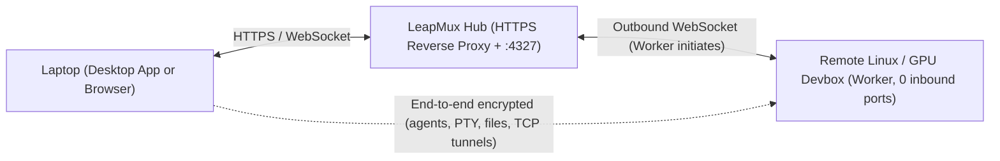

A remote Linux workstation or GPU box often sits behind a home router, corporate firewall, or cloud network address translation (NAT) gateway with no public IP. In LeapMux, Workers always **dial out** to the Hub over one persistent WebSocket, so you open **zero inbound ports** on the devbox.



## Prerequisites

- A reachable LeapMux Hub over HTTPS (see [Installation](/docs/getting-started/installation/#docker) and [Reverse Proxy](/docs/admin/reverse-proxy/)).
- The `leapmux` standalone binary installed on the remote devbox (see [Standalone binary](/docs/getting-started/installation/#standalone-binary)), plus at least one coding-agent command-line interface (CLI) on that box's `PATH`.
- On your laptop, sign in once with the `leapmux` CLI if you want to run the CLI commands below:

```sh
leapmux auth login --hub https://hub.example.com
```

{}

### Mint a registration key on the Hub



Registration keys are single-use and valid for five minutes. Mint one in either of two ways:

- **In the UI:** Open the **Workers** section in the left sidebar and click **`+`** (*Register worker*). Keep the dialog open until registration completes — it prints both the register and start commands.
- **From your laptop CLI** (after `leapmux auth login --hub https://hub.example.com`):

```sh
leapmux worker key create
```

### Register and start the Worker on the devbox

Run these two commands on the remote Linux or GPU machine. A Worker's display name defaults to the machine's OS hostname; pass `--name gpu-box` to `daemon worker start` if you want an explicit name:

```sh
leapmux daemon worker register \
  --hub https://hub.example.com \
  --registration-key <key>

leapmux daemon worker start --name gpu-box
```

The first command generates the Worker's identity keys and pairs it with your Hub. The second command installs and starts the Worker as a background service that reconnects automatically after network drops or reboots.

Confirm from your laptop that the Worker is online and check end-to-end encrypted latency:

```sh
leapmux worker list
leapmux worker ping name:gpu-box
```

### Open an agent and inspect files remotely

In the UI, open **New agent...**, select your remote Worker from the **Worker** menu, pick a repository path on that machine, and choose **Create new worktree**. Or launch it from your laptop's CLI:

```sh
leapmux agent open \
  --worker name:gpu-box \
  --provider claude \
  --dir /home/dev/model-service \
  --worktree feat/cuda-batching \
  --message "Profile the dataloader bottleneck and propose a fix."
```

Agent chats, pseudo-terminal (PTY) shells, and the right-hand **Files** diff viewer all run on `gpu-box` while streaming over the end-to-end encrypted channel.

### Reach a web UI or database on the devbox

Need to open a dev server, Jupyter notebook, or PostgreSQL port running on `gpu-box`? Forward it over the existing encrypted Worker channel without configuring Secure Shell (SSH) tunnels:

```sh
# Run from a local shell on your laptop (NOT inside a LeapMux tab):
leapmux tunnel forward 8888:127.0.0.1:8888 --worker name:gpu-box
```


Always run `leapmux tunnel forward` from a **local shell outside any LeapMux tab**. Running it inside a remote LeapMux terminal opens the listening port on the remote Worker instead of your laptop.


In **LeapMux Desktop**, you can also create port-forward or SOCKS5 tunnels from the Worker's right-click menu in the sidebar.

{}

## Next steps

- [Managing Workers](/docs/admin/managing-workers/) — trust-on-first-use (TOFU) key pinning, reconnect backoff, and deregistration.
- [Concepts & Topologies](/docs/getting-started/concepts/) — compare topologies when adding more machines or teammates.
