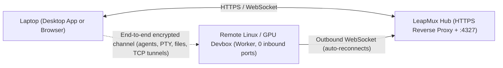

A remote Linux workstation or GPU box often sits behind a home router, corporate firewall, or cloud network address translation (NAT) gateway with no public IP. In LeapMux, Workers always **dial out** to the Hub over one persistent WebSocket, so you open **zero inbound ports** on the devbox.



## Prerequisites

- A reachable LeapMux Hub over HTTPS (see [Installation](/docs/getting-started/installation/#docker) and [Reverse Proxy](/docs/admin/reverse-proxy/)).
- The `leapmux` standalone binary installed on the remote devbox (see [Standalone binary](/docs/getting-started/installation/#standalone-binary)), plus at least one coding-agent CLI (such as `claude` or `codex`) on that box's `PATH`.

## 1. Mint a registration key on the Hub

Registration keys are single-use and valid for five minutes. Mint one in either of two ways:

- **In the UI:** Open the **Workers** section in the left sidebar and click **+** (*Register worker*). Keep the dialog open until registration finishes — it prints both the registration and start commands.
- **From the CLI** (signed in to your Hub via `leapmux auth login --hub https://hub.example.com`):

```sh
leapmux worker key create
```

## 2. Register and start the Worker on the devbox

Run these two commands on the remote Linux or GPU machine:

```sh
leapmux daemon worker register \
  --hub https://hub.example.com \
  --registration-key <key>

leapmux daemon worker start
```

The first command generates the Worker's long-term identity keys, saves credentials in `~/.config/leapmux/worker/state.json` (mode `0600`), and consumes the registration key atomically. The second command installs and starts the Worker as a background service that reconnects automatically after network drops or reboots.

Confirm from your laptop that the Worker is online and check end-to-end encrypted latency:

```sh
leapmux worker list
leapmux worker ping name:gpu-box
```

## 3. Open an agent and inspect files remotely

In the UI, open **New agent...**, select your remote Worker from the **Worker** dropdown, pick a repository path on that machine, and choose **Create new worktree**. Or launch it from your laptop's CLI:

```sh
leapmux agent open \
  --worker name:gpu-box \
  --provider claude \
  --dir /home/dev/model-service \
  --worktree feat/cuda-batching \
  --message "Profile the dataloader bottleneck and propose a fix."
```

Agent chats, terminal shells, and the right-hand **Files** diff viewer all run directly on `gpu-box` while streaming over the end-to-end encrypted channel.

## 4. Reach a web UI or database on the devbox

Need to open a dev server, Jupyter notebook, or Postgres port running on `gpu-box`? Forward it over the existing encrypted Worker channel without configuring SSH tunnels:

```sh
# Forward local 127.0.0.1:8888 to 127.0.0.1:8888 on gpu-box
leapmux tunnel forward 8888:127.0.0.1:8888 --worker name:gpu-box
```

In **LeapMux Desktop**, you can also create port-forward or SOCKS5 tunnels from the Worker's right-click menu in the sidebar.

## Next steps

- [Managing Workers](/docs/admin/managing-workers/) — trust-on-first-use (TOFU) key pinning, reconnect backoff, and deregistration.
- [Ways to Run LeapMux](/docs/getting-started/ways-to-run/) — compare topologies when adding more machines or teammates.
