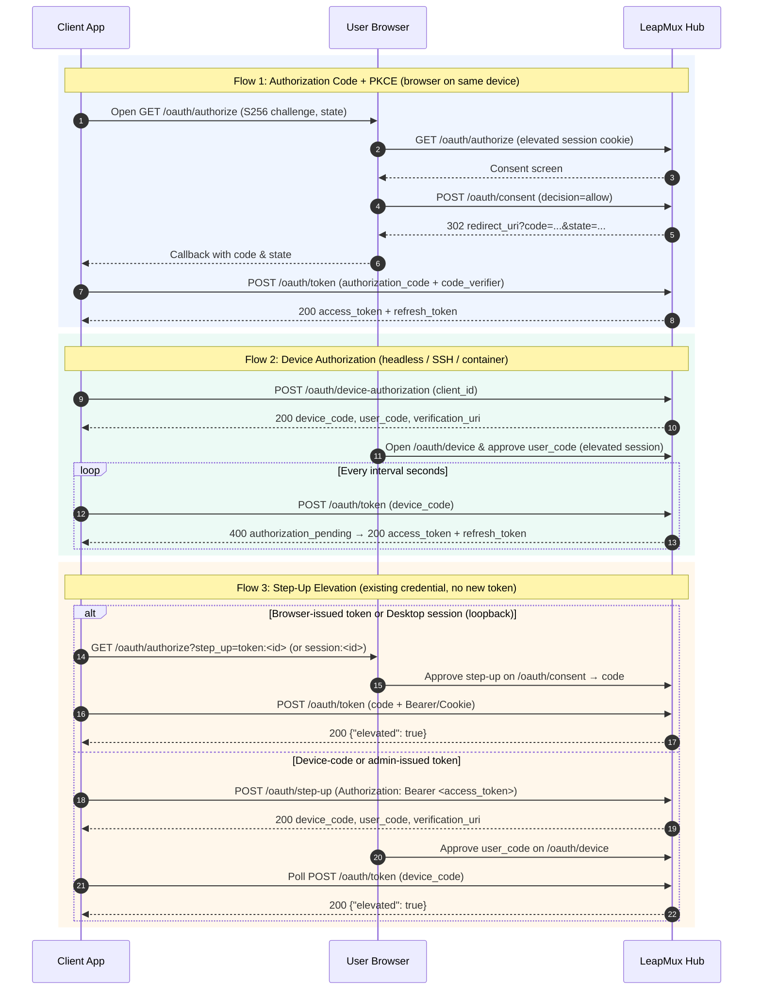

This is the wire-level specification for third-party applications that request access to a LeapMux account. For administrator policies — registering apps, verifying them, and managing scope ceilings — see [App Authorization](/docs/admin/app-authorization/).

A LeapMux Hub implements an OAuth 2.1 authorization server (OAuth 2.1 is an Internet Engineering Task Force (IETF) draft profiling RFC 6749 and RFC 6750), together with RFC 7636 (PKCE), RFC 8252 (native apps), RFC 8628 (device authorization), RFC 7009 (revocation), RFC 7591 (dynamic client registration), RFC 8414 and RFC 9728 (metadata), and RFC 9700 (OAuth 2.0 security best current practice).

## Authorization and elevation flows



## Endpoint summary

| Method & Path | Content-Type | Client / User Auth | Rate Limit | Success Status |
|---|---|---|---|---|
| `GET /.well-known/oauth-authorization-server` | — | None | None | `200 OK` |
| `GET /.well-known/oauth-protected-resource` | — | None | None | `200 OK` |
| `POST /oauth/register` | `application/json` (max 16 KiB) | None (requires `open_app_registration`) | Shared anonymous | `201 Created` |
| `GET /oauth/authorize` | — | Elevated browser session (or local solo IPC) | None | `200 OK` (HTML) or `302 Found` |
| `POST /oauth/consent` | `application/x-www-form-urlencoded` | Elevated browser session (or local solo IPC) | None | `302 Found` |
| `POST /oauth/device-authorization` | `application/x-www-form-urlencoded` | Client auth (hub-wide apps only) | Shared anonymous | `200 OK` |
| `GET`, `POST /oauth/device` | — / `application/x-www-form-urlencoded` | Elevated browser session (or local solo IPC) | None | `200 OK` (HTML) |
| `POST /oauth/token` | `application/x-www-form-urlencoded` | Client auth (+ target Bearer or Cookie for step-up codes) | Shared anonymous | `200 OK` |
| `POST /oauth/step-up` | `application/x-www-form-urlencoded` (optional) | `Authorization: Bearer <access_token>` (API token) | Shared anonymous | `200 OK` |
| `POST /oauth/revoke` | `application/x-www-form-urlencoded` | Client auth for API tokens; none for delegation tokens | Shared anonymous | `200 OK` |
| `GET /oauth/apps/<client_id>/icon` | — | None (verified apps only) | Shared anonymous | `200 OK` |

## Discovery

Fetch the metadata documents first instead of hard-coding endpoint URLs:

```text
GET /.well-known/oauth-authorization-server
GET /.well-known/oauth-protected-resource
```

Both documents are unauthenticated and return `Cache-Control: no-store`. If the Hub cannot determine its base URL (`public_url` unset and no TCP listener), both return `503` `server_error`.

Key metadata guarantees:

- `code_challenge_methods_supported` is always `["S256"]`.
- `response_types_supported` is always `["code"]`.
- `authorization_response_iss_parameter_supported` is `false` — the Hub does not emit the RFC 9207 `iss` parameter on authorization responses.
- `registration_endpoint` is omitted while `open_app_registration` is off (the default), so conformant client libraries do not call `/oauth/register` on a Hub that refuses it.

## Client registration

Every authorization request requires a registered `client_id`. Register an app through **Preferences → Apps**, via `leapmux admin app`, or dynamically through `POST /oauth/register` when `open_app_registration` is enabled.

- **Public clients** (`token_endpoint_auth_method: "none"`) hold no secret and rely on PKCE. Use this type for CLIs, desktop apps, and browser apps.
- **Confidential clients** (`client_secret_basic` or `client_secret_post`) hold a server-side secret returned once at registration.

Consent screens display the app's name and, for verified apps only, an icon served same-origin from `/oauth/apps/<client_id>/icon`. Unverified apps show a monogram.

### Dynamic registration (`POST /oauth/register`)

Accepts `application/json` with a hard **16 KiB** (`16384` bytes) body limit; larger payloads return `413` `invalid_client_metadata`. When `open_app_registration` is off, the endpoint returns `403` `access_denied`.

Dynamically registered apps are always hub-wide and unverified, cannot request `admin:*` scopes (rejected with `400` `invalid_client_metadata`), and have `elevation_allowed` forced to `false`.

**Request fields (`application/json`)**

| Field | Type | Required | Constraints |
|---|---|---|---|
| `client_name` | string | Yes | Display name shown on the consent screen (max 128 bytes after cleanup). |
| `redirect_uris` | string[] | Conditional | Required if `grant_types` includes `authorization_code`. Max 16 unique URIs (see [Redirect addresses](#redirect-addresses)). |
| `grant_types` | string[] | No | Defaults to `["authorization_code", "refresh_token"]`. Supported: `authorization_code`, `refresh_token`, `urn:ietf:params:oauth:grant-type:device_code`. |
| `scope` | string | Yes | Space-delimited permission ceiling (at least one scope; any `admin:*` scope is rejected). |
| `client_uri` | string | No | App homepage URL (max 512 bytes). |
| `token_endpoint_auth_method` | string | No | `"none"` (default), `"client_secret_basic"`, or `"client_secret_post"`. Unknown values return `400` `invalid_client_metadata`. |

**Response fields (`201 Created`, `application/json`)**

| Field | Type | Presence | Description |
|---|---|---|---|
| `client_id` | string | Always | Hub-generated client identifier. |
| `client_secret` | string | Confidential only | One-time secret; the Hub stores only its hash. |
| `client_id_issued_at` | integer | Always | Unix timestamp (seconds) when the client was created. |
| `client_name` | string | Always | Accepted display name. |
| `redirect_uris` | string[] | Always | Accepted redirect URIs. |
| `grant_types` | string[] | Always | Accepted grant types. |
| `scope` | string | Always | Closed permission ceiling (including implied scopes). |
| `client_uri` | string | If set | Accepted app homepage URL. |
| `token_endpoint_auth_method` | string | Always | Effective client authentication method. |

## Redirect addresses

Registration enforces all of these rules on `redirect_uris`:

- **Count and uniqueness:** At most **16** redirect URIs per app; duplicate entries are rejected.
- **Syntax:** Every URI must be absolute (with a scheme), contain no fragment (`#`), no wildcard (`*`), and no whitespace or control characters.
- **Non-loopback web URIs:** Must use `https://`. Plain `http://` is rejected for non-loopback hosts.
- **Loopback URIs:** `127.0.0.1` and `localhost` must use `http://` or `https://`. IPv6 literals such as `[::1]` are rejected at registration because the consent page's Content Security Policy (`form-action`) cannot represent an IPv6 host.
- **Native private-use schemes:** Supported per RFC 8252 section 7.1 when the URI has no host and a reverse-domain scheme containing a dot (for example, `com.example.app:/cb`).

At authorization time, `redirect_uri` is compared literally against the registered list with one exception per RFC 8252 section 7.3: for a registered **loopback** URI (`127.0.0.1` or `localhost`), **any port matches**. The **scheme** (case-insensitive), **host**, **escaped path** (compared without percent-decoding), and **raw query** must still match exactly, and no fragment is allowed.

## Authorization code with PKCE

Use this flow for any client that can open a browser:

```text
GET /oauth/authorize
  ?client_id=<id>
  &response_type=code
  &redirect_uri=<registered address>
  &state=<opaque, required>
  &code_challenge=<BASE64URL(SHA256(verifier))>
  &code_challenge_method=S256
  &scope=<space-delimited, optional>
  &installation_name=<label for this copy of the app, optional>
  &step_up=<session:<session id> or token:<api token id>, optional>
```

- `state` is **required**.
- `code_challenge_method` must be `S256` (`plain` is rejected), and both `code_challenge` and `code_verifier` must be 43–128 characters from the RFC 7636 unreserved set.
- Omitting `scope` requests the app's registered ceiling minus all `admin:*` scopes. Admin scopes must be requested explicitly.
- Passing `step_up` (`session:<id>` or `token:<id>`) requests an elevation window on an existing credential owned by the approving user and issued to the requesting app. `scope` must then be empty, and the app registration must allow elevation.

The Hub renders the consent screen at `GET /oauth/authorize`, and the browser submits the user's decision to `POST /oauth/consent`. Both routes require an elevated browser session (or solo local IPC). Proxies in front of the Hub must allow both routes.

After the Hub verifies `client_id` and `redirect_uri`, it redirects the browser back with either a one-shot code or an error:

```text
<redirect_uri>?code=<one-shot code>&state=<echoed>
<redirect_uri>?error=access_denied&error_description=...&state=<echoed>
```

If `client_id` or `redirect_uri` is invalid, the Hub displays an error page on its own origin and does not redirect.

Exchange the code within :

```text
POST /oauth/token
  grant_type=authorization_code
  client_id=<id>
  code=<code>
  code_verifier=<the verifier>
  redirect_uri=<the exact redirect_uri from authorization>
```

Confidential clients also authenticate with HTTP Basic or `client_secret` in the form body. To redeem a step-up code, also send the target credential: the target session cookie in `Cookie`, or the target access token in `Authorization: Bearer <access_token>` (a confidential client presenting a bearer sends `client_secret` in the form body).

**One-shot consumption and replay revocation:** A successful exchange consumes the code. Replaying a consumed code is rejected with `400` `invalid_grant`; if the replay passes client authentication and matches the original `redirect_uri` and PKCE verifier while the code row still exists, the Hub revokes the credential issued by the first exchange (RFC 6749 section 4.1.2).

| Code kind | Response |
|---|---|
| Standard authorization code | `200 OK` with [the token response](#the-token-response). |
| Sign-in code for built-in `leapmux-desktop` | `200 OK` with `{"signed_in": true}` and a new Desktop session cookie in `Set-Cookie` (starts without an elevation window). |
| Step-up code with matching target credential | `200 OK` with `{"elevated": true}`. Opens an elevation window on the existing credential and issues no new token. |
| Step-up code with missing or rejected credential | `401` `invalid_token`. The code stays valid so the client can retry. |
| Step-up code with mismatched credential or un-elevatable target | `400` `invalid_grant`. The code stays valid. |

## Device authorization

Use this flow on headless servers, SSH sessions, and containers without a local browser.

### Starting device authorization (`POST /oauth/device-authorization`)

Because this request carries no user session, it serves **hub-wide apps only**. Submitting a private app's `client_id` is refused with `400` `invalid_client`. Apps not registered for `urn:ietf:params:oauth:grant-type:device_code` receive `400` `unauthorized_client`.

**Request fields (`application/x-www-form-urlencoded`)**

| Field | Required | Description |
|---|---|---|
| `client_id` | Yes | Registered client ID (or supplied via HTTP Basic for confidential apps). |
| `client_secret` | Confidential only | Client secret in form body or HTTP Basic header. Public apps must not send a secret. |
| `scope` | No | Space-delimited scopes within the app ceiling. Defaults to the ceiling minus `admin:*` scopes. |
| `installation_name` | No | Label for this copy of the app (max 128 bytes after cleanup). |

**Response fields (`200 OK`, `application/json`)**

| Field | Type | Description |
|---|---|---|
| `device_code` | string | Secret polling handle for `/oauth/token`. |
| `user_code` | string | Short human-entry code formatted as `XXX-XXX`. |
| `verification_uri` | string | Hub activation page URL (`<hub>/oauth/device`). |
| `verification_uri_complete` | string | `<hub>/oauth/device?user_code=XXX-XXX` (carries no scope parameters). |
| `expires_in` | integer | Grant lifetime in seconds (`600`). |
| `interval` | integer | Minimum polling interval in seconds (`5`). |

A device grant requesting any `admin:*` scope requires a second confirmation click on `/oauth/device` before binding. Denying a grant (or submitting without approval) is final.

### Polling for the token

Poll `POST /oauth/token` no faster than `interval` seconds:

```text
POST /oauth/token
  grant_type=urn:ietf:params:oauth:grant-type:device_code
  client_id=<id>
  device_code=<device_code>
```

| Error code (`400`) | Meaning |
|---|---|
| `authorization_pending` | User has not answered yet. Continue polling. |
| `slow_down` | Polled faster than `interval`. Wait longer before the next poll. |
| `access_denied` | User refused. Stop polling. |
| `expired_token` | Grant expired after . Start a new flow. |

## The token response

```json
{
  "access_token": "lmx_a...",
  "refresh_token": "lmx_a...",
  "token_type": "Bearer",
  "expires_in": 3600,
  "refresh_expires_in": 7776000,
  "scope": "workspace:read worker:read file:read",
  "token_id": "...",
  "user_id": "...",
  "username": "..."
}
```

`scope` reports what the credential can actually reach: the granted scopes (including implied scopes) intersected with the app's current registered ceiling. The Hub evaluates that intersection on every request, so shrinking an app's ceiling narrows existing credentials immediately without rewriting stored consent.

Present the access token in the header `Authorization: Bearer <access_token>`. Bearer tokens are never accepted in query parameters or form bodies.

## Refreshing

```text
POST /oauth/token
  grant_type=refresh_token
  client_id=<id>
  refresh_token=<refresh_token>
  scope=<optional, to narrow>
```

Refresh tokens **rotate** on every exchange, retiring the previous token. Presenting a retired refresh token after a 60-second grace window indicates token reuse or theft, so the Hub revokes the entire credential per **OAuth 2.1 / RFC 9700 section 4.14.2**.

An optional `scope` parameter may only narrow what the credential currently reaches; requesting a scope outside the grant or outside the app's current ceiling returns `400` `invalid_scope`.

A credential refreshes for up to  from its last rotation and expires permanently  after the consent that created it (`400` `invalid_grant`).

## Revocation

```text
POST /oauth/revoke
  token=<full access or refresh token>
  client_id=<id>                    # required for public app credentials
  client_secret=<secret>            # or HTTP Basic, for confidential app credentials
```

Revocation follows RFC 7009 with strict ownership checks and non-disclosure:

1. A missing `token` parameter returns `400` `invalid_request`; a malformed form body returns plain-text `400`.
2. If the request includes client credentials (HTTP Basic or `client_id`), the Hub authenticates that client first and rejects bad credentials with `401` `invalid_client`.
3. Next, the Hub verifies the full presented token secret (a `token_id` alone revokes nothing). If the token is invalid, the Hub returns **`200 OK`** without leaking token validity — including for unauthenticated requests.
4. If the token is a valid app credential, the Hub checks app ownership **after** token verification:
   - If the owning app was already retired, the Hub returns `200 OK` idempotently.
   - If an authenticated client submits another app's token, the Hub rejects it with **`400` `invalid_grant`** when the owning app is public, or **`401` `invalid_client`** when the owning app is confidential.
   - If no client identity was presented, the Hub rejects it with `400` `invalid_request` (public owner) or `401` `invalid_client` (confidential owner).
5. If the token is a delegation token, it has no owning app and the full secret alone revokes it (`200 OK`).

## Step-up elevation

Sensitive operations require a recently proven factor. A credential without an active elevation window receives `FAILED_PRECONDITION` with the `Leapmux-Elevation-Required: 1` header. Both step-up ceremonies require the app's registration to have `elevation_allowed` enabled; see [Security & Authentication](/docs/admin/security-and-auth/).

| Credential type | Ceremony |
|---|---|
| App credential issued via `device_code` or by an administrator | Call `POST /oauth/step-up` and poll `/oauth/token` with `device_code`. |
| App credential issued via `authorization_code` (such as default `leapmux auth login`) | Loopback ceremony via `GET /oauth/authorize?step_up=token:<token_id>`. |
| LeapMux Desktop session | Loopback ceremony via `GET /oauth/authorize?step_up=session:<session_id>`. |

### Starting device-code step-up (`POST /oauth/step-up`)

**Request**

| Location & Field | Required | Description |
|---|---|---|
| Header `Authorization` | Yes | `Bearer <access_token>` of the app credential to elevate. |
| Form `installation_name` | No | Optional label carried on the grant (the activation page always displays the Hub's stored record for the credential). |

**Responses**

| Status & Error Code | Meaning |
|---|---|
| `200 OK` | Returns the same six JSON fields as `/oauth/device-authorization` (`device_code`, `user_code`, `verification_uri`, `verification_uri_complete`, `expires_in`, `interval`). Poll `/oauth/token` until it returns `{"elevated": true}`. |
| `401` `invalid_token` | Missing, malformed, expired, or revoked bearer token. |
| `403` `insufficient_scope` | Credential is forbidden from requesting verification. |
| `400` `unsupported_credential` | Presented bearer is not an API token (for example, a delegation token). |
| `403` `unauthorized_client` | The app's registration does not allow elevation (`elevation_allowed` is `false`). |
| `400` `browser_step_up_required` | The credential was issued via `authorization_code` and must elevate through the browser loopback ceremony. |
| `503` `server_error` | Hub cannot determine its base URL (`public_url` unset and no TCP listener). |

## Errors and rate limits

OAuth JSON error responses follow RFC 6749 section 5.2:

```json
{ "error": "invalid_grant", "error_description": "code expired or already consumed" }
```

HTTP status codes across the OAuth endpoints:

| HTTP Status | Error shape | When returned |
|---|---|---|
| `400` (JSON) | RFC 6749 `{"error": ...}` | Grant, request, scope, or client-metadata errors (`invalid_grant`, `invalid_request`, `invalid_scope`, `unauthorized_client`, `unsupported_grant_type`, `authorization_pending`, `slow_down`, `access_denied`, `expired_token`, `unsupported_credential`, `browser_step_up_required`), and `invalid_client` on `/oauth/device-authorization` when called for a private app. |
| `400` (plain text) | `bad form` | Malformed `application/x-www-form-urlencoded` body on form endpoints (`/oauth/token`, `/oauth/device-authorization`, `/oauth/revoke`, `/oauth/consent`, `/oauth/device`). |
| `401` (JSON) | `invalid_client` or `invalid_token` | Failed client authentication (`invalid_client`) on `/oauth/token`, `/oauth/device-authorization`, or `/oauth/revoke` (including confidential owner mismatch); missing or rejected credential (`invalid_token`) when redeeming a step-up code on `/oauth/token` or calling `/oauth/step-up`. Includes `WWW-Authenticate`. |
| `403` (JSON) | `access_denied`, `insufficient_scope`, `unauthorized_client` | Disabled open registration on `/oauth/register`, or forbidden/disallowed step-up on `/oauth/step-up`. |
| `413` (JSON) | `invalid_client_metadata` | `POST /oauth/register` JSON body exceeds 16 KiB. |
| `429` (JSON) | `slow_down` | Shared per-address anonymous rate limit exceeded (`rate_limit.oauth_anonymous`). |

The six anonymous-surface endpoints — `/oauth/device-authorization`, `/oauth/token`, `/oauth/revoke`, `/oauth/register`, `/oauth/step-up`, and `/oauth/apps/<client_id>/icon` — share one per-client-address rate-limit budget (`rate_limit.oauth_anonymous`), counting admitted requests rather than failures.

## See also

- [App Authorization](/docs/admin/app-authorization/) — registering, verifying, and scoping apps
- [Accounts & Connected Apps](/docs/using/accounts-and-apps/) — user-facing consent and disconnection
- [Security & Authentication](/docs/admin/security-and-auth/) — session elevation and token lifetimes
- [CLI Guide](/docs/using/cli-guide/) — reference client implementation built into `leapmux`
