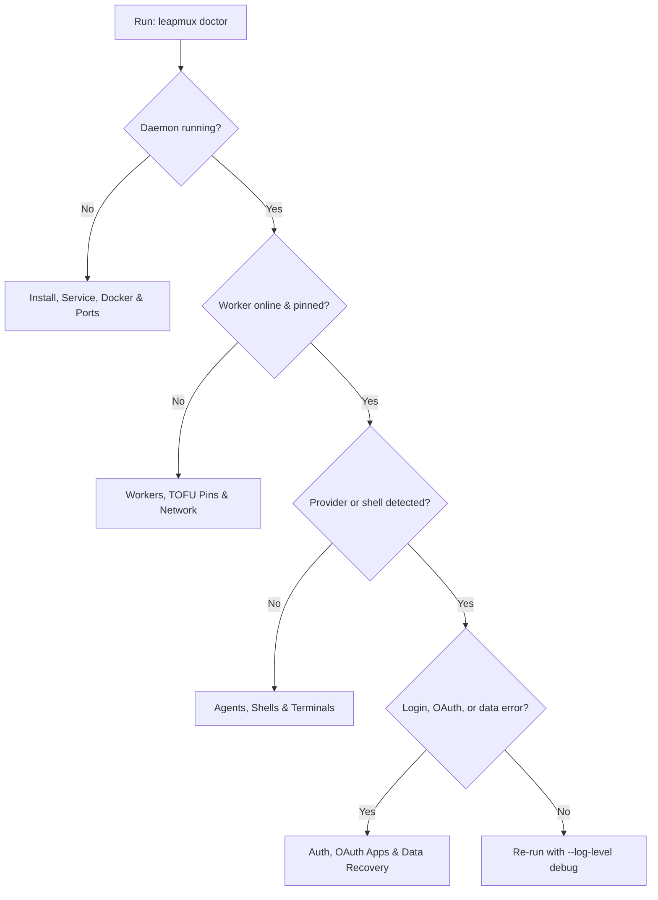

Use this triage flow to pinpoint which layer failed, then jump directly to the matching fix.

## Start here: triage flow

Run these three commands first to narrow down the failing layer:

1. **`leapmux doctor`** — checks local daemons, Hub connectivity, CLI login, Worker key pins, and online Workers.
2. **`leapmux daemon <mode> status`** — reports process state, readiness, browser URL, Worker registration, Hub connection state, and the latest failure log path (pass the instance's `--data-dir` or `--config`).
3. **`leapmux agent providers`** — lists coding-agent providers detected on the selected Worker (add `--worker name:<name>` to check a specific Worker).

## Symptom quick-jump

| Symptom | First command or check | Fix |
|---|---|---|
| macOS Solo mode asks for Full Disk Access | Open **System Settings → Privacy & Security → Full Disk Access** | [macOS Full Disk Access required](/docs/reference/troubleshooting/install-and-desktop/#macos-full-disk-access-required) |
| `start` or `restart` prints `Startup wait expired` | `leapmux daemon <mode> status` | [Startup wait expired](/docs/reference/troubleshooting/install-and-desktop/#startup-wait-expired) |
| Login startup fails over SSH on Linux | `leapmux daemon hub start --startup=boot` | [Login startup fails on headless Linux](/docs/reference/troubleshooting/install-and-desktop/#login-startup-fails-on-headless-linux) |
| Automation script fails on consent prompt | `leapmux daemon worker start --startup=boot --yes` | [Script fails on noninteractive setup](/docs/reference/troubleshooting/install-and-desktop/#script-fails-on-noninteractive-setup) |
| Windows service fails after password change | `leapmux daemon <mode> enable` | [Service fails after Windows password change](/docs/reference/troubleshooting/install-and-desktop/#service-fails-after-windows-password-change) |
| `status` says native service definition is missing or differs | `leapmux daemon <mode> enable` | [Service definition missing or modified](/docs/reference/troubleshooting/install-and-desktop/#service-definition-missing-or-modified) |
| `stop` prints `Shutdown could not be confirmed.` | `leapmux daemon <mode> status` | [Shutdown could not be confirmed](/docs/reference/troubleshooting/install-and-desktop/#shutdown-could-not-be-confirmed) |
| `start`, `disable`, or `deregister` refuses while running | `leapmux daemon <mode> stop` (or `restart`) | [Command refuses while instance is running](/docs/reference/troubleshooting/install-and-desktop/#command-refuses-while-instance-is-running) |
| Data directory belongs to another instance | `leapmux daemon <mode> status --data-dir <path>` | [Data directory belongs to another instance](/docs/reference/troubleshooting/install-and-desktop/#data-directory-belongs-to-another-instance) |
| Docker container exits immediately (`LEAPMUX_MODE`) | `docker logs <container>` | [Container exits immediately](/docs/reference/troubleshooting/install-and-desktop/#container-exits-immediately) |
| Worker Docker container exits unregistered | `docker exec <container> /usr/local/bin/leapmux daemon worker status --data-dir /data/worker` | [Worker container is unregistered](/docs/reference/troubleshooting/install-and-desktop/#worker-container-is-unregistered) |
| `LEAPMUX_HUB_STORAGE_*` env vars are ignored | Check `hub.yaml` or `--storage-*` flags | [Storage env vars are ignored](/docs/reference/troubleshooting/install-and-desktop/#storage-env-vars-are-ignored) |
| Port `4327` is already in use | `leapmux daemon hub restart --listen :4400` | [Port 4327 already in use](/docs/reference/troubleshooting/install-and-desktop/#port-4327-already-in-use) |
| Connection refused from another machine | Check `--listen` (solo binds `127.0.0.1:4327`) | [Connection refused from another machine](/docs/reference/troubleshooting/install-and-desktop/#connection-refused-from-another-machine) |
| Blank page in local source development | `task dev` or `task dev-solo` | [Blank UI in source development](/docs/reference/troubleshooting/install-and-desktop/#blank-ui-in-source-development) |
| Worker reports unregistered | `leapmux daemon worker register --hub <url> --registration-key <key>` | [Worker is unregistered](/docs/reference/troubleshooting/workers-and-network/#worker-is-unregistered) |
| Registration key rejected as invalid or consumed | `leapmux admin worker reg-key list` | [Registration key invalid or already used](/docs/reference/troubleshooting/workers-and-network/#registration-key-invalid-or-already-used) |
| `worker register` reports pending or existing registration | `leapmux daemon worker status` | [Pending registration already exists](/docs/reference/troubleshooting/workers-and-network/#pending-registration-already-exists) |
| Worker runs but stays offline | `leapmux daemon worker logs -n 100` | [Worker runs but stays offline](/docs/reference/troubleshooting/workers-and-network/#worker-runs-but-stays-offline) |
| Worker fails with `HTTP 426` or idle EOF behind a proxy | `leapmux daemon worker logs -f` | [Worker fails through a reverse proxy](/docs/reference/troubleshooting/workers-and-network/#worker-fails-through-a-reverse-proxy) |
| Worker reconnect loops on `HTTP 401` or `403` | `leapmux daemon worker status` | [Repeated HTTP 401 or 403 on reconnect](/docs/reference/troubleshooting/workers-and-network/#repeated-http-401-or-403-on-reconnect) |
| Hub refuses Worker public keys or keypair is unusable | `leapmux daemon worker deregister` | [Hub refused Worker public keys](/docs/reference/troubleshooting/workers-and-network/#hub-refused-worker-public-keys) |
| Sidebar shows Worker disconnected while Hub shows online | Open an agent or terminal on that Worker | [Sidebar shows Worker disconnected](/docs/reference/troubleshooting/workers-and-network/#sidebar-shows-worker-disconnected) |
| **"Worker public key changed"** dialog or CLI pin abort | `leapmux worker pins list` | [Browser shows "Worker public key changed"](/docs/reference/troubleshooting/workers-and-network/#browser-shows-worker-public-key-changed) |
| Sessions or rate limits show proxy IP | Check **Trusted reverse proxies** | [Sessions show reverse proxy IP](/docs/reference/troubleshooting/workers-and-network/#sessions-show-reverse-proxy-ip) |
| Login cookies do not persist behind TLS proxy | `leapmux admin settings get public_url` | [Login cookies do not persist behind a proxy](/docs/reference/troubleshooting/workers-and-network/#login-cookies-do-not-persist-behind-a-proxy) |
| Agent provider missing from picker / `"No agents available"` | `leapmux agent providers` | [Agent provider missing from picker](/docs/reference/troubleshooting/agents-and-terminals/#agent-provider-missing-from-picker) |
| ZCode missing or reports not configured | Check `zcode` on `PATH` and `~/.zcode/v2/config.json` | [ZCode missing from picker](/docs/reference/troubleshooting/agents-and-terminals/#zcode-missing-from-picker) |
| Agent fails to start or Cline rejects `providers.json` | Run the provider CLI directly on the Worker | [Agent fails to start](/docs/reference/troubleshooting/agents-and-terminals/#agent-fails-to-start) |
| Changing a setting restarts the agent | Wait for restart to complete | [Setting change restarts the agent](/docs/reference/troubleshooting/agents-and-terminals/#setting-change-restarts-the-agent) |
| `leapmux` inside a tab says `no hub selected` | `env \| grep LEAPMUX_CONTROL` | [CLI inside a tab cannot find the Hub](/docs/reference/troubleshooting/agents-and-terminals/#cli-inside-a-tab-cannot-find-the-hub) |
| Terminal stops accepting input and offers restart | Press **Enter** in the terminal | [Terminal exited and offers a restart](/docs/reference/troubleshooting/agents-and-terminals/#terminal-exited-and-offers-a-restart) |
| Expected shell missing in **New terminal** | `leapmux terminal shells` | [Expected shell missing in New terminal](/docs/reference/troubleshooting/agents-and-terminals/#expected-shell-missing-in-new-terminal) |
| Redirected to `/setup` or `"Sign-up disabled"` | `leapmux admin settings get signup_enabled` | [Redirected to /setup](/docs/reference/troubleshooting/auth-and-data/#redirected-to-setup) |
| Invalid credentials, passkey failure, or email verification block | `leapmux admin user reset-password <user>` | [Invalid username or password](/docs/reference/troubleshooting/auth-and-data/#invalid-username-or-password) |
| OAuth sign-in fails or provider button is hidden | `leapmux admin idp list` | [OAuth sign-in fails or provider is hidden](/docs/reference/troubleshooting/auth-and-data/#oauth-sign-in-fails-or-provider-is-hidden) |
| OAuth app hangs, gets `permission_denied`, `invalid_grant`, or step-up refusal | `leapmux auth status` | [Consent page never appears](/docs/reference/troubleshooting/auth-and-data/#consent-page-never-appears) |
| Workspaces or accounts vanish after restart | Verify `/data` volume or `--data-dir` | [Data disappears between restarts](/docs/reference/troubleshooting/auth-and-data/#data-disappears-between-restarts) |
| Hub fails to start or decrypt after restoring a backup | Check `encryption.key` matches the database backup | [Hub fails to start or decrypt after restore](/docs/reference/troubleshooting/auth-and-data/#hub-fails-to-start-or-decrypt-after-restore) |

## Guides by area


  
  
  
  


## Still stuck?

- Restart the Hub or Worker with `--log-level debug` for verbose logs.
- Check version alignment with `leapmux version`.
- Review the [FAQ](/docs/reference/faq/), [Glossary](/docs/reference/glossary/), and [CLI Reference](/docs/reference/cli-reference/).
- If you suspect a bug, [open a GitHub issue](https://github.com/leapmux/leapmux/issues) with your `leapmux version`, run mode, and relevant `--log-level debug` logs.
