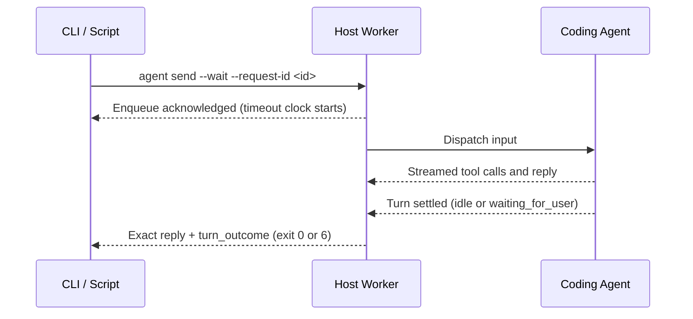

This chapter covers the behavior and mechanics behind reliable automation with `leapmux`: event-driven agent and terminal waits, JSON Schema-validated replies, idempotent retries, resumable event streams, user notifications, managed-tab IPC internals, and raw protobuf RPCs.

For authentication, Hub auto-discovery, target selectors, output formats, exit codes, and safety guards, see [Control CLI](/docs/using/control-cli/). For the full flag tables of every command, see the [Control Command Reference](/docs/reference/commands/).

## Exact agent waits and structured replies

### Driving agents and input queues

- `agent list` and `agent get` print each agent's state (`idle`, `working`, `waiting_for_user`), model, effort, and git state. `agent get` also prints current provider settings; add `--options` to show every option group and its choices in text (`--json` includes the catalog automatically).
- `agent send <agent> [text]` takes the message as an argument, `-` for standard input, or `--file <path>`. Four flags control delivery:
  - `--attach <file>` attaches a file (repeatable). A message with an attachment needs no text. The CLI refuses unreadable files, more than 100 files, or payloads whose text and attachments exceed 10 MiB combined. The Worker infers each file's media type and rejects files the provider cannot read with `invalid_argument`, identifying the file.
  - `--at <time>` holds the message in the queue until an RFC 3339 timestamp with an offset (`2026-11-20T09:00:00+09:00` or `2026-11-20T00:00:00Z`) or a relative offset (`+10m`, `+1h30m`). Timestamps without an offset or in the past fail with `usage`. The output reports the UTC schedule as `scheduled_at`.
  - `--steer` injects the message into a steerable active turn immediately; `--preempt` interrupts the active turn so the message dispatches next.
  - `--request-id <id>` makes retries idempotent; see [Safe retries with `--request-id`](#safe-retries-with---request-id).
- **Agent-to-agent sender attribution.** A message sent from inside an agent tab arrives as that agent's message, never as the operator's. The recipient receives a header line such as `[Message from agent "Release captain" (Claude Code), not from your operator]` reflecting the sender's tab title at send time. The Worker derives the sender from the tab's credentials, so no flag can spoof or hide it.
  - An agent sending a message to itself (such as a scheduled `--at` reminder) still receives it as its own message.
  - From an agent tab, the Worker accepts only a message, a clear, or a compaction; other input kinds fail with `invalid_argument` (including via `leapmux rpc`).
  - Cross-Worker messages preserve sender identity because the host Worker relays the tab identity and the Hub authenticates the relay.
  - Messages sent from a terminal tab or outside LeapMux arrive as the operator's.
- `agent sessions` lists earlier sessions that `agent open --resume <session>` can continue for one provider and directory, newest first. It merges LeapMux records with the provider's native store, omits sessions currently open in a tab, and prints bare IDs with `-q`.
- `agent clear <agent>` queues a fresh-session restart in the same tab (preserving prior transcript rows and recovering failed starts). `agent compact <agent>` queues context compaction (sending `/compact` when the provider lacks a native compaction command). Both wait in the input queue behind earlier items; subagents reject both with `invalid_argument`.
- `agent messages` prints the latest page by default (`--anchor latest`). Use `--anchor oldest`, `--anchor before --cursor-seq N`, or `--anchor after --cursor-seq N` to paginate in ascending `seq` order. `--follow` streams new messages as they arrive (with automatic reconnect) and accepts `--anchor latest` or `--anchor after`. Messages from another agent display `from agent 87a19d5f (claude-code)` in text and include `sender.tab_id` and `sender.provider` in JSON.
- `agent set` changes model, effort, permission mode, and provider options via `--option key=value`. Providers that support live updates apply changes immediately; other changes restart the agent. See [Coding Agents](/docs/using/coding-agents/).

Every input queued for an agent sits in its **input queue** (the same queue shown above the composer in the browser):

- `agent queue list [agent]` prints queued items in order with kind, state, and preview (`--json` adds attachments, failure errors, and `reorder_segment`; `-q` prints IDs only). Messages from another agent have kind `agent_message` and show `FROM` in text (`sender` in JSON).

| State | Meaning |
| --- | --- |
| `queued` | Waiting for its turn |
| `dispatching` | Currently being read by the agent |
| `awaiting_echo` | Accepted into the running turn; awaiting confirmation from the agent |
| `failed` | Delivery failed (`error` states why) |
| `delivery_uncertain` | Delivery could not be confirmed |

- The queue pauses automatically on interruption, agent exit, failed or uncertain delivery, store fault, or process recovery, and holds while a browser edits the first item. Output reports `paused` and `pause_reason` (`manual`, `interrupted`, `agent_stopped`, `delivery_failed`, `delivery_uncertain`, `store_fault`, or `process_recovery`).
- `agent queue remove <agent> <input>` deletes a waiting item (ending any active browser edit on that item).
- `agent queue move <agent> <input>` reorders an item with `--before <input>`, `--first`, or `--last` within its reorder segment (immediate items form one segment; items scheduled for the same timestamp form another; locked `dispatching`/`awaiting_echo` items split segments and reject moves or removals with `conflict`).
- `agent queue pause <agent>` stops further dispatches after the current turn while still accepting new items; `agent queue resume <agent>` resumes delivery (failed items remain failed until removed or retried).

### Waiting for agents

`agent wait` and `agent send --wait` observe agent state directly from the Worker over the encrypted stream. They never poll and never scrape screens.



- **`agent wait <agent>... --until <state>`** finishes when every listed agent reaches a matching state (including agents already in that state). Repeat `--until` to accept multiple states: `idle`, `working`, `waiting_for_user`, or the default `settled` (`idle` or `waiting_for_user`). Pass `--any` to return as soon as any single agent matches.
  - An agent with an immediate queued message is neither `idle` nor `settled` yet, so waiting right after `agent open --message` waits for that first turn even while the agent is still starting. Scheduled future messages do not hold the wait.
- **`agent send <agent> [text] --wait`** enqueues the message, waits until the agent settles after it (including any background tasks the agent runs), and prints the agent's last reply (`--all` prints every reply after the message). The `--timeout` clock starts when the Worker acknowledges enqueue.
  - Sending a new input while a permission prompt is pending fails with `agent_waiting` (exit `5`). An explicit `--request-id` retry can still match an already-recorded input; if the agent still waits for permission, the retry reports delivery state and exits `6`.
  - If the queue is paused, the CLI prints a notice on stderr and keeps waiting (planned restarts unpause automatically).
  - For tracked native inputs, `--json` includes `turn_outcome`: `completed` exits `0`, while `interrupted`, `failed`, and `unproved` report the outcome and exit `6`. (`state` reflects the tab's current activity, which can belong to later work.)
  - Providers with native turn correlation (Claude Code, Codex, ZCode, and Kimi) match the reply directly to the submitted input's native turn ID or echoed item.
- **Unmet waits always print state and exit `6`**: `--timeout` elapsed, the agent closed, or the agent paused on a prompt. For `agent wait`, `reached` marks which agents matched; for `agent send --wait`, `message` reports `queued` or `delivered` and `state` reports the agent's current state.
- **Self-wait is rejected with `usage`**, because an agent cannot settle while its own turn blocks in the wait command.

### Validating replies with JSON Schema

Pass `--output-schema` with `--wait` on `agent send`, `agent open`, or `agent fork` to enforce a structured JSON reply from an agent:

```bash
leapmux agent send "$A" "Review this diff and return findings as JSON" \
  --wait \
  --output-schema review-schema.json \
  --schema-retries 3 \
  --timeout 15m
```

- `--output-schema <path|json|->` accepts a JSON Schema file path, an inline JSON object (`'{"type":"object",...}'`), or `-` to read the schema from standard input (when the prompt itself does not read stdin). The CLI validates and compiles the schema locally before dialing the Hub or Worker.
- `--output-schema` requires `--wait` and a prompt (`--message`, `--file`, or message argument).
- `--schema-retries <n>` sets the maximum number of automatic corrective follow-up turns when a reply fails schema validation (`0` to `10`, default `2`). On each failure, the CLI logs a notice on stderr and asks the agent to fix the validation errors.
- On success, text output prints the validated JSON value, and `--json` includes the validated object along with the attempt count.

### Safe retries with `--request-id`

If a timeout or network drop interrupts `agent send`, `agent open`, `agent fork`, or `terminal run`, pass `--request-id <id>` so retries never duplicate work. When omitted, those commands generate a request ID automatically and report it on transport or wait errors alongside the delivery disposition (`not_sent`, `in_progress`, or `outcome_unknown`).

- **`agent send ... --request-id <id>`**: repeating the same request ID, agent, and message queues nothing new and returns the original result. With `--wait`, it waits for or prints the reply to the original message.
- **`agent open ... --request-id <id>`**: the Worker persists the new agent and its `--message` together. Retrying with identical arguments returns the existing agent without queuing the message again; changing or omitting the message under the same ID fails with `conflict`.
- **Inspect delivery state directly** with `leapmux agent request-status <agent> <request-id>`.
- **One ID belongs to one request.** Reusing an ID with different arguments fails with `conflict` and changes nothing. Scope IDs per job (for example `--request-id nightly-review-2026-11-19`). An `agent send` ID is scoped to one agent; an `agent open` ID is scoped to one Worker.
- **Browser edits do not break retries.** If a person edits the queued message in the browser before a retry runs, the Worker matches the retry against the original request, preserves the browser edit, and waits for the edited message under `--wait`. Sending the edited text under the original request ID fails with `conflict`.
- **Scheduled retries require RFC 3339 timestamps.** Repeating an absolute RFC 3339 `--at` value succeeds even after that time passes, whereas relative `--at +10m` values are rejected with `--request-id` because their target time changes on every run.
- **Removed messages stay deduplicated for 7 days.** If someone removes the queued message, retrying with the same ID queues nothing for 7 days (returning the original result without `--wait`, or failing with `not_found` and exit `6` with `--wait`). After 7 days the Worker forgets the removed ID and treats the next call as new.

### Answering agent prompts

Agents pause for input via control requests: permission prompts, plan approvals, questions, MCP elicitation forms, or extension dialogs. The CLI answers the exact same requests shown as banners in the browser.

- **`agent requests [agent]...`** lists pending requests for the specified agents, `children`, or all visible agents (`--workspace` narrows scope). Text output prints the full request (such as the complete shell command) and numbers each `--option`; `--json` returns structured data.
- **Each request has a unique handle** (and accepts unique prefixes). If an agent replaces a prompt, the new prompt receives a new handle so a stale answer never applies to the wrong request.
- **`agent approve <agent> <request>`** accepts:
  - A permission prompt (one-time approval)
  - A plan approval (supports `--permission-mode` and `--clear-context`)
  - An MCP elicitation form (accepts with default field values)
  - A confirmation dialog
- **`agent deny <agent> <request> [--message <text>]`** refuses a permission prompt, plan, or question (passing `--message` as the agent's rejection reason), declines an MCP form, or cancels a dialog.
- **`agent answer <agent> <request>`** submits any offered choice:
  - `--option <n>` selects a numbered option (for example, session-wide permission approval or a plan option).
  - A positional text argument supplies a custom answer or input-dialog value.
  - Multiple-choice questions accept both options and custom text (`--option 1 --option 3 "Metrics"`).
  - Multi-question prompts prefix each value with its question index: `--option 2:1` and `"1:Use the cache"`. Unanswered questions keep their agent-selected defaults shown in `agent requests`.
  - `--field <name>=<value>` fills MCP form fields (repeatable). Conditional fields listed with a `when` guard are sent only while that condition holds; hidden fields keep their defaults.
- **Validation and races.** The Worker validates every answer against the live prompt (`invalid_argument` on mismatch) and rejects answers to replaced, withdrawn, or already-answered requests with `conflict`.
- **Unreadable requests cannot be answered.** `agent requests` marks them `unreadable` with a `fault` reason (`malformed`, `not_an_object`, or `unrecognized`). Answer commands fail with `conflict`; stop the turn with `agent interrupt` instead. LeapMux also refuses an answer if the stored request fails its key check.
- **Self-answering is forbidden.** An agent cannot answer its own control requests (`usage`); an operator or another authorized caller must answer them.

## Zero-polling terminal waits and shell control

### Terminal input, startup commands, and reading

- `terminal send <terminal> [text]` sends raw bytes with no trailing newline. `--file <path>` sends a file's bytes (such as escape sequences).
  - `--key <name>` sends encoded keystrokes after any text (repeatable: `leapmux terminal send 9c02 --key down --key enter`). Keys are encoded for the terminal modes enabled by the running program. Supported names (case-insensitive): `enter`, `tab`, `escape`/`esc`, `backspace`, `space`, `up`, `down`, `left`, `right`, `home`, `end`, `insert`, `delete`, `pageup`, `pagedown`, `f1`–`f12`, and single printable characters, prefixed with any combination of `ctrl-`, `alt-`, and `shift-` (such as `ctrl-c`, `alt-b`, `shift-tab`, `ctrl-left`). Unsupported combinations such as `ctrl-enter` fail with `usage` before sending anything.
  - `--paste` normalizes line endings to carriage returns, wraps text in bracketed-paste markers when enabled, and strips embedded paste-end markers.
- `terminal run <terminal> <command>` pastes the command and presses Enter in one atomic request. It does not wait unless you pass `--wait` with a wait condition.
- `terminal open --command <command>` evaluates `<command>` in the original interactive shell after startup files load (`--command -` reads from stdin). Supported Unix shells: Bash, zsh, fish, sh, Dash, BusyBox ash, posh, KornShell 93, mksh, csh, tcsh, Elvish, Nushell, Xonsh, and Yash; PowerShell is also supported.
  - If Elvish has a startup file, the Worker creates a temporary link in that directory so relative imports resolve (the directory must be writable).
  - If the shell cannot acknowledge the handoff, the Worker reports a startup failure. Restarts never re-run `--command`, and recovery after a Worker crash reports an unverified outcome without re-running it.
  - Shell-specific startup details under `--command`:
    - **macOS system Bash:** loads standard login profiles from an interactive startup file.
    - **sh, Dash, BusyBox ash:** managed startup loads `/etc/profile`, `~/.profile`, and the resulting `ENV` file in order (login-flag checks see interactive non-login).
    - **posh:** system profile runs with a private startup home; the shell restores your home before `~/.profile` and leaves `ENV` unchanged.
    - **KornShell 93 (`ksh` / `ksh93`):** loads standard login files, its system interactive profile when enabled, and `ENV` (login-flag checks see interactive non-login).
    - **mksh (`mksh` or `ksh` alias):** loads standard login files, then `ENV` or `~/.mkshrc` when unset (login-flag checks see interactive non-login).
    - **csh / tcsh:** system profiles run with a private startup home before restoring your home; the command runs as a sourced script, so `exit` ends only the script (use `exec /bin/sh -c 'exit 19'` to exit the shell with a specific code).
- `terminal get` reports `exit_code` once the shell exits.
- `terminal restart <terminal>` starts a fresh shell after exit, or replaces a running shell with `--replace` (requiring `--allow-self` on the calling terminal). It preserves scrollback, supports `--command`, and refuses if the shell changed after lookup.
- `terminal read [terminal]` replays retained bytes and recorded resizes through the built-in terminal emulator and prints plain text (trimming trailing spaces and trailing blank rows):
  - `--scrollback` prepends up to 1,000 retained scrollback lines (alternate-screen TUIs have none).
  - `--lines N` keeps only the last `N` lines.
  - `--json` adds `cursor` (0-based row/column from top-left), `alternate_screen`, and `screen_end_offset`.
  - `--raw` prints retained bytes with escape sequences intact (for `less -R`).
- `terminal quake open|close|toggle` controls a directory's [Quake-mode terminal](/docs/using/terminals/#quake-mode-terminal) across open windows (`--dir` and `--worker` default to the calling tab). Opening creates a shell if needed; hiding keeps the shell alive.

### Zero-polling terminal waits

`terminal wait` subscribes directly to the Worker's live output and status stream without polling. Pass one condition (`terminal open --wait` and `terminal run --wait` accept the same wait flags):

- **`terminal wait <terminal> --exit`** waits until the shell ends and prints its exit code (`code=$(leapmux terminal wait "$T" --exit)`). Signal-terminated or Worker-shutdown shells report `-1`. If the shell already exited, `--exit` returns immediately with the stored code (if the Worker was killed while the shell ran and holds no code, it prints a notice on stderr and still exits `0`). Calling `--exit` on `self` fails with `usage`.
- **`terminal wait <terminal> --text <text>`** and **`--regex <pattern>`** wait until a rendered line contains the text or matches the RE2 pattern, then print the matching line (or the lowest match when multiple lines match at once).
  - Output and resize events replay in order, so split chunks and escape sequences never break a match. Wrapped lines count as one line with trailing blanks stripped, so `^` and `$` match line boundaries. If a reconnect cannot reconstruct lost history, the command returns `unavailable`.
  - The visible screen counts immediately when the wait starts, and new lines count even if they scroll off. Pass `--scrollback` to search retained history from before the wait.
  - To avoid matching your echoed command, anchor the expected output line: after `terminal run "$T" 'make test; echo DONE'`, wait with `--regex '^DONE$'`.
- **`terminal wait <terminal> --change`** waits until the visible screen text changes (event-driven over the live Worker output stream) and prints the updated screen.
  - Pass **`--after-offset <n>`** using `screen_end_offset` from a prior `terminal read --json` or `terminal wait --change --json` call to return immediately if the terminal already produced output past that byte offset. This eliminates races between reading a screen and waiting for the next screen update.

```bash
# Read current screen and offset, then wait with zero race for the next screen change:
OFFSET=$(leapmux terminal read "$T" --json | jq -r .data.screen_end_offset)
leapmux terminal send "$T" --key down
leapmux terminal wait "$T" --change --after-offset "$OFFSET" --timeout 30s
```

- **Unmet waits print status and exit `6`**: `--timeout` expired, the shell exited before matching, or startup failed. `--json` reports `status`, `reached`, and `exit_code`. Closing the terminal mid-wait fails with `not_found` and exits `6`.

## Files, git, layouts, and notifying the user

### Telling the user

These commands deliver live UI updates to open LeapMux windows through the Worker's encrypted event stream (a window hears a Worker while any of your tabs runs on it):

- `notify <title>` displays a toast with `--body` (`--body -` reads stdin) and identifies the originating tab. While a window is hidden, it also triggers a desktop notification when **Desktop notifications** is enabled in [Settings](/docs/using/settings/#desktop-notifications).
  - Pass `--tab <tab>` or `--workspace <workspace>` to make clicking the toast jump to that target. A `--tab` selects its Worker; broadcasts and workspace targets use the calling tab's Worker (or `--worker` outside a tab).
  - The output includes the notification ID and Worker. Use `notification list --worker <worker>` to inspect the latest 100 in-memory notifications and `notification clear <id> --worker <worker>` to dismiss one.
  - The Worker identifies the calling tab from its control token so a process cannot spoof another tab. Notifications from outside a tab specify no tab. Empty titles, titles over 256 bytes, and bodies over 4,096 bytes fail with `invalid_argument`.
- `tab reveal <tab>` switches open windows to the tab's workspace and activates the tab in its tile. Reveals are ephemeral; a closed or unknown tab fails with `not_found`.
- `tab status set <tab> <text>` displays a short status next to the tab title in the tab bar and sidebar, with optional `--progress 0..100` (progress ring) and `--tone neutral|success|warning|error`.
  - Pass `--key <key>` (up to 64 bytes; defaults to `default`) to track independent tasks on one tab. `tab status list <tab>` shows all entries with the visible one first; `tab status clear <tab> --key <key>` removes one entry and falls back to the most recently updated remaining key.
  - Each tab keeps up to 32 entries in Worker memory across window reconnects until the tab closes or the Worker stops. Status text is limited to 128 bytes (`invalid_argument` if exceeded); long text truncates in the tab bar and appears in full on hover.
- Reveals and tab statuses require `workspace:read` plus the tab kind's read scope (`agent:read` or `terminal:read`).

### Files and git

- `file read` and `git read` read at most `--limit` bytes (`--limit 0` defaults to 256 KiB; larger limits cap at the channel's `max_message_size`, default 16 MiB). Compare `content` length to `total_size` to detect truncation, and use `file read --offset` to read subsequent chunks (`git read` has no offset).
- `file list` prints one listing per directory. `--from-root <dir>` walks every ancestor down to the path outermost-first in one call (deepest levels may be omitted if entry or message caps are hit).
- `file roots` prints the Worker's filesystem roots (`/` on Unix, WSL, or Docker; mounted drive letters such as `C:\`, `D:\` on Windows).
- `git status`, `git branch list`, and `worktree list` default `--dir` to the calling tab's working directory. `git read` reads a file at `--ref head` or `--ref staged`, setting `exists: false` when absent so absent files stay distinct from empty files.
- `worktree get branch:<branch>` finds an exact attached checkout in `--dir` (accepting short names or `refs/heads/...`); `worktree get path:<path>` resolves directly by path; `worktree get self` (or bare `worktree get`) resolves the calling local tab's checkout. Unchecked-out branches return `not_found`; multiple matching checkouts return `ambiguous_target` with `path:` selectors.
- Pass `--use-worktree branch:<branch>`, `--use-worktree path:<path>`, or a literal path to `agent open` or `terminal open` to start in an existing linked worktree. The Worker validates the checkout (and attached branch when selected by branch) before launch.

### Tiles and layouts

- `tile split`, `tile close`, `tile make-grid`, and `tile remove-grid` modify a tile. `tile close` and `tile remove-grid` refuse non-empty tiles unless `--with-tabs close` or `--with-tabs move` is set.
- `layout get` prints a workspace's main tile tree and tabs. `layout set <workspace> [file]` replaces the main tile tree from JSON (accepting `layout get --json` output directly), moves main-tree tabs into the new first tile, and leaves floating windows untouched. A `split` requires at least two children and a `direction`; a `grid` requires `rows` and `cols` in `1..20` with `rows * cols` children. Validation errors report the failing node path (such as `root.children[1].children[0]`). `layout set` retries once if a tab arrives concurrently; persistent contention fails with `conflict`.
- `layout watch [workspace]` streams raw layout changes, starting with a `materialized` snapshot:

| `kind` | Meaning |
| --- | --- |
| `materialized` | Initial snapshot (always first) |
| `batch` | Batch of layout and tab operations |
| `batch_end` | Boundary after a committed batch |
| `resume_delta` | Frames from a resumed stream |
| `entity_materialized` | A tab, tile, or floating window became visible |
| `entity_removed` | An entity was removed |
| `presence` | Active viewing clients changed |
| `workspace_renamed`, `workspace_created`, `workspace_deleted` | Workspace lifecycle changes |
| `workers_changed` | Worker registered, deregistered, came online, or went offline (requires `worker:read`) |
| `unknown` | Event type not recognized by this CLI version |

## Event streams, checkpoints, and replay

`leapmux events` merges Hub layout changes with live watches on every Worker hosting a tab, printing one event per line:

```text
2026-11-19T19:00:01.123+09:00 agent.activity workspace=9f3kQ2aB tab=87a19d5f worker=1a2b3c4d idle (3 tool calls)
```

Pass `--json` for one `{"data": ...}` envelope per line with full IDs and structured fields.

| Kind | Meaning |
| --- | --- |
| `workspace.created`, `workspace.renamed`, `workspace.deleted` | Workspace created, renamed, or deleted |
| `tab.opened`, `tab.closed`, `tab.moved` | Tab opened, closed, or moved between workspaces |
| `agent.activity` | Agent transitioned to `idle`, `working`, or `waiting_for_user` |
| `agent.status` | Agent process status changed |
| `agent.turn_end` | Agent finished a turn |
| `agent.request`, `agent.request_ended` | Control request opened or ended (`request` gives the handle for `approve`/`deny`/`answer`) |
| `agent.todos`, `agent.background_tasks` | Agent to-do list or background tasks updated |
| `terminal.status`, `terminal.exit` | Terminal shell status changed or exited with its exit code |
| `terminal.title`, `terminal.bell`, `terminal.notification`, `terminal.progress` | Terminal program set title, rang bell, raised notification, or reported progress |
| `stream.ready`, `stream.unavailable`, `stream.gap`, `stream.heartbeat` | Stream health events |
| `stream.retired` | Worker finished a checkpointed tab's retained event history |

Key stream controls:

- **`--kind`** filters by event kind (`agent.request`) or family (`agent`, `terminal`, `workspace`, `tab`). Repeat it or pass a comma-separated list. Stream health events (`stream.*`) not selected by `--kind` still print on stderr.
- **`--workspace`** scopes the stream to one workspace (ending with status `0` if that workspace is deleted). Without it, all workspaces are watched and newly opened tabs join automatically.
- **`--tab`** watches one specific tab, following it across workspaces unless `--workspace` also restricts it.
- **`--snapshot`** emits a one-shot snapshot of current state and exits immediately.
- **`--limit N`** stops after `N` matching events (`--limit 1` waits for the next event). **`--timeout <duration>`** limits total stream time. **`--heartbeat 30s`** emits periodic `stream.heartbeat` lines (not counted by `--limit`). Ctrl-C exits with status `0`.
- **Resilience across drops.** Wait for `stream.ready` before reading state when running without a checkpoint. If a Hub or Worker drops, the stream emits `stream.unavailable` and retries automatically (permanent permission failures emit `retrying: false`). Upon reconnection, the stream emits `stream.gap` (`since` and `lost` kinds), followed by reconciled state updates marked `reconciled: true`.

### Resume a tab's event stream

```bash
leapmux events --tab "$T" --checkpoint terminal-events.json --kind terminal --json
```

The first run starts from the latest recorded event; subsequent runs with the same tab, `--kind`, and checkpoint file replay retained events recorded while disconnected.

- Terminal checkpoints cover `terminal.status`, `terminal.exit`, `terminal.title`, `terminal.bell`, `terminal.notification`, and `terminal.progress`.
- Agent checkpoints cover activity, process status, turn ends, requests (`request_instance` correlates start and end; `request` is included only while still pending), to-do lists, and background tasks.
- The Worker checks tab access on every open. Checkpoints follow a tab across workspace moves.
- After a tab retires, pass its full ID with the same checkpoint to drain remaining retained events; the command exits `0` after `stream.retired` confirms the final position. Re-running at that position prints the confirmation without duplicating earlier events. (Closing a subagent transcript keeps its history open; a terminal shell can exit and restart while its tab remains open.)
- If the Worker pruned part of the interval, `stream.gap` reports the lost sequence range and reason; if the entire stream identity was discarded, resuming fails with `conflict`.
- Because the checkpoint saves after printing an event, a crash right between write and save can repeat one event on restart. Deduplicate by `journal_id`, `tab_stream_id`, and `sequence`. Events committed before the stream opened carry `replayed: true`.

### Resume Hub layout events

```bash
leapmux events --workspace "$WS" --checkpoint workspace-events.json --kind workspace,tab --json
```

Omit `--workspace` for the account-wide layout scope, and resume with the same scope and kinds. The Hub replays retained workspace and tab lifecycle changes; if retained history expired, `stream.gap` reports the lost interval and advances. Pass a deleted workspace's full ID to drain through its final position and exit `0`.

### Resume account events

```bash
leapmux events --checkpoint account-events.json --kind terminal,workspace,tab --json
```

An account checkpoint tracks separate positions for the Hub and each selected event family on every Worker (including Workers with no open tabs). Resume with the same `--kind` selection.

- Worker membership changes report a `stream.gap` before recording the new inventory; temporarily offline Workers resume from their saved position on reconnect.
- The CLI scans Workers in turns to stay within the Hub's connection limit.
- Events committed before a source's first admission in the run carry `replayed: true`. Deduplicate Worker records by Worker ID, tab type, `journal_id`, and `sequence`; cross-source ordering can vary.

## Inside a managed tab

When a Worker spawns an agent or terminal, it injects these environment variables automatically whenever remote control is enabled:

| Variable | When present | Meaning |
| --- | --- | --- |
| `LEAPMUX_CONTROL_SOCK` | Always | Local IPC socket the CLI connects to |
| `LEAPMUX_CONTROL_TOKEN` | Always | Per-process bearer token for that socket |
| `LEAPMUX_CONTROL_USER_ID` | Always | Authenticated user ID (informational) |
| `LEAPMUX_CONTROL_WORKER_ID` | Always | Host Worker (`self` for Workers; default for `--worker`) |
| `LEAPMUX_CONTROL_TAB_ID` | When non-empty | Tab ID (`self` for tabs, agents, and terminals) |
| `LEAPMUX_CONTROL_TAB_TYPE` | When non-empty | `agent` or `terminal` |
| `LEAPMUX_CONTROL_TERMINAL_ID` | Terminals only | Terminal ID (matches `TAB_ID` in terminal tabs; the sole ID inside a [Quake panel](/docs/using/terminals/#quake-mode-terminal)) |
| `LEAPMUX_CONTROL_WORKING_DIR` | When non-empty | Working directory at spawn (default for `--dir`) |
| `LEAPMUX_CONTROL_AGENT_PROVIDER` | Agents only | Agent provider (default for `--provider`) |
| `LEAPMUX_CONTROL_CLI` | When Worker has a CLI to link | Path to the Worker's own `leapmux` executable |

Workspace ID and tile ID are deliberately omitted; commands resolve both dynamically from `LEAPMUX_CONTROL_TAB_ID` so moving a tab never makes scripts act on stale tiles.

### Matching the Worker's CLI version

The Worker prepends a directory containing `leapmux` and `lmx` (`leapmux.exe` / `lmx.exe` on Windows) linked to its own CLI onto `PATH` for every spawned agent and terminal. (The desktop app links its bundled CLI; an AppImage bundles none and sets neither.)

Because login profiles (such as macOS `/etc/profile` or Debian `/etc/profile`) can reorder `PATH`, two safeguards keep commands matched to the Worker:

- **Agent shells restore the `PATH` entry.** After login profiles run, the Worker prepends its CLI directory again across bash, zsh, sh, dash, ksh, fish, Nushell, Elvish, tcsh, csh, PowerShell, and xonsh. (In tcsh/csh the directory appears twice and the first entry wins; Elvish agent launches load `rc.elv` as a module without the interactive editor.)
- **Control handoff via `$LEAPMUX_CONTROL_CLI`.** Inside a tab, a newer `leapmux` binary that differs from `$LEAPMUX_CONTROL_CLI` re-executes `$LEAPMUX_CONTROL_CLI` with the same arguments for control commands and shell completion. Local-only commands (`daemon`, `up`, `down`, `recover`, `--version`, `commands`) stay on the binary you invoked. If `$LEAPMUX_CONTROL_CLI` is missing or cannot execute, `leapmux` prints a warning and runs directly.


If your login profile puts an older `leapmux` ahead on `PATH` that predates automatic handoff, it runs directly and can fail with `unexpected argument`. Invoke `"$LEAPMUX_CONTROL_CLI"` directly whenever you need a guaranteed version match:

```sh
"$LEAPMUX_CONTROL_CLI" tab list
"$LEAPMUX_CONTROL_CLI" commands --json
```



Before injecting `LEAPMUX_CONTROL_*` and prepending its CLI directory, the Worker strips any inherited `LEAPMUX_CONTROL_*` variables and parent Worker `PATH` entry. An agent or terminal launched from inside another tab always receives its own context, never its parent's.


Run `printenv | grep LEAPMUX_CONTROL_` inside a tab to inspect its injected context.

### Security boundaries

- **External CLI:** uses a Hub bearer token (`api_tokens` stored as a peppered HMAC-SHA256 hash) and end-to-end encrypted `Noise_NK` channels to Workers pinned on first use ([Worker key pins](/docs/using/control-cli/#worker-key-pins)).
- **Managed tab IPC:** each agent or terminal gets a private local endpoint and per-process token scoped to its user and tab. On Unix, the socket has mode `0600` under `<data-dir>/run/control` (or a private account-locked namespace under canonical `/tmp` derived from the OS account and canonical Worker data directory if the path exceeds platform socket-length limits). On Windows, it is a named pipe with an explicit ACL granting access only to the account's security identifier (SID). Closing the tab closes the endpoint and invalidates the token.
- **Cross-Worker delegation:** when a process inside a tab targets a sibling Worker (`agent`, `terminal`, `file`, or `git`), the host Worker lazily mints a scoped delegation token listing the target Workers and revokes it when the tab closes.
- **No administration inside tabs:** `leapmux admin ...` refuses to run inside any LeapMux tab, even with an explicit `--hub`, preventing an agent from acting as an administrator.

See [Security & Threat Model](/docs/admin/security/) for the full threat model and cryptographic details.

## Calling a procedure directly (`leapmux rpc`)

`leapmux rpc <procedure> [request]` invokes any unary Hub or Worker protobuf procedure directly using protobuf JSON for input and output:

```bash
leapmux rpc leapmux.v1.WorkspaceService/ListTabs '{"workspace_ids": ["'"$WS"'"]}'
leapmux rpc leapmux.v1.WorkerAgentService/ListAgents '{"tab_ids": ["'"$A"'"]}' --worker self --json
```

- Procedures match the services in `proto/leapmux/v1` (the `leapmux.v1.` prefix is optional). Unknown names fail with `usage` and suggest close matches; shell completion lists every procedure.
- Pass the request JSON as the second argument, `-` for standard input, or omit it for `{}`. Unknown fields fail locally with `usage` before dialing. Responses use `.proto` field names and omit default-valued fields.
- Worker procedures require an explicit `--worker` flag; they never default to the calling tab's Worker.
- Streaming procedures (such as `WatchEvents`) fail with `usage`; use `events`, `layout watch`, or `agent messages --follow` instead.
- Inside a managed tab, the local socket relays a fixed allowlist of Hub procedures (listed in `leapmux rpc --help`). Other Hub procedures fail with `usage`; pass `--hub <url>` with a logged-in CLI credential to call them.
- `rpc` bypasses CLI [safety guards](/docs/using/control-cli/#safety-guards); Hub and Worker authorization and validation still apply.

For native provider permission choices, `WorkerAgentService/AnswerControl` accepts Base64-encoded adapter bytes in `native_response.content` (matching an offered choice returned by `ListControlRequests` with its `claim_token`). Use a typed `decision` for plans, questions, or forms. The Worker rejects answers sent by the agent whose request is pending.

```json
{
  "agent_id": "<agent-id>",
  "request_id": "<request-id>",
  "claim_token": "<claim-token>",
  "native_response": { "content": "<base64 adapter response>" }
}
```

## Automation recipes

### Run two agents in parallel and collect replies

```bash
A=$(leapmux agent open --provider claude --message "Fix the flaky test in ./pkg/auth." -q)
B=$(leapmux agent open --provider codex --message "Update CHANGELOG.md for the release." -q)

# Wait until both agents settle, for half an hour at most.
leapmux agent wait "$A" "$B" --timeout 30m

# Ask one of them a follow-up question and keep the answer.
summary=$(leapmux agent send "$A" "Summarize your change in one line." --wait)
```

### Wait for and answer a permission prompt

```bash
# Wait until the agent stops at a prompt, then read what it asks.
leapmux agent wait "$A" --until waiting_for_user
leapmux agent requests "$A"

# Approve the first request, or refuse it with a reason.
R=$(leapmux agent requests "$A" -q | head -1)
leapmux agent approve "$A" "$R"
leapmux agent deny "$A" "$R" --message "Run the unit tests only."
```

### React to live agent events

```bash
# Ring the bell and print each prompt as agents stop on one.
leapmux events --kind agent.request --json |
  while read -r line; do
    printf '\a'
    jq -r '.data | "\(.tab_id): \(.summary)"' <<<"$line"
  done

# Wait for the next prompt from any agent, then inspect it in full.
ev=$(leapmux events --kind agent.request --limit 1 --json)
leapmux agent requests "$(jq -r .data.tab_id <<<"$ev")"
```

### Run a terminal command and wait without polling

```bash
T=$(leapmux terminal open -q)
leapmux terminal run "$T" 'make test; echo DONE'
# The echoed command holds "echo DONE"; only the output line matches '^DONE$'.
leapmux terminal wait "$T" --regex '^DONE$' --timeout 15m
leapmux terminal read "$T" --lines 40

# Or exit the shell with the command's status and capture that exit code.
leapmux terminal run "$T" 'make build; exit $?'
code=$(leapmux terminal wait "$T" --exit)
```

### Retry a message safely across transient outages

```bash
# Retry while the Worker is unreachable (status 7), reusing one request ID.
for attempt in 1 2 3; do
  leapmux agent send "$A" "Run the release checklist" --request-id "release-$(date +%F)" && break
  [ $? -eq 7 ] || exit 1
  sleep 5
done
```

### Report progress and notify the user

```bash
leapmux tab status set self "Running the tests" --progress 0
if make test > test.log 2>&1; then
  leapmux tab status set self "Tests passed" --tone success
  leapmux notify "Tests passed"
else
  leapmux tab status set self "Tests failed" --tone error
  tail -n 5 test.log | leapmux notify "Tests failed" --body -
fi
```

### Script running inside an agent tab

No login and no IDs required — the tab supplies its own context:

```bash
#!/usr/bin/env bash
set -euo pipefail

# Inspect the repository this agent works in.
leapmux git status

# Open a sibling terminal beside this tab and run the build there.
T=$(leapmux terminal open -q)
leapmux terminal run "$T" 'make build'
```

## See also

- [Control CLI](/docs/using/control-cli/) — authentication, Hub discovery, targets, output formats, exit codes, and safety guards.
- [Control Command Reference](/docs/reference/commands/) — complete flag tables for [Agents](/docs/reference/commands/agents/), [Terminals](/docs/reference/commands/terminals/), [Workers & Events](/docs/reference/commands/workers-and-events/), and [Auth & Session](/docs/reference/commands/auth-and-session/).
- [Agent Skills](/docs/using/agent-skills/) — reusable multi-agent delegation, review, council, and handoff playbooks.
- [Tabs & Layout](/docs/using/tabs-and-layout/) — tile, split, grid, and tab-status behavior in the UI.
- [Worktrees & Branches](/docs/using/worktrees-and-branches/) — worktree creation and cleanup behavior.
