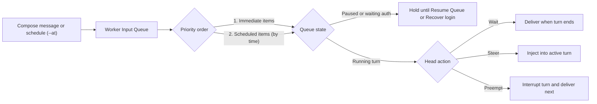

Coding agents are the core of LeapMux. Each agent tab runs a real coding-assistant CLI on a Worker and streams its conversation, tool calls, diffs, and approval prompts into your browser or desktop app over an end-to-end encrypted (E2EE) channel.

For provider-by-provider capabilities — including approvals, native context resume, session fork, inline images, goals, and plan mode — see **[Supported Agents & Feature Matrix](/docs/reference/supported-agents/)**. For workspace placement and tiling, see [Tabs & Layout](/docs/using/tabs-and-layout/); for git branch isolation, see [Worktrees & Branches](/docs/using/worktrees-and-branches/).

## Supported providers

LeapMux integrates  coding-agent providers and detects installed CLIs on each Worker automatically.



Every provider supports live chat and streamed tool calls. LeapMux disables built-in CLI self-updaters during active sessions so a binary never swaps out underneath a running conversation; update CLIs with your normal package manager between sessions. Check the **[Supported Agents & Feature Matrix](/docs/reference/supported-agents/)** to compare approval prompts, session resume, images, goals, and permission modes across providers.

## Opening an agent



Press `⌘N` / `Ctrl+N` (or click a provider button in the tab bar) to quick-open an agent in the active tab's Worker and directory using your most recent provider. Press `⇧⌘N` / `Ctrl+Shift+N` (or double-click empty space in the tab bar) to open the full **New agent** dialog.

| Field | What it does |
| --- | --- |
| **Worker** | Selects the machine that runs the agent and supplies its installed providers and filesystem. |
| **Agent Provider** | Picks the CLI backend. LeapMux remembers and pre-selects your most recently used provider on that Worker. |
| **Working Directory** | Browses the Worker's filesystem or accepts a typed path, with a **Go to home directory** button and a drive selector on Windows Workers. |
| **Provider startup options** | Shown for providers that expose launch-time choices (for example, Muse Code's **Workspace trust**). |
| **Resume an existing session** | Optional. Picks an earlier session for the selected provider and directory, or **Enter a session ID…** to paste a handle directly. Leave on **Start a new session** for a clean conversation. |
| **Title** | Pre-filled with a random `Agent <Name>`; click the refresh icon for another suggestion or type your own. |
| **Git options** | Shown inside git repositories to keep the current branch, switch branches, or create a branch or linked worktree. See [Worktrees & Branches](/docs/using/worktrees-and-branches/). |


Model, reasoning effort, and permission mode are not in the **New agent** dialog. New sessions inherit your CLI's defaults and start in a safe approval mode; change them anytime from the composer status bar after launch.


### Resuming sessions

The **Resume an existing session** menu merges LeapMux's own agent history with the CLI's native session store on that Worker, so conversations started in a plain terminal appear too. Sessions already open in another tab are excluded to avoid corrupting a native store. Changing the Worker, provider, or directory clears any selected session.

Most resumption happens automatically: tabs and transcripts survive Hub restarts, Worker restarts, and browser reconnects. When LeapMux respawns a process, it reconnects through the provider's native resume mechanism. If native resume fails, LeapMux reports the error and keeps the saved transcript instead of replacing it with an empty session; send `/clear` to begin fresh.

### Forking sessions

Run `leapmux agent fork <agent>` to branch a conversation into a new agent tab. On providers that support native session forking (see [Supported Agents & Feature Matrix](/docs/reference/supported-agents/)), LeapMux clones both the provider's native session history and the Worker transcript so the new tab keeps the conversation context and prompt cache.

Pass `--fresh` to copy only the provider, model, startup options, and working directory into a clean empty session instead of cloning history. Because `--fresh` does not clone native session state, it works across Workers (`--worker`) and while the source agent is mid-turn.

Session forking is currently available through the CLI (`leapmux agent fork`). See [Control Command Reference — Agents](/docs/reference/commands/agents/) for all flags, including `--worktree` and `--message`.

## Chatting with an agent



The composer below the transcript is a single-box Markdown editor. It starts one line tall and expands automatically for multi-line messages. Standard Markdown shortcuts format as you type (`**bold**`, `` `code` ``, `# heading`, `- list`, code fences, and links; click any link to edit its URL).

- **Sending:** Press `⌘Enter` / `Ctrl+Enter` (default) or click **Send**. You can switch to plain `Enter` sends from the composer **[+]** menu or **Preferences → Chat & Composer**; see [Keyboard Shortcuts](/docs/using/keyboard-shortcuts/#chat-editor-keys) for all editor keys.
- **Attachments:** Use **[+] → Attach file...**, paste from the clipboard, or drag and drop files onto the editor. Supported attachment types vary by provider (see [Supported Agents & Feature Matrix](/docs/reference/supported-agents/)). For example, ZCode rejects image attachments when the selected model is text-only.
- **Interrupting a turn:** While the agent works with no pending approval prompt, click the square **Interrupt** button to stop the turn cleanly via the provider's native interrupt signal. When a permission or question prompt is active, answer or reject the prompt instead.

## Input queue, scheduling, and steering



Every input you submit — messages, attachments, `/clear`, plan approvals, and prompt answers — enters a durable **input queue** stored on the Worker. The queue survives page refreshes, Worker restarts, and multi-device switching.

Immediate items always deliver ahead of scheduled items, and scheduled items deliver in timestamp order. Click the calendar button beside **Send** to hold a message until a chosen local date and time; once that time arrives, the row promotes to the immediate group automatically. Providers such as Claude Code and Codex also schedule visible **Auto-retry (usage limit)** and **Auto-retry (server error)** rows in the same queue, which you can pause or cancel like your own messages.





### Queue controls

| Control | What it does |
| --- | --- |
| **Move up** / **Move down** (or drag grip) | Reorders waiting items within the same group (immediate items, or scheduled items sharing one timestamp). |
| **Edit** / **Take Over** | Loads a queued item back into the composer to change its text or schedule. Shows **Take Over** if another device is editing it. |
| **Delete** | Removes a waiting item (requires a second confirmation click). |
| **Retry** | Re-attempts delivery after a failed send. |
| **Steer** | Injects the first waiting item into a running turn on providers that support mid-turn steering. |
| **Preempt** | Interrupts the active turn and dispatches the first waiting item next on providers that support preemption instead of steering. |
| **Pause Queue** / **Resume Queue** | Holds or resumes delivery. While paused, the Send button reads **Queue**. When paused for authentication recovery, the button reads **Recover login**. |

With an **empty composer** while a turn runs, pressing `⌘Enter` / `Ctrl+Enter` resumes a paused queue (or opens **Recover login** when login recovery is required) and triggers **Steer** or **Preempt** on the first waiting item in one step. Clicking the row's **Steer** or **Preempt** button directly acts on that item without unpausing a paused queue. If a provider drops a steered item before reading it (for example, after an interrupt), LeapMux re-queues it automatically and notes that in the transcript.

### Messages from other agents

When another agent sends a message via `leapmux agent send`, the Worker derives sender identity from the calling tab's credentials. The recipient sees a header identifying the sending agent and provider (stating the message is not from the operator), and the transcript and queue display the sender's icon and tab title. **Edit** is disabled on agent-sent queue rows, while reordering, deletion, and steering work normally.

## Reading tool calls, goals, and subagents

As an agent works, the transcript streams assistant text, optional thinking blocks, and paired tool calls and results — file reads, inline diffs (with a **split / unified** toggle), shell commands, searches, web fetches, and Model Context Protocol (MCP) tool calls. Long outputs collapse behind **Expand**, and row headers offer **Copy**, **Quote** (inserts a quoted reply into the composer), **Copy Markdown**, and **Copy Raw JSON**.

### Images in tool results

When a tool returns an image (such as a browser screenshot or image file read), LeapMux renders it inline and lets you click it to open a zoomable image tab (or the source file at full resolution when known). Images larger than about 5 MB show a placeholder, and external image URLs render as clickable links rather than auto-fetching remote hosts.

### Goals & To-dos sidebar



When an agent reports a to-do list or a session goal, the **Goals & To-dos** sidebar section appears (also accessible from the to-do count chip on the thinking indicator):

- **Session goal** — a standing objective the agent checks after each turn and keeps pursuing until satisfied. Set, update, pause, resume, or clear goals from the card menu on providers that support goal controls.
- **To-do list** — tracks pending, in-progress, and completed items reported by the agent's tools, synced from the Worker across reconnects.

### Subagents and Background tasks

When a provider spawns child subagents or background shell tasks, LeapMux lists their live statuses in the **Background tasks** sidebar section and on the thinking-indicator chip. Dynamic workflows group their child subagents under one workflow row. Click any subagent with a transcript to open it in its own tab; closing that tab leaves the subagent's transcript intact so you can reopen it later.

## Permission and approval prompts

When an agent needs approval to run a command, edit a file, execute a plan, or ask a question, a **control request** banner appears directly above the composer. The provider supplies the available choices (such as one-time approval, session-wide approval, or saved rules). Typing into the composer while denying sends your text as the rejection reason.

- **Agent Client Protocol (ACP) fallbacks:** If an ACP provider exposes no refusal option, LeapMux adds **Cancel** to refuse the call and end the turn.
- **Permission preset on approval:** Where supported, approval banners include a **Permissions** selector (**Unchanged**, **Smart**, or **Bypass**) that updates the session's permission preset alongside your approval.
- **Questions:** Single-select prompts use radio buttons (typed text replaces the selection); multi-select prompts use checkboxes (typed text joins the checked options). Multi-question prompts show **Question N of M** and submit together. MCP input requests render as structured forms or native questions.
- **Plan approvals:** Review the proposed plan and choose **Approve**, **Reject** (staying in plan mode with your feedback), or **Clear Context** (start implementation in a fresh session, where supported).



LeapMux deduplicates prompts across reconnects and discards stale answers if the agent replaces a prompt before you submit. Answered prompts remain in the transcript with a consistent summary of your decision and any feedback you sent.

## Changing settings mid-session



The status bar beneath the composer displays chips for the current git branch, model, reasoning effort, and mode. Click any chip — or open the **[+]** menu — to change settings, inspect context usage and rate limits under **Agent info**, or toggle **Show status bar**. Pickers with more than seven options switch to a searchable list automatically.

Most setting changes apply live; when a change requires a different CLI launch flag (such as changing permission mode or switching to a model that does not support the current effort level), LeapMux restarts the provider cleanly in place.

- **Permission shortcuts:** Where supported, **Smart permissions** enables the provider's safety-assisted reviewer (logging automated decisions in the transcript, with an **Approve** override for denied main-agent calls), and **Bypass permissions** disables prompts for trusted directories.
- **Reasoning effort:** Defaults to **Auto**, omitting explicit effort flags so the provider's CLI picks its default tier.
- **Plan mode:** Press `Shift+Tab` inside the composer to toggle plan mode on supported providers.


**Bypass permissions** stays enabled until you turn it off. Use it only in directories and tasks you trust.


## Driving agents from the CLI

Every workflow in this chapter — opening agents, sending messages with `--wait` or `--output-schema`, inspecting and reordering the input queue, answering approval prompts, and switching models — has a scriptable CLI counterpart in `leapmux agent`. See [CLI Guide](/docs/using/cli-guide/) for authentication, targets, and automation patterns, and [Control Command Reference — Agents](/docs/reference/commands/agents/) for every command and flag.
