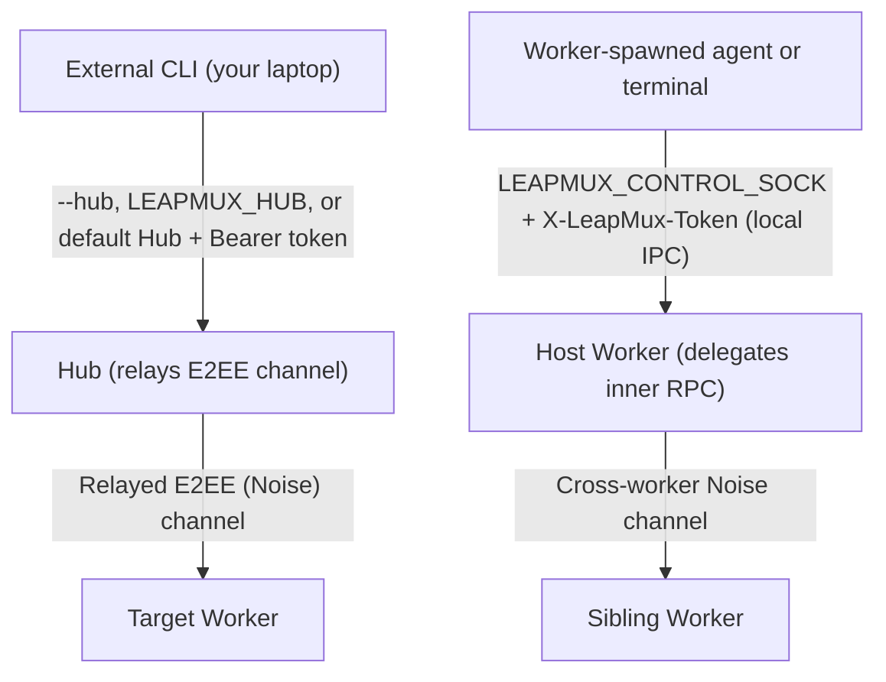

`leapmux` drives a running LeapMux instance from outside the browser. Use it from a shell, a CI job, or another coding agent. It opens and closes tabs, messages agents, runs terminal commands, arranges layouts, inspects files and git state on a Worker, and streams live events.

This chapter covers the CLI fundamentals: how `leapmux` connects to a Hub or tab socket, authenticates, resolves targets, formats output, and reports errors and exit codes. For event-driven waits, idempotent retries, JSON Schema validation, event streams, managed-tab IPC details, and raw protobuf RPCs, see [CLI Automation](/docs/using/cli-automation/).

The [Control Command Reference](/docs/reference/commands/) lists every command with its arguments, flags, and examples. For curated multi-agent playbooks (`leapmux skill`), see [Agent Skills](/docs/using/agent-skills/). For online Hub administration (`leapmux admin ...`), see [Admin CLI](/docs/admin/admin-cli/). For offline break-glass recovery (`leapmux recover ...`), see [Recovery](/docs/admin/recover/).

## Two callers, one CLI

The same `leapmux <group> <command>` (also available under the short `lmx` alias) works in two environments:

1. **On your own machine.** Sign the CLI in to a Hub once with `leapmux auth login --hub ...`, which stores a credential on disk. Every later command presents that credential to the Hub, or auto-discovers a live local Hub socket.
2. **Inside an agent or terminal that a Worker started.** The Worker provides a private local socket and bearer token through `LEAPMUX_CONTROL_*` environment variables. Commands run there need no login and no `--hub`. The target `self` selects the calling tab, tile, workspace, or Worker.

Both transports reach the same RPCs, so a script written for one environment runs unchanged in the other.



## A first session

```text
$ leapmux tab list
ID        TYPE      TITLE           STATE    WORKER     WORKSPACE
87a19d5f  agent     CLI Design      working  build-box  4f1ac2b0
4cbb3f34  agent     Fix flaky spec  idle     build-box  4f1ac2b0
9c02e7aa  terminal  zsh             ready    build-box  4f1ac2b0

$ leapmux agent send 4cbb "Run the tests again"
$ leapmux agent messages 4cbb --follow
```

`4cbb` is a prefix of the tab ID `4cbb3f34`. Any unique prefix of four or more characters selects its object; see [Targets](#targets) for every selector form.

## Command shape

Every command follows the form `leapmux <group> <command>`, followed by its arguments and flags:

```text
leapmux agent send 87a19d5f "Run the tests" --json
        ^^^^^ ^^^^ ^^^^^^^^ ^^^^^^^^^^^^^^^ ^^^^^^
        group  |   target   argument        flag
            command
```

- **Flags stand anywhere** after the command name. Place a value starting with `-` after `--`: `leapmux agent send 87a19d5f -- "-v is the verbose flag"`.
- **Command names accept unambiguous prefixes** (such as `leapmux ag se` for `agent send`), and stable canonical aliases (`lmx`, `ag`, `term`, `ws`, `wt`, `wk`, `win`, `ev`, `notif`, `ctx`, `tun`, `pref`/`prefs`, `q`, `req`, `msg`, `ls`, `rm`, `mv`, `cat`). Spell full command names or canonical aliases in scripts so a future command never makes an ad-hoc prefix ambiguous.
- **Every command prints help** with `--help`: usage, accepted arguments, flags, and examples.
- **Agents can read the bundled guide** with `leapmux guide`. Run `leapmux guide --topics --json` to list topics or `leapmux guide targets` to read one section.
- **Programs can inspect the full command schema** with `leapmux commands --json` (or `leapmux commands <prefix> --compact --json`).
- **Shell completion** completes commands, flags, and live IDs of your tabs, agents, workspaces, and Workers. Generate a script with `leapmux completion <shell>` for Bash, zsh, fish, PowerShell, Elvish, or Nushell:
  - In Elvish, run `eval (leapmux completion elvish | slurp)` to load completions into the current shell.
  - In Nushell 0.116 or later, run `leapmux completion nushell | save ($nu.default-config-dir | path join leapmux-completion.nu)` and add `use leapmux-completion.nu *` to `config.nu`.

## Choosing the Hub

Each online command resolves its Hub in this order:

1. The explicit `--hub <url>` flag.
2. Inside a LeapMux tab, the tab's local socket (`LEAPMUX_CONTROL_SOCK`).
3. The `LEAPMUX_HUB` environment variable.
4. The Hub saved in `context.json` (`leapmux context use --hub ...`) or the default Hub of stored credentials (`leapmux auth use <hub>`, or the sole stored credential).
5. A live local `solo`, `dev`, or standalone Hub socket on this machine (auto-discovered after `leapmux up`).

If none matches, the command fails with `not_logged_in` and prints how to select a Hub. `--hub` accepts an `http://` or `https://` URL or a Hub's local IPC socket (`unix:...` or `npipe:...`); see [Sockets and login](#sockets-and-login).

Use `leapmux context use --hub <url> --worker <worker> --workspace <ws> --provider <provider>` to store persistent defaults for commands run outside a tab (`leapmux context show` prints them; `leapmux context clear` resets them). When no stored defaults exist, a sole online Worker and sole active workspace are discovered automatically.

Run `leapmux doctor` to verify local daemons, Hub connectivity, credentials, Worker key pins, and online Workers in one command.

## Authentication

### `leapmux auth login`

Signs the CLI in to a Hub and writes a credential file to disk. Pass the Hub with `--hub`.

The CLI is a registered OAuth 2.1 app like any other. See [App Authorization](/docs/admin/app-authorization/) for app registrations and permission ceilings, and [OAuth API](/docs/reference/oauth-api/) for the wire contract.

**You verify your identity in the browser, not in the terminal.** Authorizing a credential requires an elevated session, so the consent page prompts for a factor (password, passkey, or linked identity provider) before issuing a token. That elevation lasts , so a second login in the same sitting does not prompt again. See [Session elevation](/docs/admin/security/#session-elevation).

**Default flow (PKCE local redirect).** The CLI opens a loopback listener on `127.0.0.1`, prints the authorization URL on stderr, and tries to open your browser (`open` on macOS, `xdg-open` on Linux, the shell handler on Windows). After you approve in the browser, the Hub redirects back to the loopback listener. The CLI waits up to **10 minutes** before failing with `timeout`.

```bash
leapmux auth login --hub https://leapmux.example.com
```

**Device-code flow (`--device-code`).** Use this on a headless host, over SSH, or inside a container. The CLI prints a verification URL and a short user code on stderr:

```bash
leapmux auth login --hub https://leapmux.example.com --device-code
```

The user code is six characters from an unambiguous alphabet (no `0`, `1`, `I`, `O`, or `L`), formatted as `XXX-XXX`. Open the verification URL on any device and enter the code, or open the second printed link that embeds the code in its query string. The CLI polls in the background and completes once you approve.

`--device-name` labels the credential in your Connected Apps list. It defaults to `<user>@<host>` of the machine that signs in.

The login flow also determines how later step-up verification runs. A credential from the loopback flow opens a browser on the CLI's host when a command needs step-up. A credential from `--device-code` keeps the device-code ceremony and prints a URL and short code instead. See [Verifying a command-line credential](/docs/admin/security/#verifying-a-command-line-credential).

### `--scope`: what the credential may do

Omitting `--scope` requests every permission you can hold **except** Hub administration. A routine login therefore leaves no administration credential on disk, and `leapmux admin ...` refuses it even for administrator accounts.

Specify permissions explicitly to request a narrower set or to request administration:

```bash
# A credential that reads files and git state, and nothing else.
leapmux auth login --hub https://leapmux.example.com --scope "file:read git:read"

# A credential that administers the Hub. Only an administrator can grant it.
leapmux auth login --hub https://leapmux.example.com --scope "admin:read admin:users admin:settings admin:workers admin:apps"
```

Spaces (quoted in the shell) and commas both work as separators.

The **browser** decides what is granted. The consent screen explains each requested permission in plain sentences, and the CLI records the permissions you actually approved. The granted set can be wider than requested when one permission implies another (`file:read` implies `worker:read`), or narrower — in which case the login output carries a `warning` listing ungranted permissions.

See [App Authorization](/docs/admin/app-authorization/#permissions) for the full permission vocabulary.

### Renewal and lifetime

Access tokens live for . The CLI renews them silently before expiry and once more if the Hub rejects a call it expected to succeed.

Each renewal slides the  refresh window forward, up to an absolute cap of **** from the original authorization. After that cap, you must sign in again. `leapmux auth status` reports both deadlines.

Signing in again on the same machine **revokes the credential it replaces**, leaving no stale secret behind.

### The other `auth` commands

| Command | What it does |
| --- | --- |
| `auth status` | Shows the user, granted permissions, and both deadlines for the active Hub. Confirms them with one Hub request (`hub_checked` reports whether the Hub answered, and `warning` notes what could not be confirmed). `expires` is the access token; `refresh_expires` is when the device must sign in again. |
| `auth list` | Lists every Hub that this machine holds a credential file for, marking the default Hub. |
| `auth use <hub>` | Sets `<hub>` as the default Hub when this machine holds credentials for multiple Hubs. |
| `auth credentials` | Lists every credential on the Hub that can reach your account from any machine. `current` marks the credential this command uses. |
| `auth logout` | Revokes the credential on the Hub and deletes the local file. If revocation fails, the local file is still deleted and the result carries a `warning`. |

`auth list` inspects local credential files on this machine, while `auth credentials` asks the Hub which credentials exist across all of your machines (the same list shown under **Preferences → Apps → Connected apps**; see [Connected Apps](/docs/using/connected-apps/)).

### Credential file location

The CLI stores one file per Hub:

```text
<ConfigDir>/<scheme>_<hub-host>.json
```

`<ConfigDir>` resolves in this order:

1. `LEAPMUX_CONTROL_CONFIG_DIR` (used verbatim when set)
2. `$XDG_CONFIG_HOME/leapmux/control`
3. `~/.config/leapmux/control`

`<scheme>_<hub-host>` includes the URL scheme and host name, with `_<port>` appended when an explicit port is present (for example `https_leapmux.example.com_8443.json` or `http_127.0.0.1_4327.json`). Files are written atomically with mode `0600` in a `0700` directory and hold the access token, refresh token, expiries, user identity, token ID, and granted permissions.

- `auth use` saves the default Hub in `<ConfigDir>/default-hub`.
- `leapmux context use` saves persistent default hub, worker, workspace, and provider in `<ConfigDir>/context.json`.


Point `LEAPMUX_CONTROL_CONFIG_DIR` at a dedicated directory per CI job so credentials stay isolated and easy to discard.


### Sockets and login

`--hub` accepts a Hub's local IPC listener (`unix:$HOME/.config/leapmux/hub/hub.sock` on Unix, `npipe:...` on Windows) as well as an `http(s)://` URL. The CLI still presents an `Authorization: Bearer` credential over a Hub socket; only the Worker's socket inside a managed tab uses `X-LeapMux-Token`.

- **Solo mode needs no login over its local socket.** Because only the local host can reach that socket, ordinary commands work without credentials there. TCP listeners never receive this exemption: before the `solo` password is set, a TCP caller can only set the first password, and afterward TCP requires a normal login. Solo mode still supports `auth login` when you want a scoped credential; see [Solo mode: a reduced threat model](/docs/admin/security/#solo-mode-a-reduced-threat-model) and [App Authorization](/docs/admin/app-authorization/#solo-mode).
- **A non-solo Hub over a socket uses `--device-code`.** `leapmux auth login --hub unix:...hub.sock --device-code` exchanges tokens over the socket while you approve in a browser against the Hub's public origin. The loopback redirect flow rejects a socket URL because a browser cannot connect to a Unix socket or named pipe.

```bash
# With a Hub running locally (leapmux daemon hub start):
leapmux auth login --hub unix:$HOME/.config/leapmux/hub/hub.sock --device-code
leapmux admin settings list --hub unix:$HOME/.config/leapmux/hub/hub.sock
```

## Targets

Most commands take a target (`<agent>`, `<terminal>`, `<tab>`, `<workspace>`, `<worker>`) as their first argument:

| Form | Example | Selects |
| --- | --- | --- |
| Full ID | `Q0vNx01dbAo1BL3bTGB4uK6gGI3FmtgV6OlhMGB4YY6PRMhh` | That exact object without listing first. |
| Unique ID prefix (4+ characters) | `87a1` | The single object whose ID begins with that prefix. |
| `id:<id>` | `id:self` | The literal ID, even when short or spelled `self`. |
| `title:<title>` | `"title:Release 1.4"` | The tab or workspace with that exact title. |
| `name:<name>` | `name:build-box` | The Worker with that name, or the agent with that `--name` slug. |
| Bare title, slug, or Worker name | `reviewer` | Case-insensitive match against a tab title, unique agent `--name` slug, or Worker name. |
| `self` | `self` | The tab, tile, workspace, or Worker running the command. |
| `parent` / `children` | `parent`, `children` | Inside an agent tab: `parent` selects the parent agent (`agent`/`tab` commands); `children` selects direct child subagents (`agent wait`, `agent requests`). |

An exact ID match takes precedence over prefixes. Title and name lookups can also inspect Worker metadata; if missing metadata leaves a match uncertain, the command fails with `unavailable` (use a full ID or unique ID prefix instead). A selector that matches nothing fails with `not_found`; one that matches multiple objects fails with `ambiguous_target` and lists the candidates. Pass `--workspace <ws>` on tab, agent, or terminal commands to narrow lookup to one workspace.

```text
$ leapmux tab get 87
error: usage: "87" is too short for a tab id prefix; type at least 4 characters
hint: use "id:<id>" to select a literal id
hint: use "self" for your own tab, or "title:<title>"
$ leapmux agent get title:Review
error: ambiguous_target: 2 agents match the title "Review"
candidates:
  ID                                    KIND   TITLE
  87a19d5f-4838-4e34-9f0f-56130f0a62b1  agent  Review
  c41e09b2-1d7e-4c51-a0d2-8b6f2e3c9a11  agent  Review
hint: type more characters of the id, or the full id
```

- **Read-only commands default to `self`** inside a tab (for example `leapmux agent get` prints the current agent).
- **Mutating or destructive commands require an explicit target.** Pass `self` explicitly when intended (and `--allow-self` where a safety guard applies).
- **`self` matches the command's resource type.** `agent` commands match only an agent tab, and `terminal` commands match only a terminal tab (or the panel shell inside a [Quake terminal](/docs/using/terminals/#quake-mode-terminal)).
- **Tab-opening commands** (`agent open`, `terminal open`, `file open`) default `--workspace`, `--tile`, `--worker`, and `--dir` to the calling tab's context.

## Output

- **Text is the default.** Lists print as aligned tables, single records print as `key: value` lines, and mutations print a one-line result. Commands that return content (such as `agent send --wait` and `rpc`) print their native text output.
  - Tables shorten IDs to 8 characters; pass `-w` / `--wide` to disable truncation.
  - Pass `--no-header` to omit table or TSV headers.
  - Pass `--fields col1,col2` to project specific columns or JSON fields.
  - Pass `--color auto|always|never` (or set `NO_COLOR`) to control ANSI color and TTY spinners.
- **`--format text|json|ndjson|tsv`** sets the output format:
  - `--json` (equivalent to `--format json`) prints one JSON envelope per line on stdout: `{"data": ...}` on success (lists sit under their plural key, such as `{"data": {"tabs": [...]}}`) and `{"error": {...}}` on failure.
  - `--format ndjson` prints unwrapped compact JSON objects, one per line, for lists and event streams.
  - `--format tsv` prints tab-separated columns with no padding or ANSI escape sequences.
- **`-q` / `--quiet`** prints only IDs, one per line, for command substitution:

```bash
A=$(leapmux agent open --provider claude --message "Run the tests" -q)
leapmux agent get "$A" --json | jq -r .data.state
```

Do not combine `--json` or `--format` with `--quiet`; the CLI rejects that combination before sending a request.

**Streams print one line per event** (`agent messages --follow`, `layout watch`, `events`). With `--json`, every line is a `{"data": ...}` envelope. Human-oriented prompts and notices go to stderr so stdout stays parseable.

## Errors and exit codes

Failures print `error: <code>: <message>` on stderr, followed by one `hint:` line per recovery suggestion. With `--json`, the CLI also writes a structured error envelope to stdout:

```json
{"error":{"code":"self_target_refused","message":"refusing to close the calling tab 87a19d5f-4838-4e34-9f0f-56130f0a62b1","hints":["pass --allow-self to do it anyway"],"retryable":false}}
```

| Field | Meaning |
| --- | --- |
| `code` | Machine-readable error code for branching in scripts. |
| `message` | Human-readable failure description. |
| `hints` | Actionable recovery steps, when available. |
| `retryable` | `true` when retrying the same command later can succeed without changes. |
| `candidates` | For `ambiguous_target`, every object that matched the selector. |

Exit codes map directly to error classes so scripts can branch without parsing JSON:

| Status | Codes | Meaning |
| --- | --- | --- |
| `0` | | Success |
| `1` | `invalid_argument`, `conflict`, `internal`, `version_mismatch` | The Hub or Worker refused the request, or the CLI failed |
| `2` | `usage` | Invalid command line, unknown flag, missing argument, or rejected value before dialing |
| `3` | `not_logged_in`, `permission_denied` | Missing credential or insufficient scope |
| `4` | `not_found`, `ambiguous_target` | Target does not exist or matches multiple objects |
| `5` | `self_target_refused`, `tab_busy_refused`, `agent_waiting` | A [safety guard](#safety-guards) refused the call, or `agent send --wait` refused to enqueue behind a pending permission prompt |
| `6` | `timeout` | A wait ended before its condition held; see [CLI Automation](/docs/using/cli-automation/#waiting-for-agents) |
| `7` | `worker_offline`, `unavailable` | Hub or Worker cannot answer right now; retrying can succeed |
| `8` | | Local daemon reported `stopped` (`leapmux daemon <mode> status`) |
| `130` | | Interrupted by Ctrl-C / `SIGINT` (`events` exits `0` on Ctrl-C) |

`version_mismatch` (status `1`) means the Hub or Worker does not implement the requested call. Run `leapmux version` to inspect the Hub and `leapmux worker info` to inspect a Worker.

## Safety guards

Three guards prevent accidental data loss in scripts. Each refusal prints the override flag in its hint.

| Guard | Code | Override | Refuses |
| --- | --- | --- | --- |
| Self-target | `self_target_refused` | `--allow-self` | `workspace delete`, `tab close`, `tile close`, `tile remove-grid`, `window close`, and `terminal restart --replace` when the calling tab is the target or sits inside it |
| Busy tab | `tab_busy_refused` | `--allow-busy` | Closing an active agent turn, a terminal with a running process, or a workspace with busy tabs or dirty git worktrees |
| Last tab of a worktree | `usage` | `--worktree keep\|push\|discard` | Closing the last tab of a git worktree or branch until you choose its disposition |

The busy check also runs when a tile, grid, window, or workspace removal closes its tabs. If the Worker cannot verify activity, pass `--allow-busy` to proceed. Closing the last tab of a worktree with active work can require both `--worktree` and `--allow-busy`.

The self-target guard does not fire when `--with-tabs move` preserves the tabs, and it does not fire inside a [Quake terminal](/docs/using/terminals/#quake-mode-terminal) (which has no tab). Closing the last tab in a Quake panel's working directory still ends that panel's shell.

`leapmux rpc` bypasses all three guards; see [Calling a procedure directly](/docs/using/cli-automation/#calling-a-procedure-directly-leapmux-rpc).

## Worker key pins

LeapMux pins each Worker's static public key on the first verified connection (trust on first use). Manage pins on this machine with `leapmux worker pins`:

| Command | What it does |
| --- | --- |
| `worker pins list` | Lists every pinned Worker for the active Hub |
| `worker pins get <worker>` | Prints one Worker's key pin |
| `worker pins remove <worker>` | Removes a pin so the next verified channel records a replacement |

A key mismatch aborts the connection. Before removing a pin, verify the presented fingerprint against `key_fingerprint` in the Worker's `worker initialized` startup log over an independent trusted channel. See [Managing Workers](/docs/admin/managing-workers/) for fingerprint verification.

Pins are stored in `<ConfigDir>/<scheme>_<hub-host>/pins.json` with mode `0644`.

## Inside a LeapMux tab

Every agent and terminal spawned by a Worker automatically receives `LEAPMUX_CONTROL_*` environment variables and a local IPC socket, so `leapmux` works inside a tab with no login and with `self` targeting. For the complete environment variable reference, `PATH` / `$LEAPMUX_CONTROL_CLI` version-matching behavior, and the managed-tab security model, see [Inside a managed tab](/docs/using/cli-automation/#inside-a-managed-tab).

## Quick examples

### Drive an agent from your laptop

```bash
leapmux auth login --hub https://leapmux.example.com

WS=$(leapmux workspace create "Bugfix" -q)
A=$(leapmux agent open --workspace "$WS" --worker name:build-box \
      --provider claude --dir ~/src/app \
      --message "Find and fix the failing test in ./pkg/auth." -q)

leapmux agent messages "$A" --follow
```

### Snapshot and restore a layout

```bash
leapmux layout get "$WS" --json > before.json
leapmux tile split "$TILE" --direction vertical
# ... experiment ...
leapmux layout set "$WS" before.json
```

### Branch on error codes in a script

```bash
if ! out=$(leapmux tab close "$T" --json 2>/dev/null); then
  case $(jq -r .error.code <<<"$out") in
    tab_busy_refused) echo "the tab is busy; try again later" ;;
    not_found)        echo "the tab is already gone" ;;
    *)                jq -r .error.message <<<"$out"; exit 1 ;;
  esac
fi
```

## See also

- [CLI Automation](/docs/using/cli-automation/) — exact agent waits, JSON Schema validation, safe retries, zero-polling terminal waits, event streams, managed-tab IPC, and `leapmux rpc`.
- [Control Command Reference](/docs/reference/commands/) — every command with its arguments, flags, and examples, grouped by topic ([Agents](/docs/reference/commands/agents/), [Terminals](/docs/reference/commands/terminals/), [Workspaces & Tabs](/docs/reference/commands/workspaces-and-tabs/), [Layout & Windows](/docs/reference/commands/layout-and-windows/), [Git & Files](/docs/reference/commands/git-and-files/), [Workers & Events](/docs/reference/commands/workers-and-events/), [Auth & Session](/docs/reference/commands/auth-and-session/), [Admin](/docs/reference/commands/admin/)).
- [Agent Skills](/docs/using/agent-skills/) — curated multi-agent `SKILL.md` playbooks built on this CLI.
- [Coding Agents](/docs/using/coding-agents/) — providers, models, effort, control prompts, and session resume.
- [Terminals](/docs/using/terminals/) — PTY sessions, shells, Quake panels, and automatic remote control.
- [Managing Workers](/docs/admin/managing-workers/) — Worker registration and key pinning.
- [Admin CLI](/docs/admin/admin-cli/) — `leapmux admin` commands for Hub administration.
- [Recovery](/docs/admin/recover/) — offline break-glass commands.
