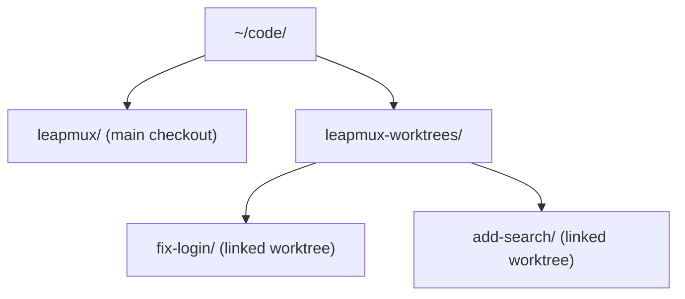

LeapMux is designed to run multiple coding agents on the same repository at the same time. **Git worktrees keep their work isolated**: each agent or terminal can run in its own linked worktree on its own branch with a separate working copy. This chapter covers creating and switching branches or worktrees, deleting them safely, pushing work, and how LeapMux guards against losing uncommitted changes when you close tabs.

For tab contents, see [Coding Agents](/docs/using/coding-agents/) and [Terminals](/docs/using/terminals/). For live git status and inline diffs, see [File Browser](/docs/using/file-browser/).

## Why per-agent worktrees matter

A single git checkout has one working directory and one active branch. Two agents sharing it overwrite each other's files, share the same staging index, and disrupt each other whenever one switches branches.

A **linked worktree** attaches a second working directory to the same repository on a separate branch, giving each agent:

- An isolated working copy where file edits stay separate.
- An independent branch for commits and tests.
- Clean teardown when the task finishes, leaving your main checkout untouched.

Worktrees are optional: you can still choose **Use current state** to work directly in your main checkout for quick tasks.

## The Repository → Branch sidebar tree



Tabs inside a workspace are grouped into a two-level tree:

- **Repository group** — displays the repository name (derived from the git origin URL, or the directory name for a local repository with no origin). Hover for the full origin URL or repository root path.
- **Branch group** — displays the branch name, a checkout icon (branch icon for the main checkout, folder-with-arrow icon for a linked worktree), and a diff-stats badge (`+N -M *U`). Hover for **Worktree branch** or **Branch**, **Directory**, and **Worker** (when the same branch exists on multiple Workers).

Tabs are grouped by branch name, Worker, and repository path together, so two clones of the same repository stay distinct. A repository with no commits yet (or a tab still starting up) appears as **`(no branch)`**, and a detached HEAD shows its short commit hash (for example, `a1b2c3d`).

### The branch context menu



Open a branch group's **`⋯`** menu (or right-click it, or click the branch chip in the agent composer status bar) to act on that checkout:

| Item | What it does |
| --- | --- |
| **Switch to branch...** | Opens the **Change branch** dialog in switch mode. |
| **Create new branch...** | Opens **Change branch** in create-branch mode. |
| **Create new worktree...** | Opens **Change branch** in create-worktree mode. |
| **Delete worktree...** / **Delete branch...** | Opens the delete dialog (labeled **Delete worktree...** for linked worktrees and **Delete branch...** for main-checkout branches). |
| **Agents** / **Terminals** | Quick-launches a provider or shell directly in that checkout, or opens **New agent...** / **New terminal...** pre-filled with that branch's Worker and directory. |

All branch actions run on the Worker hosting that repository and are disabled while that Worker is offline. **`(no branch)`** rows and rows inside an archived workspace have no branch menu. On a detached-HEAD row, use **Switch to branch...** or **Create new branch...** to attach to a named branch before deleting.

## Choosing a branch or worktree when opening a tab



Whenever you open a workspace, agent, or terminal in a git repository, the **Git options** panel offers five modes:

| Mode | What it does | Fields |
| --- | --- | --- |
| **Use current state** | Opens in the existing directory and current branch (default). | Shows current branch |
| **Switch to branch** | Checks out an existing local or remote branch in place. | Branch selector (**Local** and **Remote** groups) |
| **Create new branch** | Creates and checks out a new branch in place, keeping any uncommitted files. | **Branch Name**, **Base Branch** |
| **Create new worktree** | Creates a linked worktree on a new branch from committed state only. | **Branch Name**, **Base Branch**, **Worktree path:** preview |
| **Use existing worktree** | Attaches the new tab to an existing linked worktree (`<branch> — <path>`). | Linked worktree selector |

### Naming and worktree paths

- **Branch Name** — enter any valid git branch name, or click **Generate random name** for a three-word slug (such as `brave-amber-otter`). LeapMux validates branch names against standard git ref rules and rejects names already in use.
- **Base Branch** — defaults to the current branch; leaving it empty starts from current `HEAD` (useful on a detached or unborn `HEAD`).
- **Worktree path** — LeapMux places every managed linked worktree in a sibling directory beside the main repository:

```text
<repo-parent>/<repo-dirname>-worktrees/<branch>
```



If that directory already exists on disk, creation is refused. **Create new worktree** starts cleanly from the base branch's committed state — uncommitted edits stay in the source checkout. **Use existing worktree** lists linked worktrees only, preventing accidental adoption of the main repository checkout.

## Changing the branch on a tab



Choose **Switch to branch...**, **Create new branch...**, or **Create new worktree...** from a branch's **`⋯`** menu (or the composer branch chip) to open **Change branch**.

| Mode | Effect on Apply |
| --- | --- |
| **Switch to branch** | Checks out the selected branch in place and relabels every tab in that group. Existing agents and terminals keep running and read the new branch's files immediately. |
| **Create new branch** | Creates and checks out the new branch in place, carrying uncommitted files and relabeling tabs. |
| **Create new worktree** | Creates a new linked worktree and opens a **new tab** in it (leaving existing tabs untouched). Choose **Open as** (**Agent** or **Terminal**) and pick a provider or shell. |

Switching branches with uncommitted changes can fail or overwrite files; commit or push changes first when the dialog warns of a dirty working tree.

## Branch status indicators and pushing

Both the **Delete** dialog and the **Close last tab** dialog display a shared **branch status block**:

- **Worktree branch** or **Branch** with its checkout icon and branch name.
- **Directory** showing the checkout path on the Worker (abbreviated with `~`).
- Git state lines as applicable: **Uncommitted changes:** (with a `+N -M *U` diff-stats badge), ***N* commit(s) not pushed.**, **Branch not pushed to remote.**, or **No uncommitted changes or unpushed commits.**
- A summary of affected tabs (for example, *2 agents and 1 terminal will be stopped, 1 file will be closed.*).

When a branch has an `origin` remote, a real branch name (not detached `HEAD`), and unsaved work, both dialogs show a push button:

| Branch state | Button | What it runs |
| --- | --- | --- |
| Uncommitted changes | **Commit and Push** | Stages all changes (`git add -A`), creates a `WIP` commit, and pushes (`git push -u origin <branch>` if no upstream exists). |
| Clean tree with unpushed commits or no remote branch | **Push** | Pushes the branch (setting upstream if needed). |

Pushes time out after 60 seconds. Use **Commit and Push** as a quick checkpoint before deleting a branch or closing its last tab; you can amend or squash the `WIP` commit later.

## Deleting a branch or worktree



Open a branch group's **`⋯`** menu and choose **Delete worktree...** or **Delete branch...**.

### Deleting a linked worktree

**Delete worktree** stops every tab in the group, removes the linked worktree directory (`git worktree remove`), and deletes its branch (unless another worktree still has that branch checked out). Worktrees you created manually outside LeapMux or that another tab still points at stay on disk.

If git refuses removal (for example, the worktree is locked), the dialog stays open with the error and offers **Close tabs, keep worktree** to close the tabs while leaving the directory intact.

### Deleting a branch on a main checkout

For a branch in the main checkout, pick a destination under **Switch this working directory to:** before clicking **Delete branch**. The Worker checks out the target branch and force-deletes (`git branch -D`) the old branch while your tabs keep running on the new branch. If there is pushable work, **Commit and Push** (or **Push**) appears beside **Delete branch**. If only one branch exists, **Delete branch** stays disabled until you create another branch.


Branch deletion runs `git branch -D`. Unmerged, unpushed commits on that branch are permanently lost unless you click **Push** or **Commit and Push** first.


## Dirty-worktree protection when closing tabs



Whenever you close the **last tab** pointing at a linked worktree — or the last non-worktree tab on a branch with uncommitted changes, unpushed commits, or no remote branch — LeapMux opens the **Close last tab** dialog.

| Button | Shown when | Effect |
| --- | --- | --- |
| **Cancel** | Always | Keeps the tab open. |
| **Commit and Push** / **Push** | Pushable work exists | Commits (if dirty) and pushes the branch before you decide whether to close or delete. |
| **Delete worktree** | Target is a linked worktree | Closes the tab and schedules the worktree and branch for removal (requires confirmation; disabled with a reason if git refuses removal). |
| **Close anyway** | Always | Closes the tab and leaves the worktree and any local git changes on disk (requires confirmation). |


If the tab's Worker is offline, LeapMux cannot inspect git state and closes the tab immediately without this dialog. When the Worker reconnects, its housekeeping pass reclaims unreferenced worktrees only if they hold no uncommitted changes or unpushed commits.


## Where git commands run

All git operations run directly on the **Worker** hosting the repository and stream results over the end-to-end encrypted channel. Interactive git credential prompts are disabled so operations never hang waiting for terminal input; configure an SSH agent or git credential helper on the Worker for private remotes.

## Related chapters

- [Tabs & Layout](/docs/using/tabs-and-layout/) — closing tabs, tiles, grids, and busy-tab confirmations.
- [File Browser](/docs/using/file-browser/) — live git status colors, diff badges, and inline diffs.
- [CLI Guide](/docs/using/cli-guide/) — scripting `git`, `worktree`, and `--worktree` close flags.
- [Managing Workers](/docs/admin/managing-workers/) — connecting and choosing Workers.
